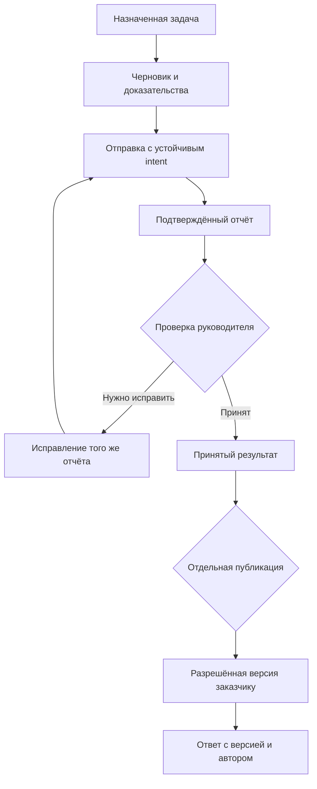

# AISTROYKA — повторный аудит продукта, структуры и архитектуры

> Перенос в действующий план: 20 октября 2026. Основной текст ниже — аудит/предложение от **19 октября** на указанном SHA, не новая runtime-проверка. [Текущие правила интеграции](../AISTROYKA_V2_AUDIT_INTEGRATION_2026-10-20.md) и [полная карта 97 пакетов](CANONICAL_MAPPING_RU.md) имеют приоритет при выборе Phase, existing requirement и release scope. Относительные ссылки адаптированы; снимки экрана и журналы доступны в [исходном архиве](ARCHIVE_REFERENCES.md).

**Дата проверки: 19 октября 2026. Версия: V2.**

Исходный код: `04ec74bf955c29799ab535c043a33c1f9296c309`, репозиторий `2qjckdknjf-ctrl/Aistroyka-web`. Проверены сайт, доступные гостевые сценарии, исходники кабинетов, iOS и Android. Документ содержит результаты анализа и предложения. Изменения продукта, слияние PR, миграции и выпуск в этой работе не выполнялись.

## 1. Чёткий вывод

**AISTROYKA уже имеет значительную функциональную основу. Следующий этап — довести основной рабочий цикл до надёжного, понятного и проверяемого результата во всех участвующих ролях.** Самая большая проблема находится на переходах: вход → рабочее пространство, карточка → конкретная сущность, черновик → загруженное доказательство, отправка → подтверждённый результат, проверка → исправление, публикация → решение заказчика.

Сейчас нельзя обоснованно объявить весь продукт готовым к широкому коммерческому запуску. Найдены воспроизводимый локально сбой основного экрана задач, разрывы в текущей навигации, источниковые риски потери незавершённой работы, неоднозначная обработка ошибок, неподтверждённые строительные показатели и четыре новых визуальных дефекта публичного сайта. Полный межролевой сценарий на актуальных нативных сборках в этой сессии не выполнен.

Рекомендую сохранить текущий стек, приложения по ролям, сервисы и уже созданные домены. Проводить изменения небольшими законченными срезами, каждый из которых заканчивается реальным результатом пользователя. Основной приоритет — contractor operations: менеджер ставит задачу, рабочий готовит отчёт, руководитель проверяет доказательства, рабочий исправляет замечание, история остаётся целой.

**Текущий канон проекта сохраняет iOS основным мобильным контуром, Android отложенным для первого пилота, а Customer — отдельным расширением с собственными условиями допуска.** Наличие подробного Android-плана не меняет это решение. Пилот подрядчика, клиентский портал, AI-результат и самостоятельная коммерческая подписка должны иметь отдельные условия выпуска. Их нельзя превращать в один огромный обязательный релиз. Основание: [PROJECT_CONTEXT](https://github.com/2qjckdknjf-ctrl/Aistroyka-web/blob/04ec74bf955c29799ab535c043a33c1f9296c309/PROJECT_CONTEXT.md) и [каноническая дорожная карта](https://github.com/2qjckdknjf-ctrl/Aistroyka-web/blob/04ec74bf955c29799ab535c043a33c1f9296c309/docs/roadmap/AISTROYKA_MEGA_ROADMAP_CUSTOMER_FINANCE_SAFE.md#L240).

### Что изменилось относительно первого прохода

Повторно разобраны 69 прежних замечаний: **33 подтверждены в прежней сути, 36 уточнены**. Добавлены **4 новых** публичных дефекта. Всего в реестре **73 наблюдения и риска: 30 P1, 43 P2**. Это не 73 воспроизведённых в production ошибки. В реестре отдельно указаны источник доказательства, ограничения и статус выполнения сценария. Ноль записей P0 означает только отсутствие подтверждённого P0 в проверенном объёме.

Уточнения существенны: часть функций, которые легко принять за отсутствующие, уже реализована. Например, существуют отдельная страница задачи, overdue-фильтр, Owner View с решениями, Gantt, управление клиентскими сметами, Download All, безопасная клиентская галерея, публикация с версией и обработкой конфликта, queued resubmit исправленного iOS-отчёта. Доработки должны сохранить эти возможности и восстановить входы и обработку состояний.

## 2. Как применены три запрошенных плагина

| Плагин | Фактическое применение | Граница результата |
|---|---|---|
| **App Design Intelligence** | Режимы AUDIT, REDESIGN, HANDOFF; VERIFY для доступного публичного интерфейса. Роли, задачи, полный путь, состояния, восстановление, доказательства, приоритеты и критерии приёмки | Исходниковый вывод не объявляется тестом на устройстве; proposed не равен verified |
| **Product Design** | Свежий проход публичных страниц, DOM после действий, просмотр сохранённых снимков, анализ расположения, клавиатурного фокуса и вычисленных цветов | Визуальные выводы относятся к указанным кадрам и размерам окна; закрытые кабинеты не получили новый visual PASS |
| **MagicPath** | Прочитан skill, проверены доступные и активные проекты; подготовлен подробный локальный дизайн-бриф для кадров, состояний, переходов и передачи в Cursor | В доступном списке нет AISTROYKA, активных проектов нет. Готового AISTROYKA canvas или интерактивного прототипа в MagicPath в этой работе не создано |

Краткая квитанция применения: [plugin-usage.json](ARCHIVE_REFERENCES.md#archive-006). Полный дизайн-бриф находится рядом с отчётом. Ссылка на несуществующий canvas не подменяет результат аудита.

## 3. Реальное покрытие и пределы проверки

| Поверхность | Повторный охват | Что это доказывает | Что остаётся открытым |
|---|---|---|---|
| Публичный сайт | Все 36 содержательных RU-маршрутов, включая 7 статей и 4 кейса; дополнительно 3 главных страницы EN/ES/IT | Прочитан основной DOM, ссылки и действия; выбранные безопасные переходы выполнены | Это не полный проход всех страниц всех локалей и размеров экрана |
| Публичные и гостевые сценарии | 68 отдельных наблюдений, включая повторные кадры, формы, FAQ, login/subscribe intent, smoke | Записана конкретная последовательность и результат наблюдения | 68 наблюдений не равны 68 уникальным страницам и не означают нажатие всех кнопок |
| Web source | 114 page-файлов: 102 страницы, 11 redirect aliases, 1 diagnostic; 34 routed и 6 embedded families | Маршруты и текущая композиция; свежий AST 1 633 модулей, 1 241 определения интерактивного JSX | Определение кнопки в исходнике не доказывает её достижимость и успешное выполнение в каждой роли |
| iOS source | 129 production Swift-файлов; 139 View declarations в 43 семействах, 718 мест вызова UI API | Свежая инвентаризация Worker, Manager, Customer, Shared; повторные трассы 19 findings | Новых нативных снимков, device E2E и actual production DTO run нет |
| Android source | 27 main Kotlin-файлов, 3 781 строка; 8 destinations и 2 dismissible overlays; 44 определения handlers | Все текущие основные поверхности Worker/Manager и общие API; 21 finding | Build, JUnit, instrumentation, Maestro и телефонный сценарий не выполнялись |
| Архитектура | Общие API, identity, media, sync, AI completion, release и канонический roadmap | Проверена связность предлагаемых контрактов и зависимостей | Полная проверка RLS/миграций, нагрузка и fault injection ещё впереди |

Для публичных наблюдений сохранился **51 снимок**; **46** приняты как относящиеся к устойчивому нужному состоянию. **5** сохранённых переходных/неподходящих кадров исключены из визуальных доказательств. Ещё **17** исходных записей не имеют доступного файла снимка: для них остаётся DOM и явное ограничение. Важные новые дефекты подтверждаются сохранившимися кадрами 16, 33, 60, 61 и 67. Подробности и все 68 шагов: [Public Walkthrough](PUBLIC_WALKTHROUGH_RU.md).

Основной размер браузерного окна — **1363 × 936**. Снимки показывают ограниченную область страницы. Прочтение всего DOM не превращается в подтверждение каждого пикселя ниже экрана. Мобильные viewport, крупный системный шрифт, screen reader, реальная камера, push, плохая сеть и закрытая ролевая навигация должны проверяться отдельно.

Вход в рабочий кабинет не был завершён: защищённый этап авторизации остался непройденным. Это ограничение доступа к аудиту, а не доказательство поломки входа AISTROYKA. Пароли, токены и производственные персональные записи в материалы не включены. Заявки, оплаты, отправка сообщений, запуск платного AI и реальные бизнес-изменения не выполнялись.

### Проверка версии

GitHub main на момент повторной сверки совпал с audited SHA. Production/apex/www и staging health возвращают `e0c9f51`, `ok=true`, `db=ok`. Сравнение `e0c9f51 → 04ec74bf` содержит 14 commits и ровно 9 изменённых документационных файлов. **Из этого сравнения не следует расхождение runtime-кода.** Для нативных приложений всё равно нужен manifest с artifact/build number, source SHA, backend, contract version и фактическими проверками. См. [release-recheck.json](ARCHIVE_REFERENCES.md#archive-007), [health-recheck.json](ARCHIVE_REFERENCES.md#archive-008).

Финальная сверка metadata и changed filenames PR **#446–451** показала: все шесть открыты, имеют статус draft и не merged. **#446 меняет private media resolver и его тесты; сохранение AI-результата этим PR не подтверждено.** Поэтому задача durable completion ARCH-05 не выдаётся за уже решённую или автоматически принадлежащую этому PR. Base #449 совпадает с head #448 — их нужно рассматривать как stack. #450/#451 затрагивают только roadmap Markdown. Эта проверка не включает полный diff, CI/review quality и готовность к слиянию. Источник: [pr-overlap-recheck.json](ARCHIVE_REFERENCES.md#archive-002).

## 4. Роли и минимальный полезный результат

| Роль | Контекст и задача | Минимальный успешный результат | Главный экран и действие |
|---|---|---|---|
| Посетитель / руководитель новой команды | Понять пригодность продукта и начать пилот | Понимает для кого продукт, ограничения пилота и следующий контакт; intent не теряется | Сайт → роль/сценарий → условия → соответствующее обращение |
| Worker | На объекте, часто с нестабильной сетью; выполнить назначенную работу | Видит актуальную задачу, сохраняет доказательство и получает достоверный статус отправки | Сегодня → задача → отчёт; помощь доступна рядом с конкретным затруднением |
| Manager / руководитель проекта | Сопоставить план, факт, доказательства и ответственность | Находит нужную задачу/отчёт, принимает решение и видит подтверждённый результат | Сегодня / проекты / задачи / отчёты / решения |
| Customer / stakeholder | Проверить опубликованные материалы своего проекта | Видит разрешённую версию документа/предложения и отвечает именно на неё | Проект → опубликованные материалы / решения / коммерческие предложения |
| Company administrator | Управлять командой и организационным контекстом | Назначает разрешённый доступ и видит его действительный результат | Люди / доступ / организация / подписка |
| Platform owner | Управлять работой платформы в своём административном scope | Видит предусмотренные метаданные и аудируемые операции | Отдельный административный контур |

Tenant owner, project owner, Customer и platform owner — разные области прав. Одна строка `owner` не должна стирать эту разницу. Скрытие кнопки помогает навигации, но решение о доступе сохраняется на API/RLS. Клиентская коммерческая смета не даёт права читать себестоимость, маржу и внутренние финансовые риски подрядчика.

Ожидаемое время до ценности следует измерять на сценариях пилота: от входа до первой разрешённой задачи, от начала отчёта до локально сохранённого draft, от отправки до доступного руководителю доказательства. В этом аудите нет пользовательских интервью, измеренной конверсии и подтверждённого среднего времени выполнения; цифровой обещанный эффект не придумывается.

## 5. Основные проблемы по влиянию на работу

| Приоритет / ID | Что установлено | Влияние и требуемый результат |
|---|---|---|
| P1 · WEB-01–04 | Локально повторён цикл React регистрации create action; Canon board не открывает выбранную задачу; скрытый диапазон и первая страница; неустойчивые mutations | Стабильный список, реальная карточка, видимые фильтры, сохранённый ввод и понятный частичный успех |
| P1 · WEB-05 | Onboarding profile создаётся, но production consumers onboarding UI не найдены | Новый разрешённый contractor доходит до рабочего пространства; invited/Customer не получают лишний tenant |
| P1 · WEB-06/07 | Lifecycle фильтруется через risk; ошибки helper превращаются в пустоту/ноль/healthy | Статус проекта, риск и свежесть данных становятся отдельными полями |
| P1 · WEB-08–10 | Есть доменные функции, к которым текущая оболочка теряет вход; document inbox теряет documentId; portal предлагает недоступные ссылки | Каждый actionable сигнал открывает конкретную разрешённую сущность; у портала собственные logout/help/next actions |
| P1 · IOS-01 | Часть Manager cache и Worker queue использует общие keys без единого владельца | Хранение и callbacks привязаны к environment, приложению, principal и tenant |
| P1 · IOS-02/03/08 | В source присутствуют 48 м³, 26 мм, AI 50/70; доля расходов называется строительной готовностью | Отображать измерение/расчёт с единицами и источником; unknown и job status не превращать в риск или прогресс |
| P1 · IOS-04/05/06 | Замена preview может оставить старый photo item; executor 409 повторно queued; cursor ACK без применения entities | Один draft и media revision, конечные recovery states, локальное применение до ACK |
| P1 · IOS-07 | Customer может перейти к решению без всего разрешённого контекста версии | Сначала содержание, срок, версия и материал; затем явное подтверждение ответа |
| P1 · AND-001/002/005/012 | Ограниченный review медиа; draft в оперативном состоянии; correction и preview/retry неполные | Сохраняемый draft, проверяемые фото, полное доказательство и восстановление того же reportId |
| P1 · AND-003/004 | Нет завершённого refresh lifecycle; sync игнорирует данные; нет durable outbox | Обновление сессии с сохранением owner и намерения, локальная модель и очередь |
| P1 · AND-007/009 | endShift очищает локальный state в finally; проект выбирается в UI, но связь отчёта определяется task/day | Подтверждённое закрытие конкретной смены и однозначная связь отчёта с задачей/объектом |
| P1 · ARCH-001 | Report media handler отбрасывает AnalysisResult; report sentinel не сохраняет итог | Доступный durable result с источником и версией; один владелец completion и безопасный повтор |
| P2 · WEB-16 / IOS-18 | Несколько многошаговых операций не удерживают созданную сущность при следующем сбое | Возобновление upload/link/patch той же сущности; сохранность записи/голоса/ввода |
| P2 · WEB-17 / IOS-09 / AND-017 | Ограниченные коллекции и неоднозначные aggregates/counts | Видимая полнота, корректная валюта и фильтрация на сервере до limit |
| P2 · PUB-001–009 | Тонкая справка, generic support/intent, focus gap, draft legal copy и новые CSS-дефекты | Понятное приобретение, помощь после внедрения и читаемый публичный интерфейс |

Подробные факты, воспроизведение, источники и ограничения каждого ID находятся в приложении к этому же документу. P1 — рекомендация очереди при включении соответствующего контура в работу; это не разрешение немедленно расширить пилот.

### 5.1. Новые визуальные дефекты сайта

**PUB-006 — главная.** При 1363 × 936 иллюстрация пересекает описание продукта. Область текста по X — 32…648, изображения — 572…1307; одновременно пересекаются и диапазоны по Y. Структура 48/52 в grid конфликтует с абсолютным изображением шириной 59%; проблема видна и на первых экранах других трёх локалей. Доработка: согласовать реальные области текста и изображения, проверить промежуточные ширины и длинные переводы. Перенос текста поверх картинки изменением z-index не исправляет структурную причину.

**Архивный снимок: Шаг 61. Пересечение иллюстрации и текста на главной.** [Исходный файл и способ проверки](ARCHIVE_REFERENCES.md#archive-003)

[Оригинал снимка в комплекте](ARCHIVE_REFERENCES.md#archive-009)

**PUB-007 — основные кнопки и ссылки.** На `/ru/features` текст `#eef4ff` на `#ffc400`, 16 px, даёт контраст **1,4466:1**. Причина — `.v41-site a { color: inherit; }` перекрывает цвет primary-варианта. На `/ru/login` измерен `#f8fbff` на `#f5c518`, **1,5707:1**. Здесь причина другая: font-headline utility сгенерирован как `color`, а не `font-size`; правильный тёмный цветовой token уже существует. Исправить оба потребителя и проверить скомпилированный CSS. Для такого обычного текста критерий WCAG AA требует 4,5:1; это проверка конкретного сочетания цветов, не сертификат доступности всего продукта. [W3C Contrast Minimum](https://www.w3.org/WAI/WCAG22/Understanding/contrast-minimum.html).

**PUB-008 — сравнение тарифов.** Четыре целые строки помещены в четыре столбца внешней grid; внутри каждой остаётся ещё пять столбцов с минимальными ширинами. Результат — взаимное наложение текста. Нужна настоящая структура строк и общих колонок, связанные заголовки и контролируемая горизонтальная прокрутка на узком экране.

**Архивный снимок: Шаг 16. Строки сравнения тарифов наложены друг на друга.** [Исходный файл и способ проверки](ARCHIVE_REFERENCES.md#archive-004)

[Оригинал снимка в комплекте](ARCHIVE_REFERENCES.md#archive-010)

**PUB-009 — справочный индекс.** Ссылки остаются inline, хотя карточка имеет padding. Измеренная высота 72 px, шаг между строками 52 px: соседние строки перекрываются примерно на 20 px. Сделать CardLink блочным/flex-элементом с собственной геометрией, корректным focus и всей ожидаемой кликабельной областью.

**Архивный снимок: Шаг 33. Карточки справки перекрывают соседние строки.** [Исходный файл и способ проверки](ARCHIVE_REFERENCES.md#archive-005)

[Оригинал снимка в комплекте](ARCHIVE_REFERENCES.md#archive-011)

Снимки поддерживают конкретные наблюдения. Проверка исправленного desktop/mobile состояния ещё не выполнена: исходники продукта не изменялись.

### 5.2. Уточнения, которые защищают проект от лишней разработки

1. **Задачи Web:** detail route и overdue logic уже есть. Исправляются Canon consumer, видимость scope и полнота выдачи.
2. **Проектный кабинет:** сметы заказчика, decisions, defects, change orders и handover существуют. Нужно восстановить semantic navigation и текущие точки входа.
3. **Документы:** Owner View умеет решения, но это project owner permission. Нельзя расширять это право до любого tenant admin ради удобства.
4. **Report viewer:** Download All включает все media URLs. Требуются выбор активного вложения и достоверная семантика «до/после», а не утверждение, что весь остаток галереи недоступен.
5. **iOS correction:** финальная повторная отправка уже queued и сохраняет reportId. Доработка — устойчивые промежуточные note/media этапы; завершение исправления R1 не очищает независимый draft R2.
6. **iOS offline:** file URL и обычный URLCache уже используются. Не доказана долговечная доступность удалённой версии документа после cold start; общее «никогда не работает офлайн» было бы неверным.
7. **Android:** токен хранится шифрованно; network upload выполняется на IO; scaling до 2048 есть после полного decode; стартовые overlays можно закрыть; FCM registration hooks присутствуют. Дорабатываются lifecycle, sampled decode/EXIF и notification journey.
8. **Customer intake:** create/edit/submit/withdraw уже существуют, дата и media URL необязательны. Нужна понятная необязательная форма и сохранённая обратная связь.
9. **AI:** существующий session executor умеет сохранять результат. Исправляется незавершённый report путь с единственным canonical completion, а не создаётся второй независимый AI backend.

## 6. Целевая структура продукта

### Сайт

Главная объясняет роль и результат; «Платформа» показывает рабочий цикл; «Возможности» группируются вокруг задач; «Решения» показывают отличия ролей; «Тарифы» честно различают планы и согласуемые условия. Документация содержит последовательные инструкции, поддержка обслуживает действующую команду, contact сохраняет тип обращения. При переходе на login сохраняются план, locale и безопасный next.

Публичный AI demo остаётся явно обозначенной демонстрацией. Распространение iOS/Android описывается в соответствии с фактическим способом пилотной выдачи. Текст mobile page сам по себе не подтверждает актуальное наличие или отсутствие приложения в магазине: проверка App Store/Google Play в этой работе не проведена.

### Worker

Основной вход — **Сегодня**: контекст объекта и смены, назначенные задачи, незавершённый отчёт, требуемые исправления и ясный статус связи. В задаче сначала описание и реальные требования, затем действие «Подготовить отчёт». Один draft используется формой, review и отправкой. История показывает submitted, changes requested и принятые результаты; sync/status помогает восстановить конкретную операцию. Документы получают проверяемую отметку «версия сохранена на устройстве».

Помощь и инструкции открываются по контексту. Они не вытесняют назначенную работу и не рисуют прогресс, которого нет в данных. Смена закрывается только после подтверждения её собственной server identity; локальное намерение закрыть и подтверждённое закрытие различаются.

### Manager

Верхний уровень: **Сегодня → Проекты → Задачи → Отчёты → Решения**; команда, загрузки, устройства, нагрузка и настройки сгруппированы по фактическому назначению. Названия вроде «Финансы», ведущие в approvals, или «Поставки», ведущие в devices, приводятся к реальной функции.

Проект — основной контекст, в котором доступны обзор, задачи, график, отчёты/доказательства, документы, решения, коммерческие предложения, изменения, замечания и передача результата. Видимость определяется ролью. Notification/attention/review pack открывает конкретную сущность, сохраняя projectId, entityId, вкладку, фильтр и locale.

Экран review показывает исходное доказательство, время, автора, purpose/версию, замечание и допустимые решения. Нажатие approve не публикует отчёт заказчику автоматически. Публикация — отдельное понятное действие со своей аудиторией и проверкой версии.

### Customer и администрация

Customer начинает с своего проекта и опубликованного контекста. Документ или смета открывается в нужной версии, показывает описание, срок, приложенные материалы и разрешённый ответ. На повторное/конкурентное решение есть конфликт и безопасное восстановление. Отозванный доступ имеет собственное состояние; contractor financial data не попадает в клиентскую projection, даже если элемент скрыт в UI.

Company admin и platform owner остаются отдельными оболочками с собственными scope. В приглашении и смене организации проверяется не только идентичность аккаунта, но и действующее членство и допустимое приложение.

## 7. Целевая архитектура

### 7.1. Сохранить основу и устранить рассогласование

Предлагается продолжить текущий Next.js/React/TypeScript Web на Cloudflare, Supabase/Postgres/Auth/RLS, SwiftUI iOS и Kotlin/Compose Android. Общие contracts и fixtures задают смысл данных; платформенные модели и хранилища реализуют его нативно. Переезд на другой стек, микросервисы, новую graph database или объединение всех мобильных ролей не обоснован найденными проблемами.

Web presentation постепенно отделяется от feature behavior: маршрут и role gate → controller/read model/commands → компоненты Canon. Начать с задач, документов и отчётов, где уже есть конкретные регрессии. Native аналогично разделяет экран, доменную операцию и repository, а не помещает весь жизненный цикл в View/ViewModel. Подробные изменения перечислены в V2-ARCH-01–09.

### 7.2. Главная доменная цепочка

Надпись «успешно» появляется по подтверждённому результату соответствующего этапа. При потере ответа UI сохраняет intent и возможность readback/reconciliation. Ручной report/review остаётся доступным при недоступном AI.

### 7.3. Контекст владельца

Хранимые cache/draft/outbox и запросы привязываются к **environment + app/audience + authenticated subject + tenant + resource/filter scope**. Для callbacks дополнительно нужен session generation: поздний ответ предыдущего аккаунта не применяется к новому. Generation не заменяет постоянную identity незавершённого draft.

При выходе или смене организации queued work прежнего owner не выполняется токеном нового пользователя. Политика сохранения, блокировки, экспорта и удаления локальных материалов должна быть явной. Старый cursor не переносится в другую identity. Проверка включает два аккаунта одной компании, две компании и переключение приложения/окружения.

### 7.4. Четыре общих server contract пакета

| Пакет | Один общий результат | Критическая граница |
|---|---|---|
| **V2-CON-01** | Долговечный outcome и защита от повторного бизнес-эффекта | Stable key клиента недостаточен: текущий receipt имеет TTL 24 часа и окно после handler. Atomicity определяется по endpoint; DB, Storage и AI не объявляются общей транзакцией |
| **V2-CON-02** | Worker bootstrap / principal / membership / capabilities | Если используется GET `/api/v1/me`, нужно точечное разрешение четырёх Worker profiles в общем allow-list; не подмена `x-client` на Manager |
| **V2-CON-03** | Media identity, revision и история исправлений | URL доступа не равен identity; before/after определяется purpose. После link исправление по умолчанию добавляет доказательство и сохраняет исходник |
| **V2-CON-04** | Reports pagination, filters before limit, counts | Контракт относится к `/api/v1/reports`. Tasks и другие Customer collections имеют свои read models; их нельзя формально закрыть этим endpoint |

Пятый возможный help contract остаётся **условным и не входит в 97 пакетов**: локальные правдивые подсказки достаточны, пока не доказана потребность в server help. AI-сервис не нужен ради обычной инструкции.

Отдельно V2-ARCH-04 имеет backend owner для двух срезов: **SYNC-CONTRACT** и **REPORT-POLICY**. Первый задаёт supported changes, partial invalidation/refetch, bounded snapshot, applied/ack cursor и согласованность snapshot/watermark. Второй — task/day identity, единицы, правила первого отчёта и исправления, absent/null/blank совместимость. `current_day` и адресный day/end в плане являются предложением контракта, не уже существующим API.

### 7.5. Состояния, восстановление и синхронизация

Обязательный набор для ресурса: initial/loading, loaded, empty, stale/offline, forbidden, not found/revoked, error with retry. Для изменения добавляются локально сохранено, отправляется, частично выполнено, результат неизвестен, конфликт версии и подтверждено. Пустой список после отказа загрузки не считается реальным отсутствием задач, а успешный AI job не доказывает отсутствие строительного риска.

Файлы идут устойчивыми этапами: local revision → подготовка → upload session → upload → finalize → link → submit. Каждый этап хранит достаточно identity для восстановления. После timeout повторяется допустимый этап того же intent, а при недоказуемом outcome требуется reconciliation. 401 допускает ограниченный replay после refresh только с тем же owner/body/key; это не разрешение повторять timeout/5xx без проверки результата.

Worker sync сначала применяет данные либо устойчиво записывает предусмотренную контрактом необходимость refetch, затем подтверждает cursor. Частичный payload не заменяет полную сущность пустыми полями; отсутствие записи в ограниченном snapshot не означает удаление локального draft. Дополнительно обнаружен **INFERRED** риск чтения entities и cursor в разных снимках состояния: нужен детерминированный race fixture. Это не объявлено воспроизведённой потерей данных. Manager остаётся на существующих REST read models.

Такое разделение локального источника данных, очереди и сети согласуется с [официальной Android offline-first guidance](https://developer.android.com/topic/architecture/data-layer/offline-first). Приёмку конкретного продукта определяют его доказанные контракты и реальные сценарии, а не само наличие repository-класса.

### 7.6. Правдивый AI и измерения

Развести четыре сущности: **job status**, **сохранённый analysis result**, **строительное наблюдение/риск** и **решение человека**. У вывода должны быть source identity/revision, время, используемый метод/модель, состояние проверки и известные ограничения. Версия источника, отозванный доступ или новое исправление инвалидируют зависимые результаты по согласованному lifecycle.

Физическая готовность не вычисляется из доли израсходованного бюджета. Число без единицы и источника не считается измерением. Предустановленные 48 м³ / 26 мм и AI probability/confidence 50/70 из проверенных путей заменяются на реальные данные либо явное unknown. Визуальная mock-сцена на маркетинговой странице может оставаться примером, когда она ясно обозначена; она не становится рабочей метрикой приложения.

V2-ARCH-05 — единственный владелец canonical persisted AI completion. Результат считается готовым после сохранения доступной projection, а не после завершения provider call. Ввод, job lease/attempt, source revision, retry и human review проверяются вместе. Простое удаление ложных процентов можно выполнить раньше, не дожидаясь всего AI-среза.

## 8. План выполнения и условия выпуска

Подготовлены **97 пакетов**, **406 критериев приёмки**, **243 описания будущих проверок**, **197 обязательных зависимостей** и **6 условных связей на выпуск отдельных срезов**. Все задачи имеют статус `PROPOSED`; проверки `NOT_RUN`. Это исполнимая очередь для оценки и распределения, а не фиктивно выполненная работа.

M00–M08 ниже — направления доставки аудиторских улучшений. **Канонические product Phase 0–13 и AIS-* IDs сохраняются.** Очерёдность определяется реальными зависимостями: готовую локальную поправку не удерживать до конца всей предыдущей строки таблицы. Полное сопоставление находится в [roadmap-crosswalk.md](ARCHIVE_REFERENCES.md#archive-012).

| Волна | Цель и ключевые работы | Результат для пользователя |
|---|---|---|
| **M00** | Зафиксировать версию; исправить create loop, публичные hero/CTA/pricing/docs; закрыть production diagnostic surface | Основной экран и публичное объяснение читаемы; есть честная отправная точка проверки |
| **M01** | Identity/capabilities, route/resource states, owner cache, четыре server contracts и schema fixtures | Приложения одинаково понимают роль, объект, результат и ошибку |
| **M02** | Worker draft, media, correction, offline, sync, смена, issue/chat recovery | Незавершённая работа сохраняется; подтверждённый отчёт доступен после сбоя |
| **M03** | Task lifecycle, project entries, полный review, отчёты/фильтры/counts, достоверный прогресс | Менеджер находит нужное доказательство и завершает решение |
| **M04** | Customer shell/detail/version, documents, safe publication, решения/изменения/handover | Заказчик понимает материал и отвечает в пределах своих прав |
| **M05** | Canonical AI result, source lifecycle, review, truthful risk UI | Проверяемый AI-вывод связан с источником; ручная работа продолжается без AI |
| **M06** | Навигация, help, уведомления, supporting screens, локали, a11y и telemetry | Повторное использование понятно, проблемы можно восстановить и измерить |
| **M07** | Финансовая полнота и валюты, подписка pending/timeout, public trust и интеграционная проверка | Коммерческий путь понятен и соответствует фактическим условиям |
| **M08** | Current-build межролевые проверки, устройства, роли, плохая сеть, release manifest | Выпуск опирается на воспроизводимые результаты конкретного контура |

**Первый рабочий отрезок — 10 рабочих дней как план организации, не обещание завершить 97 пакетов.** Дни 1–2: baseline/PR overlap, назначения owners, минимальные fixtures, локальные P1 и четыре public CSS fix. Дни 3–5: identity/media/outcome/sync решения и первый вертикальный draft→submit→review. Дни 6–8: interruptions, correction и возврат по entity links. Дни 9–10: staging/device проверка включённого contractor среза, исправление выявленного, решение о следующем этапе.

Для такого параллельного старта предполагаются владельцы backend, web, iOS и QA; Android owner подключается при возобновлении этого контура. Если один человек совмещает роли, исполнять в порядке DAG и уменьшить одновременно начатую работу. S/M/L в задачах — предварительная сложность с локальными допущениями, их нельзя сложить в достоверную дату релиза. План переоценивается после contract fixtures и первого законченного вертикального сценария.

### Раздельные условия выпуска

| Контур | Условие допуска | Что не является доказательством |
|---|---|---|
| **Contractor pilot Web + основной iOS** | Вход/членство → задача/назначение → offline draft/photo → submit/readback → Manager review → correction; права и owner switch; manifest фактических сборок | Число экранов, source scan, старый smoke и готовый дизайн |
| **Android** | Отдельно подтверждён текущий minimum и non-bypass E2E на Android; product owner возобновил этот контур | Наличие APK target или похожий iOS сценарий; текущий deferred статус не снимается отчётом |
| **Customer** | Invite/access/revoke, разрешённая опубликованная версия, полное содержание решения, conflict и financial boundary | Кнопка approve без прочитанной версии; contractor review без публикации |
| **AI** | Durable result, source/lease/retry, ясное unknown, human review; один разрешённый live сценарий после hermetic checks | Job succeeded, provider usage или заранее заданная confidence |
| **Commercial/self-service** | Public/contact/legal material owner review, регистрация, entitlement/pending/timeout, действующие billing gates | Только исправленная pricing table; legacy→account-first не переключается UX-задачей |

Существующие account/billing shadow, staging, production и семидневные zero-drift условия сохраняются. План не сокращает эти интервалы и не меняет источник entitlement. Точный актуальный gate и receipts проверяются в текущем репозитории перед соответствующим срезом.

## 9. Как понять, что доработка дала результат

Метрики следует определять через реальные исходы, с зафиксированным знаменателем и ролью. Собрать baseline перед изменением и сравнивать один и тот же включённый scope; цели согласовать после первых пилотных измерений.

| Показатель | Определение | Для какого решения |
|---|---|---|
| Первый полезный результат | Доля разрешённых новых участников, дошедших до первой задачи/проекта/решения | Проверить entry/onboarding и первое использование |
| Завершение отчёта | Подтверждённые server reports / начатые report intents; отдельно pending/failed/unknown | Выявить потери на draft, media и submit |
| Восстановление после сбоя | Незавершённые intents, восстановленные с тем же результатом без повторного эффекта | Проверить outbox и partial-success recovery |
| Время до проверки | Интервал server submit → доступное Manager evidence → подтверждённое решение | Отделить сеть/очередь от работы руководителя |
| Полнота переходов | Успешные entity opens / переходы из task, inbox, notification и review pack | Обнаружить потерю контекста и redirect в overview |
| Customer decision quality | Ответы с просмотренной доступной версией; отдельно конфликт/отзыв/отмена | Проверить понятность клиентского handoff |
| Доступный AI-результат | Durable usable results / принятые в обработку source revisions | Не путать AI availability с provider calls |
| Поддержка | Тип проблемы, роль, экран, сохранённый correlation ID без личного содержимого | Приоритизировать реальные затруднения пилота |

Crash-free, latency, память фото, network usage, accessibility и производительность измеряются на реальном профиле устройства/сети. В этом аудите численные результаты этих измерений не получены. Нельзя обещать рост конверсии или удержания на основании одной эвристической оценки.

## 10. Передача в работу

1. Открыть [Mega Plan](MEGA_PLAN_RU.md) и Excel: назначить людей на предложенные owner roles, выбрать текущий release slice.
2. Дать Cursor [Start](CURSOR_START_RU.md) и [Context](AUDIT_CONTEXT_RU.md). Он сначала сверяет текущий main/PR/artifacts и существующие исправления.
3. Реализовывать bounded PR по одному наблюдаемому результату. Общие server contracts имеют одного владельца; клиентские задачи не создают дублирующих серверных решений.
4. Использовать [MagicPath Design Brief](MAGICPATH_DESIGN_BRIEF_RU.md) для подготовки нужных состояний перед сложным UI-срезом. Макет остаётся proposed до проверки в настоящем интерфейсе.
5. Закрывать ticket только после его критериев, screenshots/interaction checks и релевантной регрессии. `Implemented`, `Verified`, `Released` фиксировать раздельно.

Главный управленческий выбор уже сформулирован: довести contractor daily loop, затем подключать проверенные Customer/AI/commercial срезы в каноническом порядке. Новые разделы, 3D/live video, matching и расширение Android parity не должны скрывать незавершённость текущего отчёта, доказательства и решения.

---

## Приложение A. Полный реестр 73 находок

`CONFIRMED/REFINED/NEW` описывает результат повторного сопоставления. `OBSERVED_CODE`, `SOURCE_ONLY`, `INFERRED`, `PUBLIC_OBSERVED`, `LOCAL_REPRO` описывают разные способы доказательства. Даже `CONFIRMED` может относиться к подтверждённой конструкции кода с ещё не выполненным runtime-тестом. Для каждой записи ниже сохранены ограничения и связанный пакет работ.

| ID | Приоритет | Результат повторной проверки | Доказательство | Задачи |
|---|---|---|---|---|
| [WEB-01](#web-01) | P1 | CONFIRMED | SOURCE_ONLY + LOCAL_REPRO | [V2-WEB-01](MEGA_PLAN_RU.md#v2-web-01), [V2-ARCH-03](MEGA_PLAN_RU.md#v2-arch-03) |
| [WEB-02](#web-02) | P1 | CONFIRMED | SOURCE_ONLY | [V2-WEB-02](MEGA_PLAN_RU.md#v2-web-02), [V2-ARCH-01](MEGA_PLAN_RU.md#v2-arch-01), [V2-ARCH-03](MEGA_PLAN_RU.md#v2-arch-03) |
| [WEB-03](#web-03) | P1 | CONFIRMED | SOURCE_ONLY | [V2-WEB-03](MEGA_PLAN_RU.md#v2-web-03) |
| [WEB-04](#web-04) | P1 | CONFIRMED | SOURCE_ONLY | [V2-WEB-04](MEGA_PLAN_RU.md#v2-web-04), [V2-ARCH-02](MEGA_PLAN_RU.md#v2-arch-02), [V2-CON-01](MEGA_PLAN_RU.md#v2-con-01) |
| [WEB-05](#web-05) | P1 | REFINED | SOURCE_ONLY | [V2-WEB-05](MEGA_PLAN_RU.md#v2-web-05) |
| [WEB-06](#web-06) | P1 | CONFIRMED | SOURCE_ONLY | [V2-WEB-06](MEGA_PLAN_RU.md#v2-web-06), [V2-ARCH-04](MEGA_PLAN_RU.md#v2-arch-04) |
| [WEB-07](#web-07) | P1 | REFINED | SOURCE_ONLY | [V2-WEB-07](MEGA_PLAN_RU.md#v2-web-07), [V2-WEB-28](MEGA_PLAN_RU.md#v2-web-28), [V2-ARCH-02](MEGA_PLAN_RU.md#v2-arch-02), [V2-ARCH-06](MEGA_PLAN_RU.md#v2-arch-06) |
| [WEB-08](#web-08) | P1 | CONFIRMED | SOURCE_ONLY | [V2-WEB-08](MEGA_PLAN_RU.md#v2-web-08), [V2-WEB-24](MEGA_PLAN_RU.md#v2-web-24), [V2-ARCH-01](MEGA_PLAN_RU.md#v2-arch-01) |
| [WEB-09](#web-09) | P1 | REFINED | SOURCE_ONLY | [V2-WEB-09](MEGA_PLAN_RU.md#v2-web-09), [V2-ARCH-01](MEGA_PLAN_RU.md#v2-arch-01), [V2-ARCH-07](MEGA_PLAN_RU.md#v2-arch-07) |
| [WEB-10](#web-10) | P1 | CONFIRMED | SOURCE_ONLY | [V2-WEB-10](MEGA_PLAN_RU.md#v2-web-10), [V2-ARCH-01](MEGA_PLAN_RU.md#v2-arch-01), [V2-ARCH-07](MEGA_PLAN_RU.md#v2-arch-07) |
| [WEB-11](#web-11) | P1 | REFINED | SOURCE_ONLY | [V2-WEB-11](MEGA_PLAN_RU.md#v2-web-11), [V2-ARCH-04](MEGA_PLAN_RU.md#v2-arch-04) |
| [WEB-12](#web-12) | P1 | REFINED | SOURCE_ONLY | [V2-WEB-12](MEGA_PLAN_RU.md#v2-web-12), [V2-ARCH-04](MEGA_PLAN_RU.md#v2-arch-04), [V2-CON-03](MEGA_PLAN_RU.md#v2-con-03) |
| [WEB-13](#web-13) | P2 | CONFIRMED | SOURCE_ONLY | [V2-WEB-13](MEGA_PLAN_RU.md#v2-web-13), [V2-ARCH-01](MEGA_PLAN_RU.md#v2-arch-01) |
| [WEB-14](#web-14) | P2 | CONFIRMED | SOURCE_ONLY | [V2-WEB-14](MEGA_PLAN_RU.md#v2-web-14) |
| [WEB-15](#web-15) | P2 | REFINED | SOURCE_ONLY | [V2-WEB-15](MEGA_PLAN_RU.md#v2-web-15), [V2-ARCH-04](MEGA_PLAN_RU.md#v2-arch-04) |
| [WEB-16](#web-16) | P2 | REFINED | SOURCE_ONLY | [V2-WEB-16](MEGA_PLAN_RU.md#v2-web-16), [V2-ARCH-02](MEGA_PLAN_RU.md#v2-arch-02), [V2-CON-01](MEGA_PLAN_RU.md#v2-con-01) |
| [WEB-17](#web-17) | P2 | REFINED | SOURCE_ONLY | [V2-WEB-17](MEGA_PLAN_RU.md#v2-web-17), [V2-ARCH-04](MEGA_PLAN_RU.md#v2-arch-04), [V2-ARCH-06](MEGA_PLAN_RU.md#v2-arch-06) |
| [WEB-18](#web-18) | P2 | REFINED | SOURCE_ONLY | [V2-WEB-18](MEGA_PLAN_RU.md#v2-web-18) |
| [WEB-19](#web-19) | P2 | REFINED | SOURCE_ONLY | [V2-WEB-19](MEGA_PLAN_RU.md#v2-web-19), [V2-WEB-20](MEGA_PLAN_RU.md#v2-web-20), [V2-WEB-28](MEGA_PLAN_RU.md#v2-web-28) |
| [WEB-20](#web-20) | P2 | REFINED | SOURCE_ONLY | [V2-WEB-21](MEGA_PLAN_RU.md#v2-web-21), [V2-ARCH-02](MEGA_PLAN_RU.md#v2-arch-02) |
| [WEB-21](#web-21) | P2 | REFINED | SOURCE_ONLY | [V2-ARCH-03](MEGA_PLAN_RU.md#v2-arch-03) |
| [WEB-22](#web-22) | P2 | REFINED | SOURCE_ONLY | [V2-WEB-22](MEGA_PLAN_RU.md#v2-web-22) |
| [IOS-01](#ios-01) | P1 | CONFIRMED | OBSERVED_CODE | [V2-IOS-02](MEGA_PLAN_RU.md#v2-ios-02), [V2-IOS-03](MEGA_PLAN_RU.md#v2-ios-03), [V2-IOS-17](MEGA_PLAN_RU.md#v2-ios-17), [V2-CON-02](MEGA_PLAN_RU.md#v2-con-02) |
| [IOS-02](#ios-02) | P1 | CONFIRMED | OBSERVED_CODE | [V2-IOS-04](MEGA_PLAN_RU.md#v2-ios-04), [V2-IOS-05](MEGA_PLAN_RU.md#v2-ios-05), [V2-IOS-13](MEGA_PLAN_RU.md#v2-ios-13), [V2-IOS-23](MEGA_PLAN_RU.md#v2-ios-23) |
| [IOS-03](#ios-03) | P1 | CONFIRMED | OBSERVED_CODE | [V2-IOS-22](MEGA_PLAN_RU.md#v2-ios-22) |
| [IOS-04](#ios-04) | P1 | CONFIRMED | OBSERVED_CODE | [V2-IOS-05](MEGA_PLAN_RU.md#v2-ios-05), [V2-IOS-06](MEGA_PLAN_RU.md#v2-ios-06), [V2-IOS-14](MEGA_PLAN_RU.md#v2-ios-14), [V2-IOS-19](MEGA_PLAN_RU.md#v2-ios-19), [V2-CON-01](MEGA_PLAN_RU.md#v2-con-01), [V2-CON-03](MEGA_PLAN_RU.md#v2-con-03) |
| [IOS-05](#ios-05) | P1 | REFINED | OBSERVED_CODE | [V2-IOS-07](MEGA_PLAN_RU.md#v2-ios-07), [V2-IOS-14](MEGA_PLAN_RU.md#v2-ios-14), [V2-CON-01](MEGA_PLAN_RU.md#v2-con-01) |
| [IOS-06](#ios-06) | P1 | REFINED | OBSERVED_CODE | [V2-IOS-08](MEGA_PLAN_RU.md#v2-ios-08), [V2-IOS-09](MEGA_PLAN_RU.md#v2-ios-09) |
| [IOS-07](#ios-07) | P1 | CONFIRMED | OBSERVED_CODE | [V2-IOS-19](MEGA_PLAN_RU.md#v2-ios-19), [V2-IOS-25](MEGA_PLAN_RU.md#v2-ios-25) |
| [IOS-08](#ios-08) | P1 | CONFIRMED | OBSERVED_CODE | [V2-IOS-23](MEGA_PLAN_RU.md#v2-ios-23) |
| [IOS-09](#ios-09) | P2 | REFINED | OBSERVED_CODE | [V2-IOS-24](MEGA_PLAN_RU.md#v2-ios-24), [V2-IOS-25](MEGA_PLAN_RU.md#v2-ios-25), [V2-IOS-26](MEGA_PLAN_RU.md#v2-ios-26), [V2-IOS-27](MEGA_PLAN_RU.md#v2-ios-27) |
| [IOS-10](#ios-10) | P2 | REFINED | OBSERVED_CODE | [V2-IOS-10](MEGA_PLAN_RU.md#v2-ios-10), [V2-IOS-11](MEGA_PLAN_RU.md#v2-ios-11) |
| [IOS-11](#ios-11) | P2 | REFINED | OBSERVED_CODE | [V2-IOS-27](MEGA_PLAN_RU.md#v2-ios-27) |
| [IOS-12](#ios-12) | P2 | CONFIRMED | INFERRED | [V2-IOS-15](MEGA_PLAN_RU.md#v2-ios-15), [V2-IOS-21](MEGA_PLAN_RU.md#v2-ios-21) |
| [IOS-13](#ios-13) | P2 | CONFIRMED | OBSERVED_CODE | [V2-IOS-13](MEGA_PLAN_RU.md#v2-ios-13), [V2-IOS-28](MEGA_PLAN_RU.md#v2-ios-28) |
| [IOS-14](#ios-14) | P2 | REFINED | OBSERVED_CODE | [V2-IOS-06](MEGA_PLAN_RU.md#v2-ios-06), [V2-IOS-07](MEGA_PLAN_RU.md#v2-ios-07) |
| [IOS-15](#ios-15) | P1 | CONFIRMED | OBSERVED_CODE | [V2-IOS-01](MEGA_PLAN_RU.md#v2-ios-01), [V2-IOS-03](MEGA_PLAN_RU.md#v2-ios-03), [V2-IOS-30](MEGA_PLAN_RU.md#v2-ios-30) |
| [IOS-16](#ios-16) | P2 | CONFIRMED | OBSERVED_CODE | [V2-IOS-12](MEGA_PLAN_RU.md#v2-ios-12), [V2-IOS-17](MEGA_PLAN_RU.md#v2-ios-17), [V2-IOS-20](MEGA_PLAN_RU.md#v2-ios-20), [V2-IOS-28](MEGA_PLAN_RU.md#v2-ios-28), [V2-CON-02](MEGA_PLAN_RU.md#v2-con-02) |
| [IOS-17](#ios-17) | P2 | REFINED | OBSERVED_CODE | [V2-IOS-10](MEGA_PLAN_RU.md#v2-ios-10) |
| [IOS-18](#ios-18) | P2 | REFINED | OBSERVED_CODE | [V2-IOS-14](MEGA_PLAN_RU.md#v2-ios-14), [V2-IOS-15](MEGA_PLAN_RU.md#v2-ios-15), [V2-IOS-16](MEGA_PLAN_RU.md#v2-ios-16) |
| [IOS-19](#ios-19) | P2 | CONFIRMED | UNKNOWN | [V2-IOS-01](MEGA_PLAN_RU.md#v2-ios-01), [V2-IOS-29](MEGA_PLAN_RU.md#v2-ios-29), [V2-IOS-30](MEGA_PLAN_RU.md#v2-ios-30) |
| [AND-001](#and-001) | P1 | CONFIRMED | OBSERVED_CODE | [V2-AND-08](MEGA_PLAN_RU.md#v2-and-08), [V2-CON-03](MEGA_PLAN_RU.md#v2-con-03) |
| [AND-002](#and-002) | P1 | CONFIRMED | OBSERVED_CODE | [V2-AND-03](MEGA_PLAN_RU.md#v2-and-03), [V2-AND-04](MEGA_PLAN_RU.md#v2-and-04), [V2-AND-10](MEGA_PLAN_RU.md#v2-and-10) |
| [AND-003](#and-003) | P1 | REFINED | OBSERVED_CODE | [V2-AND-01](MEGA_PLAN_RU.md#v2-and-01), [V2-AND-10](MEGA_PLAN_RU.md#v2-and-10) |
| [AND-004](#and-004) | P1 | REFINED | OBSERVED_CODE | [V2-AND-01](MEGA_PLAN_RU.md#v2-and-01), [V2-AND-03](MEGA_PLAN_RU.md#v2-and-03), [V2-AND-04](MEGA_PLAN_RU.md#v2-and-04), [V2-AND-05](MEGA_PLAN_RU.md#v2-and-05), [V2-CON-02](MEGA_PLAN_RU.md#v2-con-02) |
| [AND-005](#and-005) | P1 | REFINED | OBSERVED_CODE | [V2-AND-04](MEGA_PLAN_RU.md#v2-and-04), [V2-AND-07](MEGA_PLAN_RU.md#v2-and-07), [V2-CON-03](MEGA_PLAN_RU.md#v2-con-03) |
| [AND-006](#and-006) | P2 | REFINED | OBSERVED_CODE | [V2-AND-09](MEGA_PLAN_RU.md#v2-and-09) |
| [AND-007](#and-007) | P1 | CONFIRMED | OBSERVED_CODE | [V2-AND-03](MEGA_PLAN_RU.md#v2-and-03), [V2-AND-06](MEGA_PLAN_RU.md#v2-and-06) |
| [AND-008](#and-008) | P2 | REFINED | OBSERVED_CODE | [V2-AND-05](MEGA_PLAN_RU.md#v2-and-05) |
| [AND-009](#and-009) | P1 | REFINED | OBSERVED_CODE | [V2-AND-02](MEGA_PLAN_RU.md#v2-and-02), [V2-AND-03](MEGA_PLAN_RU.md#v2-and-03), [V2-AND-06](MEGA_PLAN_RU.md#v2-and-06), [V2-AND-09](MEGA_PLAN_RU.md#v2-and-09) |
| [AND-010](#and-010) | P2 | CONFIRMED | OBSERVED_CODE | [V2-AND-07](MEGA_PLAN_RU.md#v2-and-07) |
| [AND-011](#and-011) | P2 | REFINED | OBSERVED_CODE | [V2-AND-01](MEGA_PLAN_RU.md#v2-and-01), [V2-AND-12](MEGA_PLAN_RU.md#v2-and-12), [V2-AND-13](MEGA_PLAN_RU.md#v2-and-13) |
| [AND-012](#and-012) | P1 | REFINED | OBSERVED_CODE | [V2-AND-03](MEGA_PLAN_RU.md#v2-and-03), [V2-AND-04](MEGA_PLAN_RU.md#v2-and-04), [V2-CON-01](MEGA_PLAN_RU.md#v2-con-01) |
| [AND-013](#and-013) | P2 | CONFIRMED | OBSERVED_CODE | [V2-AND-07](MEGA_PLAN_RU.md#v2-and-07), [V2-AND-08](MEGA_PLAN_RU.md#v2-and-08), [V2-AND-09](MEGA_PLAN_RU.md#v2-and-09), [V2-AND-10](MEGA_PLAN_RU.md#v2-and-10) |
| [AND-014](#and-014) | P2 | REFINED | OBSERVED_CODE | [V2-AND-01](MEGA_PLAN_RU.md#v2-and-01), [V2-AND-02](MEGA_PLAN_RU.md#v2-and-02), [V2-AND-08](MEGA_PLAN_RU.md#v2-and-08), [V2-CON-02](MEGA_PLAN_RU.md#v2-con-02) |
| [AND-015](#and-015) | P2 | CONFIRMED | OBSERVED_CODE | [V2-AND-03](MEGA_PLAN_RU.md#v2-and-03), [V2-AND-10](MEGA_PLAN_RU.md#v2-and-10), [V2-AND-12](MEGA_PLAN_RU.md#v2-and-12) |
| [AND-016](#and-016) | P2 | REFINED | OBSERVED_CODE | [V2-AND-02](MEGA_PLAN_RU.md#v2-and-02), [V2-AND-11](MEGA_PLAN_RU.md#v2-and-11) |
| [AND-017](#and-017) | P2 | REFINED | OBSERVED_CODE | [V2-AND-08](MEGA_PLAN_RU.md#v2-and-08), [V2-AND-09](MEGA_PLAN_RU.md#v2-and-09), [V2-CON-04](MEGA_PLAN_RU.md#v2-con-04) |
| [AND-018](#and-018) | P2 | CONFIRMED | OBSERVED_CODE | [V2-AND-04](MEGA_PLAN_RU.md#v2-and-04), [V2-AND-08](MEGA_PLAN_RU.md#v2-and-08), [V2-AND-10](MEGA_PLAN_RU.md#v2-and-10), [V2-AND-11](MEGA_PLAN_RU.md#v2-and-11) |
| [AND-019](#and-019) | P2 | CONFIRMED | OBSERVED_CODE | [V2-AND-13](MEGA_PLAN_RU.md#v2-and-13) |
| [AND-020](#and-020) | P2 | REFINED | OBSERVED_CODE | [V2-AND-13](MEGA_PLAN_RU.md#v2-and-13) |
| [AND-021](#and-021) | P2 | REFINED | OBSERVED_CODE | [V2-AND-04](MEGA_PLAN_RU.md#v2-and-04) |
| [ARCH-001](#arch-001) | P1 | CONFIRMED | SOURCE_ONLY | [V2-ARCH-05](MEGA_PLAN_RU.md#v2-arch-05), [V2-CON-03](MEGA_PLAN_RU.md#v2-con-03) |
| [ARCH-002](#arch-002) | P2 | REFINED | OBSERVED_LIVE_AND_SOURCE | [V2-ARCH-09](MEGA_PLAN_RU.md#v2-arch-09) |
| [PUB-001](#pub-001) | P2 | CONFIRMED | OBSERVED_LIVE | [V2-PUB-07](MEGA_PLAN_RU.md#v2-pub-07) |
| [PUB-002](#pub-002) | P2 | CONFIRMED | OBSERVED_LIVE | [V2-PUB-06](MEGA_PLAN_RU.md#v2-pub-06) |
| [PUB-003](#pub-003) | P2 | REFINED | OBSERVED_LIVE | [V2-PUB-05](MEGA_PLAN_RU.md#v2-pub-05) |
| [PUB-004](#pub-004) | P2 | CONFIRMED | OBSERVED_LIVE_AND_SOURCE | [V2-PUB-05](MEGA_PLAN_RU.md#v2-pub-05) |
| [PUB-005](#pub-005) | P2 | CONFIRMED | OBSERVED_LIVE | [V2-PUB-08](MEGA_PLAN_RU.md#v2-pub-08) |
| [PUB-006](#pub-006) | P2 | NEW | OBSERVED_LIVE_AND_SOURCE | [V2-PUB-01](MEGA_PLAN_RU.md#v2-pub-01) |
| [PUB-007](#pub-007) | P2 | NEW | OBSERVED_LIVE_AND_SOURCE | [V2-PUB-02](MEGA_PLAN_RU.md#v2-pub-02) |
| [PUB-008](#pub-008) | P2 | NEW | OBSERVED_LIVE_AND_SOURCE | [V2-PUB-03](MEGA_PLAN_RU.md#v2-pub-03) |
| [PUB-009](#pub-009) | P2 | NEW | OBSERVED_LIVE_AND_SOURCE | [V2-PUB-04](MEGA_PLAN_RU.md#v2-pub-04) |

## WEB-01

**Tasks: цикл рендера при регистрации действия «Создать задачу»**

**P1 · CONFIRMED · SOURCE_ONLY + LOCAL_REPRO · runtime: LOCAL_REPRO**

**Роль / место:** См. роль и маршрут в evidence; /dashboard/tasks.

**Повторно установлено:** Повторный локальный запуск actual parent/child TSX снова дал 123 parent renders /120 registration effects и Maximum update depth. Стабильный callback только в памяти дал 2/1.

**Влияние:** Основной экран задач непрерывно обновляется, расходует CPU и может перестать отвечать. Это препятствует началу операционного рабочего дня.

**Существующее поведение и уточнение:** Изолированный тест использует стабильные mocks navigation/query/UI и fetch, который не выходит в сеть. Доказана React-причина; authenticated production browser не запускался.

**Ограничения:** Изолированный тест использует стабильные mocks navigation/query/UI и fetch, который не выходит в сеть. Доказана React-причина; authenticated production browser не запускался.

**Рекомендуемое изменение:** V2-WEB-01: Tasks стабилизируется после первого render и открывает форму с актуальным контекстом.

V2-ARCH-03: Route pages собирают feature controllers, а Canon компоненты не теряют действия из-за skin-ветвления.

**Проверяемый результат до закрытия:**

- V2-WEB-01: На пустом и заполненном экране commits стабилизируются; Maximum update depth отсутствует.
- V2-ARCH-03: Один task command ведёт к одному backend mutation независимо от list/board/phone view.

**Будущая проверка — NOT_RUN:**

- V2-WEB-01: Actual-source React regression для callback identity; route render smoke без сети.
- V2-ARCH-03: Feature command integration tests и stable React render test.

Полные критерии, тесты и зависимости: [V2-WEB-01](MEGA_PLAN_RU.md#v2-web-01), [V2-ARCH-03](MEGA_PLAN_RU.md#v2-arch-03).

**Доказательства:**

- [apps/web/components/canon/DashboardTasksCanonPage.tsx:150](https://github.com/2qjckdknjf-ctrl/Aistroyka-web/blob/04ec74bf955c29799ab535c043a33c1f9296c309/apps/web/components/canon/DashboardTasksCanonPage.tsx#L150)
- [apps/web/app/[locale]/(dashboard)/dashboard/tasks/DashboardTasksClient.tsx:118](https://github.com/2qjckdknjf-ctrl/Aistroyka-web/blob/04ec74bf955c29799ab535c043a33c1f9296c309/apps/web/app/[locale]/(dashboard)/dashboard/tasks/DashboardTasksClient.tsx#L118)

Исходная повторная трасса: [revalidation.json](ARCHIVE_REFERENCES.md#archive-013).

## WEB-02

**Tasks: нажатие карточки меняет URL, но скрытая Canon-ветка не открывает задачу**

**P1 · CONFIRMED · SOURCE_ONLY · runtime: NOT_RUN**

**Роль / место:** См. роль и маршрут в evidence; /dashboard/tasks / /dashboard/tasks/[id].

**Повторно установлено:** Current Canon принудительно выбирает board; карточка записывает ?task в URL, а inspector и отдельная ссылка исключены skin !== canon.

**Влияние:** Менеджер видит карточку, но не получает детали, отчёт, исполнителя и чат после нажатия. Deep links из других виджетов с ?task=id теряют назначение.

**Существующее поведение и уточнение:** Самостоятельный /dashboard/tasks/:id существует. Phone cards и full-link есть в альтернативном режиме. Вывод касается текущего Canon board, а не отсутствия detail route вообще.

**Ограничения:** Самостоятельный /dashboard/tasks/:id существует. Phone cards и full-link есть в альтернативном режиме. Вывод касается текущего Canon board, а не отсутствия detail route вообще.

**Рекомендуемое изменение:** V2-WEB-02: Нажатие карточки открывает detail/inspector с корректным URL и возвратом.

V2-ARCH-01: Продуктовые producers и UI consumers используют проверяемые типизированные маршруты без рассогласованных labels/roles.

V2-ARCH-03: Route pages собирают feature controllers, а Canon компоненты не теряют действия из-за skin-ветвления.

**Проверяемый результат до закрытия:**

- V2-WEB-02: Одна карточка открывает соответствующую задачу на desktop и phone.
- V2-ARCH-01: Каждый current producer route resolves в поддерживаемый consumer и сохраняет entityId/locale/filter.
- V2-ARCH-03: Один task command ведёт к одному backend mutation независимо от list/board/phone view.

**Будущая проверка — NOT_RUN:**

- V2-WEB-02: Route builder/resolver tests для task id/filter/locale.
- V2-ARCH-01: Pure route roundtrip and producer-consumer contract tests.
- V2-ARCH-03: Feature command integration tests и stable React render test.

Полные критерии, тесты и зависимости: [V2-WEB-02](MEGA_PLAN_RU.md#v2-web-02), [V2-ARCH-01](MEGA_PLAN_RU.md#v2-arch-01), [V2-ARCH-03](MEGA_PLAN_RU.md#v2-arch-03).

**Доказательства:**

- [apps/web/app/[locale]/(dashboard)/dashboard/tasks/DashboardTasksClient.tsx:555](https://github.com/2qjckdknjf-ctrl/Aistroyka-web/blob/04ec74bf955c29799ab535c043a33c1f9296c309/apps/web/app/[locale]/(dashboard)/dashboard/tasks/DashboardTasksClient.tsx#L555)
- [apps/web/app/[locale]/(dashboard)/dashboard/tasks/DashboardTasksClient.tsx:717](https://github.com/2qjckdknjf-ctrl/Aistroyka-web/blob/04ec74bf955c29799ab535c043a33c1f9296c309/apps/web/app/[locale]/(dashboard)/dashboard/tasks/DashboardTasksClient.tsx#L717)
- [apps/web/app/[locale]/(dashboard)/dashboard/tasks/[id]/page.tsx:2](https://github.com/2qjckdknjf-ctrl/Aistroyka-web/blob/04ec74bf955c29799ab535c043a33c1f9296c309/apps/web/app/[locale]/(dashboard)/dashboard/tasks/[id]/page.tsx#L2)
- [apps/web/app/[locale]/(dashboard)/dashboard/tasks/DashboardTasksClient.tsx:95](https://github.com/2qjckdknjf-ctrl/Aistroyka-web/blob/04ec74bf955c29799ab535c043a33c1f9296c309/apps/web/app/[locale]/(dashboard)/dashboard/tasks/DashboardTasksClient.tsx#L95)
- [apps/web/app/[locale]/(dashboard)/dashboard/tasks/DashboardTasksClient.tsx:586](https://github.com/2qjckdknjf-ctrl/Aistroyka-web/blob/04ec74bf955c29799ab535c043a33c1f9296c309/apps/web/app/[locale]/(dashboard)/dashboard/tasks/DashboardTasksClient.tsx#L586)

Исходная повторная трасса: [revalidation.json](ARCHIVE_REFERENCES.md#archive-013).

## WEB-03

**Tasks: «Все задачи» ограничены скрытыми датами и первой страницей**

**P1 · CONFIRMED · SOURCE_ONLY · runtime: NOT_RUN**

**Роль / место:** См. роль и маршрут в evidence; /dashboard/tasks.

**Повторно установлено:** useFilterParams задаёт due_date from=сегодня−7, to=сегодня, pageSize=25; Canon скрывает FilterBar и list pagination. URL без дат не означает неограниченную выдачу.

**Влияние:** Будущие, без даты, старые просроченные и задачи после первых 25 могут отсутствовать под названием «Все задачи». Менеджер получает неверную полноту списка.

**Существующее поведение и уточнение:** Overdue фильтр реализован. Он фильтрует уже ограниченный сервером набор; полное отсутствие overdue-функции не утверждается. Даты заданы при загрузке модуля, что дополнительно требует проверки долгой сессии.

**Ограничения:** Overdue фильтр реализован. Он фильтрует уже ограниченный сервером набор; полное отсутствие overdue-функции не утверждается. Даты заданы при загрузке модуля, что дополнительно требует проверки долгой сессии.

**Рекомендуемое изменение:** V2-WEB-03: «Все задачи» означает явно выбранный scope; отсутствие срока и все страницы доступны.

**Проверяемый результат до закрытия:**

- V2-WEB-03: Fixtures: >25 tasks, due в прошлом больше7 дней, future due, null due — каждая доступна при All.

**Будущая проверка — NOT_RUN:**

- V2-WEB-03: Repository/filter contract tests на null/from/to/limit/offset.

Полные критерии, тесты и зависимости: [V2-WEB-03](MEGA_PLAN_RU.md#v2-web-03).

**Доказательства:**

- [apps/web/lib/cockpit/useFilterParams.ts:20](https://github.com/2qjckdknjf-ctrl/Aistroyka-web/blob/04ec74bf955c29799ab535c043a33c1f9296c309/apps/web/lib/cockpit/useFilterParams.ts#L20)
- [apps/web/lib/cockpit/useFilterParams.ts:33](https://github.com/2qjckdknjf-ctrl/Aistroyka-web/blob/04ec74bf955c29799ab535c043a33c1f9296c309/apps/web/lib/cockpit/useFilterParams.ts#L33)
- [apps/web/app/[locale]/(dashboard)/dashboard/tasks/DashboardTasksClient.tsx:154](https://github.com/2qjckdknjf-ctrl/Aistroyka-web/blob/04ec74bf955c29799ab535c043a33c1f9296c309/apps/web/app/[locale]/(dashboard)/dashboard/tasks/DashboardTasksClient.tsx#L154)
- [apps/web/lib/domain/tasks/task.repository.ts:183](https://github.com/2qjckdknjf-ctrl/Aistroyka-web/blob/04ec74bf955c29799ab535c043a33c1f9296c309/apps/web/lib/domain/tasks/task.repository.ts#L183)
- [apps/web/app/[locale]/(dashboard)/dashboard/tasks/DashboardTasksClient.tsx:612](https://github.com/2qjckdknjf-ctrl/Aistroyka-web/blob/04ec74bf955c29799ab535c043a33c1f9296c309/apps/web/app/[locale]/(dashboard)/dashboard/tasks/DashboardTasksClient.tsx#L612)
- [apps/web/app/[locale]/(dashboard)/dashboard/tasks/DashboardTasksClient.tsx:303](https://github.com/2qjckdknjf-ctrl/Aistroyka-web/blob/04ec74bf955c29799ab535c043a33c1f9296c309/apps/web/app/[locale]/(dashboard)/dashboard/tasks/DashboardTasksClient.tsx#L303)
- [apps/web/app/[locale]/(dashboard)/dashboard/tasks/DashboardTasksClient.tsx:448](https://github.com/2qjckdknjf-ctrl/Aistroyka-web/blob/04ec74bf955c29799ab535c043a33c1f9296c309/apps/web/app/[locale]/(dashboard)/dashboard/tasks/DashboardTasksClient.tsx#L448)

Исходная повторная трасса: [revalidation.json](ARCHIVE_REFERENCES.md#archive-013).

## WEB-04

**Изменения задач завершаются без видимой ошибки; назначение после создания не проверяет HTTP-результат**

**P1 · CONFIRMED · SOURCE_ONLY · runtime: NOT_RUN**

**Роль / место:** См. роль и маршрут в evidence; /dashboard/tasks / /dashboard/tasks/[id].

**Повторно установлено:** Create/assign/status handlers и detail mutations по-прежнему поглощают ошибки. Второй HTTP response assign после удачного POST task не проверяется перед закрытием формы.

**Влияние:** Задача может создаться неназначенной, а пользователь считает назначение успешным. Ошибки прав, сети и validation не объясняются; повторный клик может создать дубликат.

**Существующее поведение и уточнение:** GET tasks имеет ErrorState; часть detail mutations имеет pending flags. Это не компенсирует отсутствие mutation error/retry и частично созданного результата.

**Ограничения:** GET tasks имеет ErrorState; часть detail mutations имеет pending flags. Это не компенсирует отсутствие mutation error/retry и частично созданного результата.

**Рекомендуемое изменение:** V2-WEB-04: Пользователь знает, сохранена ли задача/назначение/статус, и повторяет только неуспешную часть.

V2-ARCH-02: Общий UI контракт различает loading/empty/error/partial/stale/forbidden и частичный mutation success.

V2-CON-01: Для каждого writer установить доказуемый outcome после lost response: использовать существующие CAS/unique constraints/readback; закрыть оставшиеся окна отдельным backend срезом.

**Проверяемый результат до закрытия:**

- V2-WEB-04: Create success+assign403 оставляет доступную созданную задачу и видимую ошибку назначения; retry не делает второй POST create.
- V2-ARCH-02: HTTP500 нельзя скомпилировать в Success<[]> без explicit intended empty policy.
- V2-CON-01: Один logical intent после timeout/restart/replay за пределами24h создаёт один подтверждённый результат либо явный NeedsReconciliation без второго эффекта.

**Будущая проверка — NOT_RUN:**

- V2-WEB-04: Meaningful fault injection на create→assign partial success; double-click; offline error; version conflict.
- V2-ARCH-02: Fault-injection contract table 401/403/404/409/422/429/5xx/network.
- V2-CON-01: Контрактная матрица same/different payload, concurrency, stale owner,24h+, unavailable store.

Полные критерии, тесты и зависимости: [V2-WEB-04](MEGA_PLAN_RU.md#v2-web-04), [V2-ARCH-02](MEGA_PLAN_RU.md#v2-arch-02), [V2-CON-01](MEGA_PLAN_RU.md#v2-con-01).

**Доказательства:**

- [apps/web/app/[locale]/(dashboard)/dashboard/tasks/DashboardTasksClient.tsx:217](https://github.com/2qjckdknjf-ctrl/Aistroyka-web/blob/04ec74bf955c29799ab535c043a33c1f9296c309/apps/web/app/[locale]/(dashboard)/dashboard/tasks/DashboardTasksClient.tsx#L217)
- [apps/web/app/[locale]/(dashboard)/dashboard/tasks/DashboardTasksClient.tsx:258](https://github.com/2qjckdknjf-ctrl/Aistroyka-web/blob/04ec74bf955c29799ab535c043a33c1f9296c309/apps/web/app/[locale]/(dashboard)/dashboard/tasks/DashboardTasksClient.tsx#L258)
- [apps/web/app/[locale]/(dashboard)/dashboard/tasks/[id]/DashboardTaskDetailClient.tsx:116](https://github.com/2qjckdknjf-ctrl/Aistroyka-web/blob/04ec74bf955c29799ab535c043a33c1f9296c309/apps/web/app/[locale]/(dashboard)/dashboard/tasks/[id]/DashboardTaskDetailClient.tsx#L116)

Исходная повторная трасса: [revalidation.json](ARCHIVE_REFERENCES.md#archive-013).

## WEB-05

**Новая регистрация не соединена с созданием рабочего пространства**

**P1 · REFINED · SOURCE_ONLY · runtime: NOT_RUN**

**Роль / место:** См. роль и маршрут в evidence; /register / /dashboard / /projects/new.

**Повторно установлено:** Свежий scan всех tracked production TS/TSX не нашёл consumers OnboardingGate/PlanFitOnboardingShell. Dashboard возвращает только DashboardCanonHome. Создание contractor tenant вызывается из onboarding/complete.

**Влияние:** Новый пользователь без tenant/membership оказывается в dashboard без пригодного рабочего пространства; create project получает Tenant required. Пустые состояния скрывают причину. Для invited/customer требуется другая ветка, а не автоматическое создание подрядной компании.

**Существующее поведение и уточнение:** OAuth callback создаёт onboarding profile и при отсутствии membership формирует /dashboard?onboarding=1; этот query не монтирует onboarding UI. Auth существует; no-tenant не равен отсутствию session. Customer и invited не должны автоматически получать contractor tenant.

**Ограничения:** OAuth callback создаёт onboarding profile и при отсутствии membership формирует /dashboard?onboarding=1; этот query не монтирует onboarding UI. Auth существует; no-tenant не равен отсутствию session. Customer и invited не должны автоматически получать contractor tenant.

**Рекомендуемое изменение:** V2-WEB-05: Новый contractor проходит существующий onboarding и получает workspace; invited/customer попадает в свой правильный путь.

**Проверяемый результат до закрытия:**

- V2-WEB-05: Fresh email и OAuth user без membership видит понятный onboarding и достигает первого проекта.

**Будущая проверка — NOT_RUN:**

- V2-WEB-05: Entry state machine unit tests и integration tests current auth callback/onboarding complete.

Полные критерии, тесты и зависимости: [V2-WEB-05](MEGA_PLAN_RU.md#v2-web-05).

**Доказательства:**

- [apps/web/app/[locale]/(auth)/register/page.tsx:55](https://github.com/2qjckdknjf-ctrl/Aistroyka-web/blob/04ec74bf955c29799ab535c043a33c1f9296c309/apps/web/app/[locale]/(auth)/register/page.tsx#L55)
- [apps/web/app/[locale]/(dashboard)/dashboard/page.tsx:1](https://github.com/2qjckdknjf-ctrl/Aistroyka-web/blob/04ec74bf955c29799ab535c043a33c1f9296c309/apps/web/app/[locale]/(dashboard)/dashboard/page.tsx#L1)
- [apps/web/lib/api/engine.ts:18](https://github.com/2qjckdknjf-ctrl/Aistroyka-web/blob/04ec74bf955c29799ab535c043a33c1f9296c309/apps/web/lib/api/engine.ts#L18)
- [apps/web/app/api/v1/onboarding/complete/route.ts:103](https://github.com/2qjckdknjf-ctrl/Aistroyka-web/blob/04ec74bf955c29799ab535c043a33c1f9296c309/apps/web/app/api/v1/onboarding/complete/route.ts#L103)
- [apps/web/app/api/auth/callback/route.ts:116](https://github.com/2qjckdknjf-ctrl/Aistroyka-web/blob/04ec74bf955c29799ab535c043a33c1f9296c309/apps/web/app/api/auth/callback/route.ts#L116)
- [apps/web/components/onboarding/OnboardingGate.tsx:38](https://github.com/2qjckdknjf-ctrl/Aistroyka-web/blob/04ec74bf955c29799ab535c043a33c1f9296c309/apps/web/components/onboarding/OnboardingGate.tsx#L38)

Исходная повторная трасса: [revalidation.json](ARCHIVE_REFERENCES.md#archive-013).

## WEB-06

**Фильтры жизненного цикла проектов используют уровень риска**

**P1 · CONFIRMED · SOURCE_ONLY · runtime: NOT_RUN**

**Роль / место:** См. роль и маршрут в evidence; /dashboard/projects.

**Повторно установлено:** Вкладки active/paused/completed используют portfolioState (risk), хотя projectStatus есть отдельно. Healthy проект попадает в completed независимо от lifecycle.

**Влияние:** Здоровый активный проект попадает в «Завершены», критический активный исчезает из «В работе». Пользователь не может опираться на портфель для контроля объёмов работы.

**Существующее поведение и уточнение:** ProjectStatus действительно отображается в строке; проблема в predicate/count/header semantics, а не в отсутствии данных lifecycle. Конкретные production проекты не читались.

**Ограничения:** ProjectStatus действительно отображается в строке; проблема в predicate/count/header semantics, а не в отсутствии данных lifecycle. Конкретные production проекты не читались.

**Рекомендуемое изменение:** V2-WEB-06: Вкладки и header показывают реальный lifecycle; risk остаётся отдельным индикатором.

V2-ARCH-04: Web/iOS/Android читают одинаковые поля и значения, а unknown и source identity не теряются.

**Проверяемый результат до закрытия:**

- V2-WEB-06: Active+critical остаётся в Active; completed+healthy только Completed; paused+low risk только Paused.
- V2-ARCH-04: Contract fixtures одинаково декодируются всеми поддерживаемыми клиентами, включая snake/camel правила iOS.

**Будущая проверка — NOT_RUN:**

- V2-WEB-06: Parameterized lifecycle×risk fixtures; real read-only list/detail after implementation.
- V2-ARCH-04: Shared schema fixtures, web contract tests and peer mobile decoder tests.

Полные критерии, тесты и зависимости: [V2-WEB-06](MEGA_PLAN_RU.md#v2-web-06), [V2-ARCH-04](MEGA_PLAN_RU.md#v2-arch-04).

**Доказательства:**

- [apps/web/components/canon/DashboardProjectsCanonGrid.tsx:59](https://github.com/2qjckdknjf-ctrl/Aistroyka-web/blob/04ec74bf955c29799ab535c043a33c1f9296c309/apps/web/components/canon/DashboardProjectsCanonGrid.tsx#L59)
- [apps/web/components/canon/DashboardProjectsCanonGrid.tsx:55](https://github.com/2qjckdknjf-ctrl/Aistroyka-web/blob/04ec74bf955c29799ab535c043a33c1f9296c309/apps/web/components/canon/DashboardProjectsCanonGrid.tsx#L55)
- [apps/web/components/canon/DashboardProjectsCanonGrid.tsx:195](https://github.com/2qjckdknjf-ctrl/Aistroyka-web/blob/04ec74bf955c29799ab535c043a33c1f9296c309/apps/web/components/canon/DashboardProjectsCanonGrid.tsx#L195)

Исходная повторная трасса: [revalidation.json](ARCHIVE_REFERENCES.md#archive-013).

## WEB-07

**HTTP failure превращается в пустые данные, нули и благополучный статус**

**P1 · REFINED · SOURCE_ONLY · runtime: NOT_RUN**

**Роль / место:** См. роль и маршрут в evidence; /dashboard / /dashboard/projects / /dashboard/projects/[id] / /dashboard/notifications / /dashboard/support / /platform-admin.

**Повторно установлено:** Неполученные portfolio/summary/milestones/documents данные возвращаются как null/[]/0; несколько Canon consumers преобразуют их в healthy/no risks/system OK.

**Влияние:** Пользователь не отличает отсутствие работы от отсутствия доступа/сбоя/неполной синхронизации. Это особенно опасно для рисков, денег и решений.

**Существующее поведение и уточнение:** У некоторых consumers есть isError/error UI, но response !ok в helper не throw. У ReportPublicationControls уже есть полноценные conflict/error состояния; не надо заменять их более слабой общей заглушкой.

**Ограничения:** У некоторых consumers есть isError/error UI, но response !ok в helper не throw. У ReportPublicationControls уже есть полноценные conflict/error состояния; не надо заменять их более слабой общей заглушкой.

**Рекомендуемое изменение:** V2-WEB-07: Каждый главный блок различает отсутствие данных, отказ и актуальный подтверждённый ноль.

V2-WEB-28: Помощь даёт правильный следующий шаг, а обращение/изменение метода входа имеет ясный результат.

V2-ARCH-02: Общий UI контракт различает loading/empty/error/partial/stale/forbidden и частичный mutation success.

V2-ARCH-06: Dashboard/inbox/portal считают один и тот же scope и обновляются после подтверждённой команды.

**Проверяемый результат до закрытия:**

- V2-WEB-07: 500 summary не рисует 0 reports/low risk как факт; 200 пустой ответ даёт genuine empty.
- V2-WEB-28: Ни worker, ни customer не получают неподходящую manager launch step без объяснения.
- V2-ARCH-02: HTTP500 нельзя скомпилировать в Success<[]> без explicit intended empty policy.
- V2-ARCH-06: List counts и detail/portfolio totals согласованы при одинаковом filter.

**Будущая проверка — NOT_RUN:**

- V2-WEB-07: Fault injection каждого важного helper !ok/network/partial.
- V2-WEB-28: Help role/action projection tests and support partial failure.
- V2-ARCH-02: Fault-injection contract table 401/403/404/409/422/429/5xx/network.
- V2-ARCH-06: Aggregation fixtures complete/partial/mixed currency/page2.

Полные критерии, тесты и зависимости: [V2-WEB-07](MEGA_PLAN_RU.md#v2-web-07), [V2-WEB-28](MEGA_PLAN_RU.md#v2-web-28), [V2-ARCH-02](MEGA_PLAN_RU.md#v2-arch-02), [V2-ARCH-06](MEGA_PLAN_RU.md#v2-arch-06).

**Доказательства:**

- [apps/web/components/canon/canon-live-data.ts:8](https://github.com/2qjckdknjf-ctrl/Aistroyka-web/blob/04ec74bf955c29799ab535c043a33c1f9296c309/apps/web/components/canon/canon-live-data.ts#L8)
- [apps/web/components/canon/DashboardCanonHome.tsx:373](https://github.com/2qjckdknjf-ctrl/Aistroyka-web/blob/04ec74bf955c29799ab535c043a33c1f9296c309/apps/web/components/canon/DashboardCanonHome.tsx#L373)
- [apps/web/components/canon/ProjectCommandCenterOverview.tsx:281](https://github.com/2qjckdknjf-ctrl/Aistroyka-web/blob/04ec74bf955c29799ab535c043a33c1f9296c309/apps/web/components/canon/ProjectCommandCenterOverview.tsx#L281)
- [apps/web/app/[locale]/(dashboard)/dashboard/projects/[id]/DashboardProjectDetailClient.tsx:74](https://github.com/2qjckdknjf-ctrl/Aistroyka-web/blob/04ec74bf955c29799ab535c043a33c1f9296c309/apps/web/app/[locale]/(dashboard)/dashboard/projects/[id]/DashboardProjectDetailClient.tsx#L74)
- [apps/web/components/canon/CanonFooterBar.tsx:40](https://github.com/2qjckdknjf-ctrl/Aistroyka-web/blob/04ec74bf955c29799ab535c043a33c1f9296c309/apps/web/components/canon/CanonFooterBar.tsx#L40)
- [apps/web/app/[locale]/(dashboard)/dashboard/support/SupportClient.tsx:41](https://github.com/2qjckdknjf-ctrl/Aistroyka-web/blob/04ec74bf955c29799ab535c043a33c1f9296c309/apps/web/app/[locale]/(dashboard)/dashboard/support/SupportClient.tsx#L41)

Исходная повторная трасса: [revalidation.json](ARCHIVE_REFERENCES.md#archive-013).

## WEB-08

**В текущем project workspace потеряны точки входа к существующим manager capabilities**

**P1 · CONFIRMED · SOURCE_ONLY · runtime: NOT_RUN**

**Роль / место:** См. роль и маршрут в evidence; /dashboard/projects/[id] / /dashboard/notifications / /dashboard/workload.

**Повторно установлено:** Свежий git-tracked import/reference scan повторно подтвердил немонтируемые manager panels; реальные notification/timeline/review-pack producers ведут в ?tab=issues/commercial, которые resolver превращает в overview.

**Влияние:** Worker issue → manager notification ведёт к overview вместо обработки issue. Менеджер теряет discoverability включения портала и приглашений, клиентских запросов и aftercare. Backend/часть detail routes уже есть, поэтому простое расширение меню без capability/route восстановления не завершит flow.

**Существующее поведение и уточнение:** CustomerEstimatesManagerPanel уже подключён через ProjectEstimatePanel. Defects, change orders, decision requests и handover имеют рабочие модули; отсутствие отдельного tab не доказывает отсутствие домена. ProofPack импортирован только немонтируемым старым DocumentsPanel.

**Ограничения:** CustomerEstimatesManagerPanel уже подключён через ProjectEstimatePanel. Defects, change orders, decision requests и handover имеют рабочие модули; отсутствие отдельного tab не доказывает отсутствие домена. ProofPack импортирован только немонтируемым старым DocumentsPanel.

**Рекомендуемое изменение:** V2-WEB-08: Все действующие manager jobs достижимы из project workspace и существующих notifications/review packs.

V2-WEB-24: Manager и customer завершают один lifecycle change-order/defect/discussion/aftercare, сохраняя собственную projection.

V2-ARCH-01: Продуктовые producers и UI consumers используют проверяемые типизированные маршруты без рассогласованных labels/roles.

**Проверяемый результат до закрытия:**

- V2-WEB-08: Producer URLs из notifications/timeline/attention/review pack больше не падают в unrelated overview.
- V2-WEB-24: Нет detail route без входа из своей family; links из notifications приводят в correct object.
- V2-ARCH-01: Каждый current producer route resolves в поддерживаемый consumer и сохраняет entityId/locale/filter.

**Будущая проверка — NOT_RUN:**

- V2-WEB-08: Registry producer/consumer route contract tests; role-aware action inventory.
- V2-WEB-24: Lifecycle fixture matrix per domain; both roles after mutation; same-entity refresh/back.
- V2-ARCH-01: Pure route roundtrip and producer-consumer contract tests.

Полные критерии, тесты и зависимости: [V2-WEB-08](MEGA_PLAN_RU.md#v2-web-08), [V2-WEB-24](MEGA_PLAN_RU.md#v2-web-24), [V2-ARCH-01](MEGA_PLAN_RU.md#v2-arch-01).

**Доказательства:**

- [apps/web/app/[locale]/(dashboard)/dashboard/projects/[id]/DashboardProjectDetailClient.tsx:24](https://github.com/2qjckdknjf-ctrl/Aistroyka-web/blob/04ec74bf955c29799ab535c043a33c1f9296c309/apps/web/app/[locale]/(dashboard)/dashboard/projects/[id]/DashboardProjectDetailClient.tsx#L24)
- [apps/web/app/[locale]/(dashboard)/dashboard/projects/[id]/project-detail-tabs.ts:25](https://github.com/2qjckdknjf-ctrl/Aistroyka-web/blob/04ec74bf955c29799ab535c043a33c1f9296c309/apps/web/app/[locale]/(dashboard)/dashboard/projects/[id]/project-detail-tabs.ts#L25)
- [apps/web/app/[locale]/(dashboard)/dashboard/notifications/notifications-workspace.utils.ts:77](https://github.com/2qjckdknjf-ctrl/Aistroyka-web/blob/04ec74bf955c29799ab535c043a33c1f9296c309/apps/web/app/[locale]/(dashboard)/dashboard/notifications/notifications-workspace.utils.ts#L77)
- [apps/web/lib/domain/projects/project-timeline.repository.ts:95](https://github.com/2qjckdknjf-ctrl/Aistroyka-web/blob/04ec74bf955c29799ab535c043a33c1f9296c309/apps/web/lib/domain/projects/project-timeline.repository.ts#L95)
- [apps/web/lib/domain/review-packs/project-review-pack.service.ts:178](https://github.com/2qjckdknjf-ctrl/Aistroyka-web/blob/04ec74bf955c29799ab535c043a33c1f9296c309/apps/web/lib/domain/review-packs/project-review-pack.service.ts#L178)
- [apps/web/app/[locale]/(dashboard)/dashboard/projects/[id]/ProjectEstimatePanel.tsx:134](https://github.com/2qjckdknjf-ctrl/Aistroyka-web/blob/04ec74bf955c29799ab535c043a33c1f9296c309/apps/web/app/[locale]/(dashboard)/dashboard/projects/[id]/ProjectEstimatePanel.tsx#L134)
- [apps/web/app/[locale]/(dashboard)/dashboard/projects/[id]/ProjectDocumentsPanel.tsx:371](https://github.com/2qjckdknjf-ctrl/Aistroyka-web/blob/04ec74bf955c29799ab535c043a33c1f9296c309/apps/web/app/[locale]/(dashboard)/dashboard/projects/[id]/ProjectDocumentsPanel.tsx#L371)

Исходная повторная трасса: [revalidation.json](ARCHIVE_REFERENCES.md#archive-013).

## WEB-09

**Главный путь согласования документа обрывается в Canon Documents**

**P1 · REFINED · SOURCE_ONLY · runtime: NOT_RUN**

**Роль / место:** См. роль и маршрут в evidence; /dashboard/approvals / /dashboard/projects/[id]?tab=documents / /dashboard/projects/[id]/owner.

**Повторно установлено:** Документ из approvals открывает общий documents tab без documentId; Canon preview умеет только отправить under_review. Главный путь inbox→конкретный документ→решение не замкнут.

**Влияние:** Ожидающий решения документ можно открыть из списка согласований, но нужное разрешённое действие на этом пути недоступно. Нельзя считать наличие альтернативного URL завершённым пользовательским сценарием.

**Существующее поведение и уточнение:** OwnerViewClient и /projects/:id/owner существуют, включая single/bulk approve/reject/request_changes. Действие требует project_members.role=owner; tenant admin и platform owner не получают это право автоматически. Свежий scan не нашёл обычную JSX навигацию в OwnerView; owner attention может генерировать self-route.

**Ограничения:** OwnerViewClient и /projects/:id/owner существуют, включая single/bulk approve/reject/request_changes. Действие требует project_members.role=owner; tenant admin и platform owner не получают это право автоматически. Свежий scan не нашёл обычную JSX навигацию в OwnerView; owner attention может генерировать self-route.

**Рекомендуемое изменение:** V2-WEB-09: Разрешённый project owner открывает нужный документ/версию из inbox и принимает решение.

V2-ARCH-01: Продуктовые producers и UI consumers используют проверяемые типизированные маршруты без рассогласованных labels/roles.

V2-ARCH-07: UI делает доступными нужные действия, а сервер сохраняет tenant/project/platform/source isolation.

**Проверяемый результат до закрытия:**

- V2-WEB-09: Каждый inbox document открывает именно его preview и разрешённые decision controls.
- V2-ARCH-01: Каждый current producer route resolves в поддерживаемый consumer и сохраняет entityId/locale/filter.
- V2-ARCH-07: Одна роль не наследует несвязанные privileges из другого namespace.

**Будущая проверка — NOT_RUN:**

- V2-WEB-09: Project role matrix owner/manager/internal/stakeholder/platform owner; source revision conflict.
- V2-ARCH-01: Pure route roundtrip and producer-consumer contract tests.
- V2-ARCH-07: Existing policy/RLS/route contract suites plus direct negative fixtures per principal.

Полные критерии, тесты и зависимости: [V2-WEB-09](MEGA_PLAN_RU.md#v2-web-09), [V2-ARCH-01](MEGA_PLAN_RU.md#v2-arch-01), [V2-ARCH-07](MEGA_PLAN_RU.md#v2-arch-07).

**Доказательства:**

- [apps/web/app/[locale]/(dashboard)/dashboard/approvals/approvals-workspace.utils.ts:54](https://github.com/2qjckdknjf-ctrl/Aistroyka-web/blob/04ec74bf955c29799ab535c043a33c1f9296c309/apps/web/app/[locale]/(dashboard)/dashboard/approvals/approvals-workspace.utils.ts#L54)
- [apps/web/components/canon/ProjectDocumentsCanonPanel.tsx:91](https://github.com/2qjckdknjf-ctrl/Aistroyka-web/blob/04ec74bf955c29799ab535c043a33c1f9296c309/apps/web/components/canon/ProjectDocumentsCanonPanel.tsx#L91)
- [apps/web/app/[locale]/(dashboard)/dashboard/projects/[id]/OwnerViewClient.tsx:194](https://github.com/2qjckdknjf-ctrl/Aistroyka-web/blob/04ec74bf955c29799ab535c043a33c1f9296c309/apps/web/app/[locale]/(dashboard)/dashboard/projects/[id]/OwnerViewClient.tsx#L194)
- [apps/web/app/api/v1/projects/[id]/documents/[documentId]/decision/route.ts:33](https://github.com/2qjckdknjf-ctrl/Aistroyka-web/blob/04ec74bf955c29799ab535c043a33c1f9296c309/apps/web/app/api/v1/projects/[id]/documents/[documentId]/decision/route.ts#L33)
- [apps/web/lib/domain/projects/project-access.ts:54](https://github.com/2qjckdknjf-ctrl/Aistroyka-web/blob/04ec74bf955c29799ab535c043a33c1f9296c309/apps/web/lib/domain/projects/project-access.ts#L54)
- [apps/web/app/[locale]/(dashboard)/dashboard/projects/[id]/owner/page.tsx:14](https://github.com/2qjckdknjf-ctrl/Aistroyka-web/blob/04ec74bf955c29799ab535c043a33c1f9296c309/apps/web/app/[locale]/(dashboard)/dashboard/projects/[id]/owner/page.tsx#L14)
- [apps/web/lib/domain/projects/project-attention.repository.ts:105](https://github.com/2qjckdknjf-ctrl/Aistroyka-web/blob/04ec74bf955c29799ab535c043a33c1f9296c309/apps/web/lib/domain/projects/project-attention.repository.ts#L105)

Исходная повторная трасса: [revalidation.json](ARCHIVE_REFERENCES.md#archive-013).

## WEB-10

**Portal-only shell предлагает заблокированные внутренние маршруты и не предоставляет выход**

**P1 · CONFIRMED · SOURCE_ONLY · runtime: NOT_RUN**

**Роль / место:** См. роль и маршрут в evidence; /portal/projects / /dashboard/projects/[id]/client.

**Повторно установлено:** Portal-only DashboardShell скрывает NavLogout, но оставляет CanonTopBar/Bell/footer c internal tasks/help/support. ClientPortalCanonView предлагает handover/pack вне allowed /client subtree.

**Влияние:** Клиент нажимает доступный видимый элемент и возвращается домой вместо ожидаемой функции. Нет штатного понятного выхода/смены аккаунта в portal. Это ограничение UI, не свидетельство обхода авторизации.

**Существующее поведение и уточнение:** Middleware защищает эти пути редиректом; это доказательство UX dead ends, не RBAC bypass. Customer-safe DTO и опубликованная gallery существуют. Портальный logout и разрешённые next actions должны быть отдельными capability-based элементами.

**Ограничения:** Middleware защищает эти пути редиректом; это доказательство UX dead ends, не RBAC bypass. Customer-safe DTO и опубликованная gallery существуют. Портальный logout и разрешённые next actions должны быть отдельными capability-based элементами.

**Рекомендуемое изменение:** V2-WEB-10: Customer/stakeholder получает навигацию, поиск, помощь, logout и handover в рамках своего доступа.

V2-ARCH-01: Продуктовые producers и UI consumers используют проверяемые типизированные маршруты без рассогласованных labels/roles.

V2-ARCH-07: UI делает доступными нужные действия, а сервер сохраняет tenant/project/platform/source isolation.

**Проверяемый результат до закрытия:**

- V2-WEB-10: Portal-only user не видит tasks/help/support/internal handover CTA, который немедленно возвращает его домой.
- V2-ARCH-01: Каждый current producer route resolves в поддерживаемый consumer и сохраняет entityId/locale/filter.
- V2-ARCH-07: Одна роль не наследует несвязанные privileges из другого namespace.

**Будущая проверка — NOT_RUN:**

- V2-WEB-10: Policy/path resolver negatives; portal role screenshot matrix and keyboard flow.
- V2-ARCH-01: Pure route roundtrip and producer-consumer contract tests.
- V2-ARCH-07: Existing policy/RLS/route contract suites plus direct negative fixtures per principal.

Полные критерии, тесты и зависимости: [V2-WEB-10](MEGA_PLAN_RU.md#v2-web-10), [V2-ARCH-01](MEGA_PLAN_RU.md#v2-arch-01), [V2-ARCH-07](MEGA_PLAN_RU.md#v2-arch-07).

**Доказательства:**

- [apps/web/components/DashboardShell.tsx:44](https://github.com/2qjckdknjf-ctrl/Aistroyka-web/blob/04ec74bf955c29799ab535c043a33c1f9296c309/apps/web/components/DashboardShell.tsx#L44)
- [apps/web/components/canon/CanonTopBar.tsx:44](https://github.com/2qjckdknjf-ctrl/Aistroyka-web/blob/04ec74bf955c29799ab535c043a33c1f9296c309/apps/web/components/canon/CanonTopBar.tsx#L44)
- [apps/web/lib/tenant/stakeholder-dashboard-paths.ts:47](https://github.com/2qjckdknjf-ctrl/Aistroyka-web/blob/04ec74bf955c29799ab535c043a33c1f9296c309/apps/web/lib/tenant/stakeholder-dashboard-paths.ts#L47)
- [apps/web/components/canon/ClientPortalCanonView.tsx:84](https://github.com/2qjckdknjf-ctrl/Aistroyka-web/blob/04ec74bf955c29799ab535c043a33c1f9296c309/apps/web/components/canon/ClientPortalCanonView.tsx#L84)
- [apps/web/components/canon/CanonPortalBottomNav.tsx:8](https://github.com/2qjckdknjf-ctrl/Aistroyka-web/blob/04ec74bf955c29799ab535c043a33c1f9296c309/apps/web/components/canon/CanonPortalBottomNav.tsx#L8)
- [apps/web/components/DashboardShell.tsx:71](https://github.com/2qjckdknjf-ctrl/Aistroyka-web/blob/04ec74bf955c29799ab535c043a33c1f9296c309/apps/web/components/DashboardShell.tsx#L71)
- [apps/web/components/DashboardShell.tsx:88](https://github.com/2qjckdknjf-ctrl/Aistroyka-web/blob/04ec74bf955c29799ab535c043a33c1f9296c309/apps/web/components/DashboardShell.tsx#L88)

Исходная повторная трасса: [revalidation.json](ARCHIVE_REFERENCES.md#archive-013).

## WEB-11

**AI-очередь подменяет строительные риски и выдаёт неподтверждённые рекомендации**

**P1 · REFINED · SOURCE_ONLY · runtime: NOT_RUN**

**Роль / место:** См. роль и маршрут в evidence; /dashboard/ai / /dashboard.

**Повторно установлено:** failed+dead AI jobs названы строительными рисками, ≥90% successful jobs ведёт к copy «нет проектов с высоким риском», пустая рекомендация содержит монолит/секцию2 без source.

**Влияние:** Техническая успешность обработки интерпретируется как здоровье стройки; вымышленные рекомендации выглядят персонализированными. Пользователь не может понять источник, свежесть и применимость вывода.

**Существующее поведение и уточнение:** Current heatmap строится из реальных request rows type×status; старый synthetic risk builder не используется в этом пути. Help confidence — детерминированный score Math.min(98,52+...), а не model probability. У desktop AIGuidePanel нет current consumer.

**Ограничения:** Current heatmap строится из реальных request rows type×status; старый synthetic risk builder не используется в этом пути. Help confidence — детерминированный score Math.min(98,52+...), а не model probability. У desktop AIGuidePanel нет current consumer.

**Рекомендуемое изменение:** V2-WEB-11: AI центр показывает техническое состояние jobs и только обоснованные строительные выводы.

V2-ARCH-04: Web/iOS/Android читают одинаковые поля и значения, а unknown и source identity не теряются.

**Проверяемый результат до закрытия:**

- V2-WEB-11: 90% successful jobs никогда не утверждает отсутствие high-risk проектов.
- V2-ARCH-04: Contract fixtures одинаково декодируются всеми поддерживаемыми клиентами, включая snake/camel правила iOS.

**Будущая проверка — NOT_RUN:**

- V2-WEB-11: Fixtures queued/running/failed/dead/success и no construction sources.
- V2-ARCH-04: Shared schema fixtures, web contract tests and peer mobile decoder tests.

Полные критерии, тесты и зависимости: [V2-WEB-11](MEGA_PLAN_RU.md#v2-web-11), [V2-ARCH-04](MEGA_PLAN_RU.md#v2-arch-04).

**Доказательства:**

- [apps/web/components/canon/DashboardAiRisksCanonPage.tsx:95](https://github.com/2qjckdknjf-ctrl/Aistroyka-web/blob/04ec74bf955c29799ab535c043a33c1f9296c309/apps/web/components/canon/DashboardAiRisksCanonPage.tsx#L95)
- [apps/web/app/[locale]/(dashboard)/dashboard/ai/ai-requests-workspace.utils.ts:173](https://github.com/2qjckdknjf-ctrl/Aistroyka-web/blob/04ec74bf955c29799ab535c043a33c1f9296c309/apps/web/app/[locale]/(dashboard)/dashboard/ai/ai-requests-workspace.utils.ts#L173)
- [apps/web/app/[locale]/(dashboard)/dashboard/ai/ai-requests-workspace.utils.ts:175](https://github.com/2qjckdknjf-ctrl/Aistroyka-web/blob/04ec74bf955c29799ab535c043a33c1f9296c309/apps/web/app/[locale]/(dashboard)/dashboard/ai/ai-requests-workspace.utils.ts#L175)
- [apps/web/messages/ru.json:115](https://github.com/2qjckdknjf-ctrl/Aistroyka-web/blob/04ec74bf955c29799ab535c043a33c1f9296c309/apps/web/messages/ru.json#L115)
- [apps/web/messages/ru.json:121](https://github.com/2qjckdknjf-ctrl/Aistroyka-web/blob/04ec74bf955c29799ab535c043a33c1f9296c309/apps/web/messages/ru.json#L121)
- [apps/web/app/api/v1/help/assistant/route.ts:259](https://github.com/2qjckdknjf-ctrl/Aistroyka-web/blob/04ec74bf955c29799ab535c043a33c1f9296c309/apps/web/app/api/v1/help/assistant/route.ts#L259)

Исходная повторная трасса: [revalidation.json](ARCHIVE_REFERENCES.md#archive-013).

## WEB-12

**Report review присваивает произвольным фотографиям смысл «До/После»**

**P1 · REFINED · SOURCE_ONLY · runtime: NOT_RUN**

**Роль / место:** См. роль и маршрут в evidence; /dashboard/reports/[id].

**Повторно установлено:** Before/After берётся из первых двух media_urls, при одном изображении это один и тот же source. Шесть миниатюр не выбирают active media; workflow steps константны.

**Влияние:** Один кадр выглядит как сравнение изменений, а порядок загрузки как доказательство прогресса. При human approval такая презентация вводит в заблуждение независимо от корректности backend оригиналов.

**Существующее поведение и уточнение:** DownloadAll открывает ВСЕ mediaUrls; первые4 attachments имеют отдельные anchors. Нельзя говорить, что остальные media полностью недоступны. Popup blocker и реальные изображения не проверялись. Publication controls с expected_version/409 сохраняются.

**Ограничения:** DownloadAll открывает ВСЕ mediaUrls; первые4 attachments имеют отдельные anchors. Нельзя говорить, что остальные media полностью недоступны. Popup blocker и реальные изображения не проверялись. Publication controls с expected_version/409 сохраняются.

**Рекомендуемое изменение:** V2-WEB-12: Проверяющий выбирает любое attachment и видит настоящий смысл before/after, единицы и этап review.

V2-ARCH-04: Web/iOS/Android читают одинаковые поля и значения, а unknown и source identity не теряются.

V2-CON-03: Определить source/association identity отдельно от file_url; разрешать media_id и upload_session_id сервером и возвращать достаточную projection всем читателям.

**Проверяемый результат до закрытия:**

- V2-WEB-12: 1/2/7+ attachments доступны без назначения ложной пары; выбор меняет fullscreen source.
- V2-ARCH-04: Contract fixtures одинаково декодируются всеми поддерживаемыми клиентами, включая snake/camel правила iOS.
- V2-CON-03: Worker preview, uploaded item, Manager detail, Web viewer и AI source указывают на ту же подтверждённую identity/revision.

**Будущая проверка — NOT_RUN:**

- V2-WEB-12: Media gallery state tests; role/source-original revoked fixtures.
- V2-ARCH-04: Shared schema fixtures, web contract tests and peer mobile decoder tests.
- V2-CON-03: A→upload→B replacement, late callback, process kill на каждом шаге.

Полные критерии, тесты и зависимости: [V2-WEB-12](MEGA_PLAN_RU.md#v2-web-12), [V2-ARCH-04](MEGA_PLAN_RU.md#v2-arch-04), [V2-CON-03](MEGA_PLAN_RU.md#v2-con-03).

**Доказательства:**

- [apps/web/components/canon/ReportReviewCanonView.tsx:71](https://github.com/2qjckdknjf-ctrl/Aistroyka-web/blob/04ec74bf955c29799ab535c043a33c1f9296c309/apps/web/components/canon/ReportReviewCanonView.tsx#L71)
- [apps/web/components/canon/ReportReviewCanonView.tsx:72](https://github.com/2qjckdknjf-ctrl/Aistroyka-web/blob/04ec74bf955c29799ab535c043a33c1f9296c309/apps/web/components/canon/ReportReviewCanonView.tsx#L72)
- [apps/web/components/canon/ReportReviewCanonView.tsx:82](https://github.com/2qjckdknjf-ctrl/Aistroyka-web/blob/04ec74bf955c29799ab535c043a33c1f9296c309/apps/web/components/canon/ReportReviewCanonView.tsx#L82)
- [apps/web/components/canon/ReportReviewCanonView.tsx:279](https://github.com/2qjckdknjf-ctrl/Aistroyka-web/blob/04ec74bf955c29799ab535c043a33c1f9296c309/apps/web/components/canon/ReportReviewCanonView.tsx#L279)
- [apps/web/components/canon/ReportReviewCanonView.tsx:391](https://github.com/2qjckdknjf-ctrl/Aistroyka-web/blob/04ec74bf955c29799ab535c043a33c1f9296c309/apps/web/components/canon/ReportReviewCanonView.tsx#L391)
- [apps/web/components/canon/ReportReviewCanonView.tsx:404](https://github.com/2qjckdknjf-ctrl/Aistroyka-web/blob/04ec74bf955c29799ab535c043a33c1f9296c309/apps/web/components/canon/ReportReviewCanonView.tsx#L404)

Исходная повторная трасса: [revalidation.json](ARCHIVE_REFERENCES.md#archive-013).

## WEB-13

**Подписи главной навигации не соответствуют содержимому маршрутов**

**P2 · CONFIRMED · SOURCE_ONLY · runtime: NOT_RUN**

**Роль / место:** См. роль и маршрут в evidence; /dashboard/*.

**Повторно установлено:** Finance→approvals, Supplies→devices, Documents→uploads, Calendar→workload сохраняются. Global search обещает несколько типов, но отправляет task query.

**Влияние:** Менеджер формирует неверное ожидание назначения разделов; финансы и документы кажутся готовыми самостоятельными продуктами. Есть быстрые прямые пути, но не целостная IA.

**Существующее поведение и уточнение:** Все перечисленные маршруты существуют, включая tracked uploads/page.tsx, игнорируемый обычным rg. Предлагается правка названий/группировки и truthful search scope, а не создание несуществующих финансирования/склада.

**Ограничения:** Все перечисленные маршруты существуют, включая tracked uploads/page.tsx, игнорируемый обычным rg. Предлагается правка названий/группировки и truthful search scope, а не создание несуществующих финансирования/склада.

**Рекомендуемое изменение:** V2-WEB-13: Пункт меню однозначно описывает фактический экран, а поиск обещает только доступный scope.

V2-ARCH-01: Продуктовые producers и UI consumers используют проверяемые типизированные маршруты без рассогласованных labels/roles.

**Проверяемый результат до закрытия:**

- V2-WEB-13: Ни один пункт не обещает supply/finance/document registry, которого он не открывает.
- V2-ARCH-01: Каждый current producer route resolves в поддерживаемый consumer и сохраняет entityId/locale/filter.

**Будущая проверка — NOT_RUN:**

- V2-WEB-13: Registry label/destination assertions; keyboard shortcut and navigation smoke.
- V2-ARCH-01: Pure route roundtrip and producer-consumer contract tests.

Полные критерии, тесты и зависимости: [V2-WEB-13](MEGA_PLAN_RU.md#v2-web-13), [V2-ARCH-01](MEGA_PLAN_RU.md#v2-arch-01).

**Доказательства:**

- [apps/web/components/canon/CanonSidebarNav.tsx:37](https://github.com/2qjckdknjf-ctrl/Aistroyka-web/blob/04ec74bf955c29799ab535c043a33c1f9296c309/apps/web/components/canon/CanonSidebarNav.tsx#L37)
- [apps/web/components/canon/CanonSidebarNav.tsx:39](https://github.com/2qjckdknjf-ctrl/Aistroyka-web/blob/04ec74bf955c29799ab535c043a33c1f9296c309/apps/web/components/canon/CanonSidebarNav.tsx#L39)
- [apps/web/components/canon/CanonSidebarNav.tsx:40](https://github.com/2qjckdknjf-ctrl/Aistroyka-web/blob/04ec74bf955c29799ab535c043a33c1f9296c309/apps/web/components/canon/CanonSidebarNav.tsx#L40)
- [apps/web/components/canon/CanonTopBar.tsx:44](https://github.com/2qjckdknjf-ctrl/Aistroyka-web/blob/04ec74bf955c29799ab535c043a33c1f9296c309/apps/web/components/canon/CanonTopBar.tsx#L44)
- [apps/web/messages/ru.json:30](https://github.com/2qjckdknjf-ctrl/Aistroyka-web/blob/04ec74bf955c29799ab535c043a33c1f9296c309/apps/web/messages/ru.json#L30)

Исходная повторная трасса: [revalidation.json](ARCHIVE_REFERENCES.md#archive-013).

## WEB-14

**Декоративные Favorite и меню проекта выглядят рабочими кнопками**

**P2 · CONFIRMED · SOURCE_ONLY · runtime: NOT_RUN**

**Роль / место:** См. роль и маршрут в evidence; /dashboard/* / /dashboard/projects/[id].

**Повторно установлено:** Default Favorite в CanonPageHeader и ellipsis в заголовке project по-прежнему native buttons без обработчика.

**Влияние:** Пользователь тратит действие и не получает реакции; клавиатурная навигация включает бесполезные элементы.

**Существующее поведение и уточнение:** showFavorite=false уже используется в части страниц. Кнопка в Link и скрытый onContinueEmail не считаются no-op автоматически; в finding входят только проверенные достижимые определения.

**Ограничения:** showFavorite=false уже используется в части страниц. Кнопка в Link и скрытый onContinueEmail не считаются no-op автоматически; в finding входят только проверенные достижимые определения.

**Рекомендуемое изменение:** V2-WEB-14: Favorite и project ellipsis имеют реальное действие либо не выглядят интерактивными.

**Проверяемый результат до закрытия:**

- V2-WEB-14: В актуальном action registry нет достижимой Favorite/ellipsis без outcome.

**Будущая проверка — NOT_RUN:**

- V2-WEB-14: Source action audit plus targeted keyboard interaction screenshots.

Полные критерии, тесты и зависимости: [V2-WEB-14](MEGA_PLAN_RU.md#v2-web-14).

**Доказательства:**

- [apps/web/components/canon/CanonPageHeader.tsx:24](https://github.com/2qjckdknjf-ctrl/Aistroyka-web/blob/04ec74bf955c29799ab535c043a33c1f9296c309/apps/web/components/canon/CanonPageHeader.tsx#L24)
- [apps/web/app/[locale]/(dashboard)/dashboard/projects/[id]/DashboardProjectDetailClient.tsx:244](https://github.com/2qjckdknjf-ctrl/Aistroyka-web/blob/04ec74bf955c29799ab535c043a33c1f9296c309/apps/web/app/[locale]/(dashboard)/dashboard/projects/[id]/DashboardProjectDetailClient.tsx#L244)

Исходная повторная трасса: [revalidation.json](ARCHIVE_REFERENCES.md#archive-013).

## WEB-15

**Заметки при создании проекта не становятся данными проекта**

**P2 · REFINED · SOURCE_ONLY · runtime: NOT_RUN**

**Роль / место:** См. роль и маршрут в evidence; /projects/new.

**Повторно установлено:** CreateProjectForm POST содержит только composed name; notes пишутся в sessionStorage, consumers ключа не найдены; длинное composed name обрезается до проверки.

**Влияние:** Пользователь вводит заметки, после перехода не может их найти; они не доступны команде/другому устройству. Адрес/клиент не годятся для поиска/контрактов как отдельные сущности.

**Существующее поведение и уточнение:** Интерфейс прямо сообщает, что адрес/клиент входят в название, а notes локальны. Это ограничение сохранности/структуры, не скрытое обещание серверного сохранения. Расширение домена должно быть additive и согласовано с contracts.

**Ограничения:** Интерфейс прямо сообщает, что адрес/клиент входят в название, а notes локальны. Это ограничение сохранности/структуры, не скрытое обещание серверного сохранения. Расширение домена должно быть additive и согласовано с contracts.

**Рекомендуемое изменение:** V2-WEB-15: Созданный project brief имеет явный и восстанавливаемый контракт сохранения.

V2-ARCH-04: Web/iOS/Android читают одинаковые поля и значения, а unknown и source identity не теряются.

**Проверяемый результат до закрытия:**

- V2-WEB-15: Каждое принятое поле доступно после reload и authorized readback в своём scope.
- V2-ARCH-04: Contract fixtures одинаково декодируются всеми поддерживаемыми клиентами, включая snake/camel правила iOS.

**Будущая проверка — NOT_RUN:**

- V2-WEB-15: POST/GET roundtrip contract test; form reload/long-text/partial failure.
- V2-ARCH-04: Shared schema fixtures, web contract tests and peer mobile decoder tests.

Полные критерии, тесты и зависимости: [V2-WEB-15](MEGA_PLAN_RU.md#v2-web-15), [V2-ARCH-04](MEGA_PLAN_RU.md#v2-arch-04).

**Доказательства:**

- [apps/web/app/[locale]/(dashboard)/projects/CreateProjectForm.tsx:48](https://github.com/2qjckdknjf-ctrl/Aistroyka-web/blob/04ec74bf955c29799ab535c043a33c1f9296c309/apps/web/app/[locale]/(dashboard)/projects/CreateProjectForm.tsx#L48)
- [apps/web/app/[locale]/(dashboard)/projects/CreateProjectForm.tsx:69](https://github.com/2qjckdknjf-ctrl/Aistroyka-web/blob/04ec74bf955c29799ab535c043a33c1f9296c309/apps/web/app/[locale]/(dashboard)/projects/CreateProjectForm.tsx#L69)
- [apps/web/app/[locale]/(dashboard)/projects/CreateProjectForm.tsx:29](https://github.com/2qjckdknjf-ctrl/Aistroyka-web/blob/04ec74bf955c29799ab535c043a33c1f9296c309/apps/web/app/[locale]/(dashboard)/projects/CreateProjectForm.tsx#L29)
- [apps/web/messages/ru.json:1026](https://github.com/2qjckdknjf-ctrl/Aistroyka-web/blob/04ec74bf955c29799ab535c043a33c1f9296c309/apps/web/messages/ru.json#L1026)
- [apps/web/messages/ru.json:1025](https://github.com/2qjckdknjf-ctrl/Aistroyka-web/blob/04ec74bf955c29799ab535c043a33c1f9296c309/apps/web/messages/ru.json#L1025)

Исходная повторная трасса: [revalidation.json](ARCHIVE_REFERENCES.md#archive-013).

## WEB-16

**Создание документа + загрузка не восстанавливаются после частичного успеха**

**P2 · REFINED · SOURCE_ONLY · runtime: NOT_RUN**

**Роль / место:** См. роль и маршрут в evidence; /dashboard/projects/[id]?tab=documents.

**Повторно установлено:** Canonical create modal требует файл, но size проверяется после создания document. После upload failure existing documentId не сохраняется для retry; повторный submit создаёт новый документ.

**Влияние:** После сетевого сбоя появляются дубли/пустые drafts, пользователь не понимает состояние файла; отправленная внешнему человеку ссылка может быть недоступна.

**Существующее поведение и уточнение:** Форма показывает createError и удерживает ввод. Нельзя утверждать полное отсутствие ошибок. Кнопка share копирует защищённый original URL: это внутренняя ссылка, не публичный share token. Public Proof Pack отдельный действующий путь.

**Ограничения:** Форма показывает createError и удерживает ввод. Нельзя утверждать полное отсутствие ошибок. Кнопка share копирует защищённый original URL: это внутренняя ссылка, не публичный share token. Public Proof Pack отдельный действующий путь.

**Рекомендуемое изменение:** V2-WEB-16: Невалидный файл не создаёт запись; повтор upload использует тот же documentId; share semantics ясны.

V2-ARCH-02: Общий UI контракт различает loading/empty/error/partial/stale/forbidden и частичный mutation success.

V2-CON-01: Для каждого writer установить доказуемый outcome после lost response: использовать существующие CAS/unique constraints/readback; закрыть оставшиеся окна отдельным backend срезом.

**Проверяемый результат до закрытия:**

- V2-WEB-16: Oversize file делает0 POST document; upload500 после create даёт1 document и retry upload без нового POST.
- V2-ARCH-02: HTTP500 нельзя скомпилировать в Success<[]> без explicit intended empty policy.
- V2-CON-01: Один logical intent после timeout/restart/replay за пределами24h создаёт один подтверждённый результат либо явный NeedsReconciliation без второго эффекта.

**Будущая проверка — NOT_RUN:**

- V2-WEB-16: Failure-at-each-step mutation tests; double submit, cancel, retry.
- V2-ARCH-02: Fault-injection contract table 401/403/404/409/422/429/5xx/network.
- V2-CON-01: Контрактная матрица same/different payload, concurrency, stale owner,24h+, unavailable store.

Полные критерии, тесты и зависимости: [V2-WEB-16](MEGA_PLAN_RU.md#v2-web-16), [V2-ARCH-02](MEGA_PLAN_RU.md#v2-arch-02), [V2-CON-01](MEGA_PLAN_RU.md#v2-con-01).

**Доказательства:**

- [apps/web/components/canon/ProjectDocumentsCanonPanel.tsx:228](https://github.com/2qjckdknjf-ctrl/Aistroyka-web/blob/04ec74bf955c29799ab535c043a33c1f9296c309/apps/web/components/canon/ProjectDocumentsCanonPanel.tsx#L228)
- [apps/web/components/canon/ProjectDocumentsCanonPanel.tsx:230](https://github.com/2qjckdknjf-ctrl/Aistroyka-web/blob/04ec74bf955c29799ab535c043a33c1f9296c309/apps/web/components/canon/ProjectDocumentsCanonPanel.tsx#L230)
- [apps/web/components/canon/ProjectDocumentsCanonPanel.tsx:106](https://github.com/2qjckdknjf-ctrl/Aistroyka-web/blob/04ec74bf955c29799ab535c043a33c1f9296c309/apps/web/components/canon/ProjectDocumentsCanonPanel.tsx#L106)
- [apps/web/app/[locale]/(dashboard)/dashboard/projects/[id]/project-documents.api.ts:25](https://github.com/2qjckdknjf-ctrl/Aistroyka-web/blob/04ec74bf955c29799ab535c043a33c1f9296c309/apps/web/app/[locale]/(dashboard)/dashboard/projects/[id]/project-documents.api.ts#L25)
- [apps/web/components/canon/CanonCreateDocumentModal.tsx:38](https://github.com/2qjckdknjf-ctrl/Aistroyka-web/blob/04ec74bf955c29799ab535c043a33c1f9296c309/apps/web/components/canon/CanonCreateDocumentModal.tsx#L38)

Исходная повторная трасса: [revalidation.json](ARCHIVE_REFERENCES.md#archive-013).

## WEB-17

**Агрегаты бюджета и валюты не выражают полноту/сопоставимость**

**P2 · REFINED · SOURCE_ONLY · runtime: NOT_RUN**

**Роль / место:** См. роль и маршрут в evidence; /dashboard / /dashboard/projects/[id]/client.

**Повторно установлено:** Dashboard агрегирует summary первых6 проектов; aggregateBudgets суммирует суммы с последней непустой currency. Client project суммирует approved estimates, но currency берёт из первого estimate, и cap 100 скрывает численный перерасход.

**Влияние:** Суммарное число может описывать только первые шесть проектов или смешивать несопоставимые валюты; перерасход визуально скрывается за100%. Решения о деньгах/прогрессе получают неверный знаменатель.

**Существующее поведение и уточнение:** Ошибка смешения валют зависит от набора данных; production суммы не смотрелись. PortalCanonProjectsList не выполняет этот monetary aggregate. Ограничение ширины progress bar допустимо, ограничение текстового процента нет.

**Ограничения:** Ошибка смешения валют зависит от набора данных; production суммы не смотрелись. PortalCanonProjectsList не выполняет этот monetary aggregate. Ограничение ширины progress bar допустимо, ограничение текстового процента нет.

**Рекомендуемое изменение:** V2-WEB-17: Итоги имеют явные scope/currency/coverage, а перерасход остаётся видимым численно.

V2-ARCH-04: Web/iOS/Android читают одинаковые поля и значения, а unknown и source identity не теряются.

V2-ARCH-06: Dashboard/inbox/portal считают один и тот же scope и обновляются после подтверждённой команды.

**Проверяемый результат до закрытия:**

- V2-WEB-17: 7+ проектов не даёт portfolio total по6 без предупреждения.
- V2-ARCH-04: Contract fixtures одинаково декодируются всеми поддерживаемыми клиентами, включая snake/camel правила iOS.
- V2-ARCH-06: List counts и detail/portfolio totals согласованы при одинаковом filter.

**Будущая проверка — NOT_RUN:**

- V2-WEB-17: Single/mixed currency, incomplete summaries, overrun, missing denominator fixtures.
- V2-ARCH-04: Shared schema fixtures, web contract tests and peer mobile decoder tests.
- V2-ARCH-06: Aggregation fixtures complete/partial/mixed currency/page2.

Полные критерии, тесты и зависимости: [V2-WEB-17](MEGA_PLAN_RU.md#v2-web-17), [V2-ARCH-04](MEGA_PLAN_RU.md#v2-arch-04), [V2-ARCH-06](MEGA_PLAN_RU.md#v2-arch-06).

**Доказательства:**

- [apps/web/components/canon/DashboardCanonHome.tsx:63](https://github.com/2qjckdknjf-ctrl/Aistroyka-web/blob/04ec74bf955c29799ab535c043a33c1f9296c309/apps/web/components/canon/DashboardCanonHome.tsx#L63)
- [apps/web/components/canon/ClientPortalCanonView.tsx:36](https://github.com/2qjckdknjf-ctrl/Aistroyka-web/blob/04ec74bf955c29799ab535c043a33c1f9296c309/apps/web/components/canon/ClientPortalCanonView.tsx#L36)
- [apps/web/components/canon/canon-live-data.ts:105](https://github.com/2qjckdknjf-ctrl/Aistroyka-web/blob/04ec74bf955c29799ab535c043a33c1f9296c309/apps/web/components/canon/canon-live-data.ts#L105)
- [apps/web/components/canon/ProjectCommandCenterOverview.tsx:115](https://github.com/2qjckdknjf-ctrl/Aistroyka-web/blob/04ec74bf955c29799ab535c043a33c1f9296c309/apps/web/components/canon/ProjectCommandCenterOverview.tsx#L115)
- [apps/web/lib/domain/customer-estimates/customer-estimates.service.ts:133](https://github.com/2qjckdknjf-ctrl/Aistroyka-web/blob/04ec74bf955c29799ab535c043a33c1f9296c309/apps/web/lib/domain/customer-estimates/customer-estimates.service.ts#L133)

Исходная повторная трасса: [revalidation.json](ARCHIVE_REFERENCES.md#archive-013).

## WEB-18

**Schedule предлагает разные периоды с частично неизменной семантикой отображения**

**P2 · REFINED · SOURCE_ONLY · runtime: NOT_RUN**

**Роль / место:** См. роль и маршрут в evidence; /dashboard/projects/[id]?tab=schedule.

**Повторно установлено:** 7/14/30 влияет на partitions; dayStrip и заголовок lookahead жёстко 7. Week и month используют одну list/strip структуру и отличаются главным заголовком.

**Влияние:** Выбранный период и видимый заголовок расходятся; пользователь может принять сбой за отсутствие вех. В целом создание milestone и read model существуют.

**Существующее поведение и уточнение:** Gantt, выбор milestone, создание milestone и список действительно реализованы. Утверждение «все периоды/кнопки не работают» отвергнуто как чрезмерное; нужно согласовать диапазон/названия, не создавать новый Gantt.

**Ограничения:** Gantt, выбор milestone, создание milestone и список действительно реализованы. Утверждение «все периоды/кнопки не работают» отвергнуто как чрезмерное; нужно согласовать диапазон/названия, не создавать новый Gantt.

**Рекомендуемое изменение:** V2-WEB-18: Заголовки, day strip и списки показывают один выбранный период.

**Проверяемый результат до закрытия:**

- V2-WEB-18: Выбор14/30 меняет и bucket, и label, и визуально обещанный диапазон.

**Будущая проверка — NOT_RUN:**

- V2-WEB-18: Schedule-health/layout fixtures day7/8/14/15/30, timezone boundaries.

Полные критерии, тесты и зависимости: [V2-WEB-18](MEGA_PLAN_RU.md#v2-web-18).

**Доказательства:**

- [apps/web/components/canon/ProjectScheduleCanonPanel.tsx:43](https://github.com/2qjckdknjf-ctrl/Aistroyka-web/blob/04ec74bf955c29799ab535c043a33c1f9296c309/apps/web/components/canon/ProjectScheduleCanonPanel.tsx#L43)
- [apps/web/components/canon/ProjectScheduleCanonPanel.tsx:88](https://github.com/2qjckdknjf-ctrl/Aistroyka-web/blob/04ec74bf955c29799ab535c043a33c1f9296c309/apps/web/components/canon/ProjectScheduleCanonPanel.tsx#L88)
- [apps/web/components/canon/ProjectScheduleCanonPanel.tsx:359](https://github.com/2qjckdknjf-ctrl/Aistroyka-web/blob/04ec74bf955c29799ab535c043a33c1f9296c309/apps/web/components/canon/ProjectScheduleCanonPanel.tsx#L359)
- [apps/web/components/canon/ProjectScheduleCanonPanel.tsx:84](https://github.com/2qjckdknjf-ctrl/Aistroyka-web/blob/04ec74bf955c29799ab535c043a33c1f9296c309/apps/web/components/canon/ProjectScheduleCanonPanel.tsx#L84)
- [apps/web/components/canon/ProjectScheduleCanonPanel.tsx:170](https://github.com/2qjckdknjf-ctrl/Aistroyka-web/blob/04ec74bf955c29799ab535c043a33c1f9296c309/apps/web/components/canon/ProjectScheduleCanonPanel.tsx#L170)

Исходная повторная трасса: [revalidation.json](ARCHIVE_REFERENCES.md#archive-013).

## WEB-19

**Доступность и локализация Canon имеют разрывы на основных действиях**

**P2 · REFINED · SOURCE_ONLY · runtime: NOT_RUN**

**Роль / место:** См. роль и маршрут в evidence; /dashboard/* / /portal/* / /dashboard/support / /platform-admin/*.

**Повторно установлено:** TabPanel aria-labelledby ссылается на отсутствующие tab-* ids; custom mobile document preview не использует Modal; locale switch скрыт на phone и не переносит query; Support hardcoded English; Team status только цвет.

**Влияние:** Клавиатура/screenreader теряют имя/фокус, мобильный пользователь не может сменить язык внутри shell; переключение языка сбрасывает выбранную задачу/вкладку. Смена визуальной темы не даёт функциональной доступности.

**Существующее поведение и уточнение:** Shared Modal уже содержит focus trap/Escape/restore. Contrast, actual touch targets, VoiceOver/NVDA и 200%/400% zoom не измерялись; это отдельные NOT_RUN checks. CanonLocaleSwitcher реально импортирован CanonTopBar под именем LocaleSwitcher.

**Ограничения:** Shared Modal уже содержит focus trap/Escape/restore. Contrast, actual touch targets, VoiceOver/NVDA и 200%/400% zoom не измерялись; это отдельные NOT_RUN checks. CanonLocaleSwitcher реально импортирован CanonTopBar под именем LocaleSwitcher.

**Рекомендуемое изменение:** V2-WEB-19: Project navigation, mobile document preview и status metadata доступны с клавиатуры и assistive technology.

V2-WEB-20: Смена языка не теряет task/tab/filter и доступна на мобильном; support/auth copy использует текущую локаль.

V2-WEB-28: Помощь даёт правильный следующий шаг, а обращение/изменение метода входа имеет ясный результат.

**Проверяемый результат до закрытия:**

- V2-WEB-19: Нет aria-labelledby на отсутствующий id; active tab/section announces корректно.
- V2-WEB-20: Смена ru→en→es→it сохраняет projectId/taskId/tab/date filter и ожидаемый return.
- V2-WEB-28: Ни worker, ни customer не получают неподходящую manager launch step без объяснения.

**Будущая проверка — NOT_RUN:**

- V2-WEB-19: Targeted accessibility tree + keyboard + screen reader runs after implementation.
- V2-WEB-20: Locale URL builder tests; auth/provider safe-next fixtures.
- V2-WEB-28: Help role/action projection tests and support partial failure.

Полные критерии, тесты и зависимости: [V2-WEB-19](MEGA_PLAN_RU.md#v2-web-19), [V2-WEB-20](MEGA_PLAN_RU.md#v2-web-20), [V2-WEB-28](MEGA_PLAN_RU.md#v2-web-28).

**Доказательства:**

- [apps/web/components/canon/CanonProjectTabBar.tsx:83](https://github.com/2qjckdknjf-ctrl/Aistroyka-web/blob/04ec74bf955c29799ab535c043a33c1f9296c309/apps/web/components/canon/CanonProjectTabBar.tsx#L83)
- [apps/web/app/[locale]/(dashboard)/dashboard/projects/[id]/DashboardProjectDetailClient.tsx:262](https://github.com/2qjckdknjf-ctrl/Aistroyka-web/blob/04ec74bf955c29799ab535c043a33c1f9296c309/apps/web/app/[locale]/(dashboard)/dashboard/projects/[id]/DashboardProjectDetailClient.tsx#L262)
- [apps/web/components/canon/CanonLocaleSwitcher.tsx:9](https://github.com/2qjckdknjf-ctrl/Aistroyka-web/blob/04ec74bf955c29799ab535c043a33c1f9296c309/apps/web/components/canon/CanonLocaleSwitcher.tsx#L9)
- [apps/web/app/[locale]/(dashboard)/dashboard/support/SupportClient.tsx:140](https://github.com/2qjckdknjf-ctrl/Aistroyka-web/blob/04ec74bf955c29799ab535c043a33c1f9296c309/apps/web/app/[locale]/(dashboard)/dashboard/support/SupportClient.tsx#L140)
- [apps/web/components/canon/DashboardTeamCanonPage.tsx:157](https://github.com/2qjckdknjf-ctrl/Aistroyka-web/blob/04ec74bf955c29799ab535c043a33c1f9296c309/apps/web/components/canon/DashboardTeamCanonPage.tsx#L157)
- [apps/web/components/canon/CanonTopBar.tsx:7](https://github.com/2qjckdknjf-ctrl/Aistroyka-web/blob/04ec74bf955c29799ab535c043a33c1f9296c309/apps/web/components/canon/CanonTopBar.tsx#L7)
- [apps/web/components/canon/ProjectDocumentsCanonPanel.tsx:506](https://github.com/2qjckdknjf-ctrl/Aistroyka-web/blob/04ec74bf955c29799ab535c043a33c1f9296c309/apps/web/components/canon/ProjectDocumentsCanonPanel.tsx#L506)

Исходная повторная трасса: [revalidation.json](ARCHIVE_REFERENCES.md#archive-013).

## WEB-20

**Billing page использует отдельную legacy модель; ожидание активации не завершает timeout состоянием**

**P2 · REFINED · SOURCE_ONLY · runtime: NOT_RUN**

**Роль / место:** См. роль и маршрут в evidence; /billing / /subscribe / /billing/return / /billing/cancel.

**Повторно установлено:** Billing page читает legacy billing без обработки error; SubscribePlansClient прекращает polling после24 попыток, но checkingStatus остаётся без timeout state.

**Влияние:** Пользователь после оплаты/ожидания webhook может видеть пустой billing и бесконечное ожидание без следующего шага. Нельзя обещать активный доступ только по query success.

**Существующее поведение и уточнение:** Не доказаны неправильные live billing rows/платежи. Account-first migration намеренно gated: нельзя менять source of entitlement или checkout в UX задаче. Разрешённое предложение здесь — честное pending/timeout/error объяснение и проверка существующих read models с billing owner.

**Ограничения:** Не доказаны неправильные live billing rows/платежи. Account-first migration намеренно gated: нельзя менять source of entitlement или checkout в UX задаче. Разрешённое предложение здесь — честное pending/timeout/error объяснение и проверка существующих read models с billing owner.

**Рекомендуемое изменение:** V2-WEB-21: Пользователь понимает pending/timeout/error и не получает неподтверждённое обещание active subscription.

V2-ARCH-02: Общий UI контракт различает loading/empty/error/partial/stale/forbidden и частичный mutation success.

**Проверяемый результат до закрытия:**

- V2-WEB-21: Через2 минуты без подтверждения не остаётся бесконечное «Проверяем»; новый checkout автоматически не запускается.
- V2-ARCH-02: HTTP500 нельзя скомпилировать в Success<[]> без explicit intended empty policy.

**Будущая проверка — NOT_RUN:**

- V2-WEB-21: Fake timers на24attempt timeout и active transition; billing read error fixtures.
- V2-ARCH-02: Fault-injection contract table 401/403/404/409/422/429/5xx/network.

Полные критерии, тесты и зависимости: [V2-WEB-21](MEGA_PLAN_RU.md#v2-web-21), [V2-ARCH-02](MEGA_PLAN_RU.md#v2-arch-02).

**Доказательства:**

- [apps/web/app/[locale]/(dashboard)/billing/page.tsx:11](https://github.com/2qjckdknjf-ctrl/Aistroyka-web/blob/04ec74bf955c29799ab535c043a33c1f9296c309/apps/web/app/[locale]/(dashboard)/billing/page.tsx#L11)
- [apps/web/components/billing/SubscribePlansClient.tsx:82](https://github.com/2qjckdknjf-ctrl/Aistroyka-web/blob/04ec74bf955c29799ab535c043a33c1f9296c309/apps/web/components/billing/SubscribePlansClient.tsx#L82)
- [apps/web/components/billing/SubscribePlansClient.tsx:102](https://github.com/2qjckdknjf-ctrl/Aistroyka-web/blob/04ec74bf955c29799ab535c043a33c1f9296c309/apps/web/components/billing/SubscribePlansClient.tsx#L102)
- [apps/web/app/[locale]/(public)/subscribe/page.tsx:46](https://github.com/2qjckdknjf-ctrl/Aistroyka-web/blob/04ec74bf955c29799ab535c043a33c1f9296c309/apps/web/app/[locale]/(public)/subscribe/page.tsx#L46)

Исходная повторная трасса: [revalidation.json](ARCHIVE_REFERENCES.md#archive-013).

## WEB-21

**Смешение Canon UI и route implementation усложняет сохранение поведения**

**P2 · REFINED · SOURCE_ONLY · runtime: NOT_RUN**

**Роль / место:** См. роль и маршрут в evidence; /dashboard/* / /dashboard/projects/[id] / /dashboard/reports/[id].

**Повторно установлено:** Canon presentation imports route implementation, а skin ветвления меняют доступность поведения. Связь подтверждается tasks regressions и несколькими cross-layer imports.

**Влияние:** Визуальная итерация меняет capabilities и маршрутизацию без явного контракта. Количество похожих оболочек, filter state и fetch вариантов увеличивает риск повторных регрессий.

**Существующее поведение и уточнение:** Размер файла сам по себе не дефект. Это архитектурный риск/обоснование постепенного controller extraction, не новая runtime поломка. Массовый перенос всех модулей не нужен.

**Ограничения:** Размер файла сам по себе не дефект. Это архитектурный риск/обоснование постепенного controller extraction, не новая runtime поломка. Массовый перенос всех модулей не нужен.

**Рекомендуемое изменение:** V2-ARCH-03: Route pages собирают feature controllers, а Canon компоненты не теряют действия из-за skin-ветвления.

**Проверяемый результат до закрытия:**

- V2-ARCH-03: Один task command ведёт к одному backend mutation независимо от list/board/phone view.

**Будущая проверка — NOT_RUN:**

- V2-ARCH-03: Feature command integration tests и stable React render test.

Полные критерии, тесты и зависимости: [V2-ARCH-03](MEGA_PLAN_RU.md#v2-arch-03).

**Доказательства:**

- [apps/web/components/canon/DashboardTasksCanonPage.tsx:8](https://github.com/2qjckdknjf-ctrl/Aistroyka-web/blob/04ec74bf955c29799ab535c043a33c1f9296c309/apps/web/components/canon/DashboardTasksCanonPage.tsx#L8)
- [apps/web/components/canon/DashboardAiRisksCanonPage.tsx:14](https://github.com/2qjckdknjf-ctrl/Aistroyka-web/blob/04ec74bf955c29799ab535c043a33c1f9296c309/apps/web/components/canon/DashboardAiRisksCanonPage.tsx#L14)
- [apps/web/app/[locale]/(dashboard)/dashboard/projects/[id]/DashboardProjectDetailClient.tsx:24](https://github.com/2qjckdknjf-ctrl/Aistroyka-web/blob/04ec74bf955c29799ab535c043a33c1f9296c309/apps/web/app/[locale]/(dashboard)/dashboard/projects/[id]/DashboardProjectDetailClient.tsx#L24)
- [apps/web/app/[locale]/(dashboard)/dashboard/tasks/DashboardTasksClient.tsx:84](https://github.com/2qjckdknjf-ctrl/Aistroyka-web/blob/04ec74bf955c29799ab535c043a33c1f9296c309/apps/web/app/[locale]/(dashboard)/dashboard/tasks/DashboardTasksClient.tsx#L84)

Исходная повторная трасса: [revalidation.json](ARCHIVE_REFERENCES.md#archive-013).

## WEB-22

**DEV smoke/RPC console доступна на публичном production маршруте**

**P2 · REFINED · SOURCE_ONLY · runtime: NOT_RUN**

**Роль / место:** См. роль и маршрут в evidence; /smoke.

**Повторно установлено:** Свежий source снова показывает публичную smoke/page.tsx без env/auth guard, полное session JSON и произвольный callRPC.

**Влияние:** Пользователь может открыть внутреннюю диагностическую поверхность и случайно скопировать свои session tokens в поддержку/скриншот либо вызвать разрешённый его роли RPC вне основного UX. Это увеличивает риск ошибочных действий и утечки собственного credential.

**Существующее поведение и уточнение:** Production route был увиден root в V1; в этой подзадаче V2 браузер не открывался. Ни auth.getSession, ни RPC не вызывались. Существующие RLS/grants не обходились и их bypass не утверждается.

**Ограничения:** Production route был увиден root в V1; в этой подзадаче V2 браузер не открывался. Ни auth.getSession, ни RPC не вызывались. Существующие RLS/grants не обходились и их bypass не утверждается.

**Рекомендуемое изменение:** V2-WEB-22: Публичная production страница больше не предлагает session dump и произвольные RPC.

**Проверяемый результат до закрытия:**

- V2-WEB-22: Production anon и ordinary authenticated user получают404/403 вместо dev console.

**Будущая проверка — NOT_RUN:**

- V2-WEB-22: Production-mode route gate test; build artifact/static UI assertion.

Полные критерии, тесты и зависимости: [V2-WEB-22](MEGA_PLAN_RU.md#v2-web-22).

**Доказательства:**

- [apps/web/app/[locale]/smoke/page.tsx:3](https://github.com/2qjckdknjf-ctrl/Aistroyka-web/blob/04ec74bf955c29799ab535c043a33c1f9296c309/apps/web/app/[locale]/smoke/page.tsx#L3)
- [apps/web/app/[locale]/smoke/page.tsx:26](https://github.com/2qjckdknjf-ctrl/Aistroyka-web/blob/04ec74bf955c29799ab535c043a33c1f9296c309/apps/web/app/[locale]/smoke/page.tsx#L26)
- [apps/web/app/[locale]/smoke/page.tsx:50](https://github.com/2qjckdknjf-ctrl/Aistroyka-web/blob/04ec74bf955c29799ab535c043a33c1f9296c309/apps/web/app/[locale]/smoke/page.tsx#L50)
- [apps/web/middleware.ts:20](https://github.com/2qjckdknjf-ctrl/Aistroyka-web/blob/04ec74bf955c29799ab535c043a33c1f9296c309/apps/web/middleware.ts#L20)

Исходная повторная трасса: [revalidation.json](ARCHIVE_REFERENCES.md#archive-013).

## IOS-01

**Глобальные Manager caches и Worker outbox не имеют единого контекста владельца.**

**P1 · CONFIRMED · OBSERVED_CODE · runtime: NOT_RUN**

**Роль / место:** Worker / Manager; См. source trace.

**Повторно установлено:** Manager Reports/Tasks гидратируют фиксированные UserDefaults keys. Worker QueuedOperation не содержит user/tenant; operations.json общий. Logout очищает auth и только cachedTodayTasks, executor берёт текущий токен.

**Влияние:** При смене пользователя возможны показ данных предыдущей компании и попытка выполнить старую очередь под новой сессией. Сервер может отклонить повтор; обход серверной RBAC не доказан. Проверку локального чтения и авторства запросов нужно провести до расширения пилота.

**Существующее поведение и уточнение:** У cachedTodayTasks уже есть userId guard; AuthService защищает refresh epoch и token rotation. Reports cache удаляется после успешного review. Эти защиты следует расширить, а не описывать весь auth/cache как отсутствующий.

**Ограничения:** Серверный обход прав и передача данных другого пользователя в работающей сборке не воспроизводились. Локальный риск и возможность повторения требуют двух аккаунтов и смены сессии во время callback.

**Рекомендуемое изменение:** V2-IOS-02: Продолжить только свою работу после входа или смены компании

V2-IOS-03: Войти существующим способом и попасть в правильное приложение/проект

V2-IOS-17: Создать первый объект или открыть существующую рабочую задачу

V2-CON-02: Согласовать Worker bootstrap для ios_lite/android_lite/ios_worker/android_worker с authoritative principal, tenant, memberships и capabilities.

**Проверяемый результат до закрытия:**

- V2-IOS-02: Given A с draft, When logout→B login, Then B не видит A preview, task cache, cursor или очередь и executor не отправляет A intent токеном B.
- V2-IOS-03: Given OAuth cancel, Then форма снова доступна и нет ложной ошибки/успеха.
- V2-IOS-17: Given 0 проектов и право create, Then CTA доступен прямо в пустом списке.
- V2-CON-02: Четыре Worker profiles получают разрешённый own context; negative method/path/tenant/role fixtures закрыты.

**Будущая проверка — NOT_RUN:**

- V2-IOS-02: Production repository migration fixture: старый формат, новый scope, повреждённый/частично записанный файл.
- V2-IOS-03: Unit: production CustomerAuthGate и auth epoch; existing Shared tests расширять по реальной дельте.
- V2-IOS-17: UI empty/error/success create с production view model.
- V2-CON-02: Header/method/path allow-list positive и negative contract tests.

Полные критерии, тесты и зависимости: [V2-IOS-02](MEGA_PLAN_RU.md#v2-ios-02), [V2-IOS-03](MEGA_PLAN_RU.md#v2-ios-03), [V2-IOS-17](MEGA_PLAN_RU.md#v2-ios-17), [V2-CON-02](MEGA_PLAN_RU.md#v2-con-02).

**Доказательства:**

- [ios/AiStroykaManager/AiStroykaManager/Services/ManagerV43Models.swift:186](https://github.com/2qjckdknjf-ctrl/Aistroyka-web/blob/04ec74bf955c29799ab535c043a33c1f9296c309/ios/AiStroykaManager/AiStroykaManager/Services/ManagerV43Models.swift#L186)
- [ios/AiStroykaManager/AiStroykaManager/Views/ReportsInboxView.swift:24](https://github.com/2qjckdknjf-ctrl/Aistroyka-web/blob/04ec74bf955c29799ab535c043a33c1f9296c309/ios/AiStroykaManager/AiStroykaManager/Views/ReportsInboxView.swift#L24)
- [ios/AiStroykaManager/AiStroykaManager/Views/TasksListView.swift:90](https://github.com/2qjckdknjf-ctrl/Aistroyka-web/blob/04ec74bf955c29799ab535c043a33c1f9296c309/ios/AiStroykaManager/AiStroykaManager/Views/TasksListView.swift#L90)
- [ios/AiStroykaManager/AiStroykaManager/ManagerSessionState.swift:259](https://github.com/2qjckdknjf-ctrl/Aistroyka-web/blob/04ec74bf955c29799ab535c043a33c1f9296c309/ios/AiStroykaManager/AiStroykaManager/ManagerSessionState.swift#L259)
- [ios/AiStroykaWorker/AiStroykaWorker/Persistence/Operation.swift:92](https://github.com/2qjckdknjf-ctrl/Aistroyka-web/blob/04ec74bf955c29799ab535c043a33c1f9296c309/ios/AiStroykaWorker/AiStroykaWorker/Persistence/Operation.swift#L92)
- [ios/AiStroykaWorker/AiStroykaWorker/Persistence/OperationQueueStore.swift:26](https://github.com/2qjckdknjf-ctrl/Aistroyka-web/blob/04ec74bf955c29799ab535c043a33c1f9296c309/ios/AiStroykaWorker/AiStroykaWorker/Persistence/OperationQueueStore.swift#L26)
- [ios/AiStroykaWorker/AiStroykaWorker/AppState.swift:45](https://github.com/2qjckdknjf-ctrl/Aistroyka-web/blob/04ec74bf955c29799ab535c043a33c1f9296c309/ios/AiStroykaWorker/AiStroykaWorker/AppState.swift#L45)
- [ios/AiStroykaWorker/AiStroykaWorker/Persistence/AppStateStore.swift:223](https://github.com/2qjckdknjf-ctrl/Aistroyka-web/blob/04ec74bf955c29799ab535c043a33c1f9296c309/ios/AiStroykaWorker/AiStroykaWorker/Persistence/AppStateStore.swift#L223)
- [ios/AiStroykaWorker/AiStroykaWorker/Services/OperationQueueExecutor.swift:144](https://github.com/2qjckdknjf-ctrl/Aistroyka-web/blob/04ec74bf955c29799ab535c043a33c1f9296c309/ios/AiStroykaWorker/AiStroykaWorker/Services/OperationQueueExecutor.swift#L144)
- [ios/AiStroykaWorker/AiStroykaWorker/AiStroykaWorkerAppDelegate.swift:23](https://github.com/2qjckdknjf-ctrl/Aistroyka-web/blob/04ec74bf955c29799ab535c043a33c1f9296c309/ios/AiStroykaWorker/AiStroykaWorker/AiStroykaWorkerAppDelegate.swift#L23)
- [ios/Shared/Sources/Shared/AuthService.swift:173](https://github.com/2qjckdknjf-ctrl/Aistroyka-web/blob/04ec74bf955c29799ab535c043a33c1f9296c309/ios/Shared/Sources/Shared/AuthService.swift#L173)
- [ios/AiStroykaWorker/AiStroykaWorker/Persistence/AppStateStore.swift:113](https://github.com/2qjckdknjf-ctrl/Aistroyka-web/blob/04ec74bf955c29799ab535c043a33c1f9296c309/ios/AiStroykaWorker/AiStroykaWorker/Persistence/AppStateStore.swift#L113)
- [ios/AiStroykaManager/AiStroykaManager/Views/ReportsInboxView.swift:686](https://github.com/2qjckdknjf-ctrl/Aistroyka-web/blob/04ec74bf955c29799ab535c043a33c1f9296c309/ios/AiStroykaManager/AiStroykaManager/Views/ReportsInboxView.swift#L686)

Исходная повторная трасса: [revalidation.json](ARCHIVE_REFERENCES.md#archive-014).

## IOS-02

**План 48 м³, условный замер 26 мм и фиксированные строительные шаги присутствуют в live Worker.**

**P1 · CONFIRMED · OBSERVED_CODE · runtime: NOT_RUN**

**Роль / место:** Worker / Manager; См. source trace.

**Повторно установлено:** WorkerTaskProgressStore создаёт plannedVolume=48. WorkInProgress при четвёртом текущем шаге выводит measurementMm ?? 26 и «В норме». ReportCreate передаёт plannedVolume через OperationPayload в WorkerAPI.submitReport.

**Влияние:** Вид работ не меняет checklist и единицу измерения; пользователь может отправить недостоверный плановый объём. Статус «на объекте» также не подтверждает фактическую геопозицию. Сохранение поля сервером и реальный инцидент в этом аудите не воспроизводились.

**Существующее поведение и уточнение:** Наличие preview guards в других View не защищает эту цепочку. Фактический объём имеет локальный ввод; план и замер нельзя автоматически считать подтверждёнными им.

**Ограничения:** Не доказано, что конкретный production отчёт уже содержит эти значения. Наблюдение касается достижимой source цепочки и payload.

**Рекомендуемое изменение:** V2-IOS-04: Зафиксировать действительный план, выполненный объём и проверенные условия

V2-IOS-05: Сохранить, проверить и отправить один и тот же отчёт

V2-IOS-13: Сохранить подходящую фотографию с понятным качеством и расходом трафика

V2-IOS-23: Оценить расходы и подтверждённый прогресс без подмены смысла

**Проверяемый результат до закрытия:**

- V2-IOS-04: Given задача без quantity, Then submit не отправляет план48 и UI показывает отсутствие плана.
- V2-IOS-05: Given два task drafts, When пользователь переключается между ними, Then заметки/фото не смешиваются.
- V2-IOS-13: Given Saver выбран, Then фактический output следует документированному профилю; переключатель не пустой.
- V2-IOS-23: Given actual80/planned100, Then показано80% освоения бюджета, не80% строительной готовности.

**Будущая проверка — NOT_RUN:**

- V2-IOS-04: Production mapping fixture: разные task types, no requirements, null/zero/negative/decimal quantity.
- V2-IOS-05: Repository round-trip/process-restoration fixture с двумя drafts и partial media.
- V2-IOS-13: Real image fixtures по encoding/type, dimensions и заведомой размытости; не тестировать копию формулы.
- V2-IOS-23: Production metrics fixture null/zero/decimal/overrun/currency.

Полные критерии, тесты и зависимости: [V2-IOS-04](MEGA_PLAN_RU.md#v2-ios-04), [V2-IOS-05](MEGA_PLAN_RU.md#v2-ios-05), [V2-IOS-13](MEGA_PLAN_RU.md#v2-ios-13), [V2-IOS-23](MEGA_PLAN_RU.md#v2-ios-23).

**Доказательства:**

- [ios/AiStroykaWorker/AiStroykaWorker/Services/WorkerV43Models.swift:577](https://github.com/2qjckdknjf-ctrl/Aistroyka-web/blob/04ec74bf955c29799ab535c043a33c1f9296c309/ios/AiStroykaWorker/AiStroykaWorker/Services/WorkerV43Models.swift#L577)
- [ios/AiStroykaWorker/AiStroykaWorker/Views/TaskDetailV43View.swift:69](https://github.com/2qjckdknjf-ctrl/Aistroyka-web/blob/04ec74bf955c29799ab535c043a33c1f9296c309/ios/AiStroykaWorker/AiStroykaWorker/Views/TaskDetailV43View.swift#L69)
- [ios/AiStroykaWorker/AiStroykaWorker/Views/WorkInProgressView.swift:112](https://github.com/2qjckdknjf-ctrl/Aistroyka-web/blob/04ec74bf955c29799ab535c043a33c1f9296c309/ios/AiStroykaWorker/AiStroykaWorker/Views/WorkInProgressView.swift#L112)
- [ios/AiStroykaWorker/AiStroykaWorker/Views/ReportCreateView.swift:376](https://github.com/2qjckdknjf-ctrl/Aistroyka-web/blob/04ec74bf955c29799ab535c043a33c1f9296c309/ios/AiStroykaWorker/AiStroykaWorker/Views/ReportCreateView.swift#L376)
- [ios/AiStroykaWorker/AiStroykaWorker/Services/OperationQueueExecutor.swift:181](https://github.com/2qjckdknjf-ctrl/Aistroyka-web/blob/04ec74bf955c29799ab535c043a33c1f9296c309/ios/AiStroykaWorker/AiStroykaWorker/Services/OperationQueueExecutor.swift#L181)
- [ios/AiStroykaWorker/AiStroykaWorker/Services/WorkerAPI.swift:145](https://github.com/2qjckdknjf-ctrl/Aistroyka-web/blob/04ec74bf955c29799ab535c043a33c1f9296c309/ios/AiStroykaWorker/AiStroykaWorker/Services/WorkerAPI.swift#L145)
- [ios/AiStroykaManager/AiStroykaManager/Views/ReportsInboxView.swift:480](https://github.com/2qjckdknjf-ctrl/Aistroyka-web/blob/04ec74bf955c29799ab535c043a33c1f9296c309/ios/AiStroykaManager/AiStroykaManager/Views/ReportsInboxView.swift#L480)
- [ios/AiStroykaWorker/AiStroykaWorker/Views/ShiftStartSafetyView.swift:49](https://github.com/2qjckdknjf-ctrl/Aistroyka-web/blob/04ec74bf955c29799ab535c043a33c1f9296c309/ios/AiStroykaWorker/AiStroykaWorker/Views/ShiftStartSafetyView.swift#L49)

Исходная повторная трасса: [revalidation.json](ARCHIVE_REFERENCES.md#archive-014).

## IOS-03

**Manager отображает AI jobs как строительные риски с probability=50 и confidence=70.**

**P1 · CONFIRMED · OBSERVED_CODE · runtime: NOT_RUN**

**Роль / место:** Manager; См. source trace.

**Повторно установлено:** AITabView строит live risks из jobs.prefix(8), назначая severity по fail, probability=50, delayDays=0, confidence=70. AIRiskDetail всегда показывает high-risk badge.

**Влияние:** Техническая ошибка обработки представляется строительным риском, а постоянные проценты выглядят точной оценкой. Решения по этим карточкам приложение умеет сохранять через настоящий API.

**Существующее поведение и уточнение:** Сохранение решения настоящее: для авторизованной live сессии вызывается ManagerAPI.submitRiskDecision. Не следует заявлять, что весь AI или review существуют только в демонстрации.

**Ограничения:** Качество provider inference и актуальный production result этим чтением не проверяются.

**Рекомендуемое изменение:** V2-IOS-22: Понять результат анализа и принять обоснованное действие

**Проверяемый результат до закрытия:**

- V2-IOS-22: Given failed job без insight, Then не появляется строительный high-risk или вымышленная вероятность.

**Будущая проверка — NOT_RUN:**

- V2-IOS-22: Production job→view model fixtures success/fail/empty/unknown/stale.

Полные критерии, тесты и зависимости: [V2-IOS-22](MEGA_PLAN_RU.md#v2-ios-22).

**Доказательства:**

- [ios/AiStroykaManager/AiStroykaManager/Views/AITabView.swift:59](https://github.com/2qjckdknjf-ctrl/Aistroyka-web/blob/04ec74bf955c29799ab535c043a33c1f9296c309/ios/AiStroykaManager/AiStroykaManager/Views/AITabView.swift#L59)
- [ios/AiStroykaManager/AiStroykaManager/Views/AIRiskDetailView.swift:24](https://github.com/2qjckdknjf-ctrl/Aistroyka-web/blob/04ec74bf955c29799ab535c043a33c1f9296c309/ios/AiStroykaManager/AiStroykaManager/Views/AIRiskDetailView.swift#L24)
- [ios/AiStroykaManager/AiStroykaManager/Views/AIRiskDetailView.swift:167](https://github.com/2qjckdknjf-ctrl/Aistroyka-web/blob/04ec74bf955c29799ab535c043a33c1f9296c309/ios/AiStroykaManager/AiStroykaManager/Views/AIRiskDetailView.swift#L167)
- [ios/AiStroykaManager/AiStroykaManager/Services/ManagerV43Models.swift:209](https://github.com/2qjckdknjf-ctrl/Aistroyka-web/blob/04ec74bf955c29799ab535c043a33c1f9296c309/ios/AiStroykaManager/AiStroykaManager/Services/ManagerV43Models.swift#L209)

Исходная повторная трасса: [revalidation.json](ARCHIVE_REFERENCES.md#archive-014).

## IOS-04

**Изображение в форме может измениться без замены ранее созданного photo item.**

**P1 · CONFIRMED · OBSERVED_CODE · runtime: NOT_RUN**

**Роль / место:** Worker; См. source trace.

**Повторно установлено:** onChange(beforeImage/afterImage) вызывает addPhoto только при nil itemId; picker остаётся активным. pendingImage выбирает последнее изображение по purpose без task/draft. Form и Review создают собственные ReportCreateView.

**Влияние:** Пользователь может видеть новый снимок, а отправить старый, либо подтянуть media другой задачи. Возврат и повторная гидратация могут создать новые цепочки вложений. Влияние нескольких SwiftUI подписчиков на отправку отдельно требует runtime проверки.

**Существующее поведение и уточнение:** Item ID устанавливается уже при добавлении цепочки, до завершения upload. Глобальное submit notification не доказывает двойной серверный submit: operation IDs и idempotency могут ограничить его.

**Ограничения:** Утверждается рассогласование source state и обработчика, не выполненное на устройстве сравнение A/B. Необходимо проверить replacement до, во время и после upload.

**Рекомендуемое изменение:** V2-IOS-05: Сохранить, проверить и отправить один и тот же отчёт

V2-IOS-06: Заменить фото и отправить именно отображаемую версию

V2-IOS-14: Исправить и повторно отправить тот же отчёт после ошибки или перезапуска

V2-IOS-19: Принять или вернуть отчёт и отдельно выбрать фото для заказчика

V2-CON-01: Для каждого writer установить доказуемый outcome после lost response: использовать существующие CAS/unique constraints/readback; закрыть оставшиеся окна отдельным backend срезом.

V2-CON-03: Определить source/association identity отдельно от file_url; разрешать media_id и upload_session_id сервером и возвращать достаточную projection всем читателям.

**Проверяемый результат до закрытия:**

- V2-IOS-05: Given два task drafts, When пользователь переключается между ними, Then заметки/фото не смешиваются.
- V2-IOS-06: Given A выбран и загружается, When заменён B, Then Form/Review/Manager показывают B; callback A не возвращает старый preview.
- V2-IOS-14: Given report R1 changes_requested, When исправление отправлено, Then Manager видит новые разрешённые media/note в R1 и историю.
- V2-IOS-19: Given report с8media включая session-only, Then все доступны Manager и identity совпадает с Worker.
- V2-CON-01: Один logical intent после timeout/restart/replay за пределами24h создаёт один подтверждённый результат либо явный NeedsReconciliation без второго эффекта.
- V2-CON-03: Worker preview, uploaded item, Manager detail, Web viewer и AI source указывают на ту же подтверждённую identity/revision.

**Будущая проверка — NOT_RUN:**

- V2-IOS-05: Repository round-trip/process-restoration fixture с двумя drafts и partial media.
- V2-IOS-06: Production media-slot state tests с reorder callbacks и checksums.
- V2-IOS-14: State-machine tests с fake transport для каждого interruption boundary.
- V2-IOS-19: Existing ReportPhotoPublication contract fixtures + wrong-project/foreign-url negative cases.
- V2-CON-01: Контрактная матрица same/different payload, concurrency, stale owner,24h+, unavailable store.
- V2-CON-03: A→upload→B replacement, late callback, process kill на каждом шаге.

Полные критерии, тесты и зависимости: [V2-IOS-05](MEGA_PLAN_RU.md#v2-ios-05), [V2-IOS-06](MEGA_PLAN_RU.md#v2-ios-06), [V2-IOS-14](MEGA_PLAN_RU.md#v2-ios-14), [V2-IOS-19](MEGA_PLAN_RU.md#v2-ios-19), [V2-CON-01](MEGA_PLAN_RU.md#v2-con-01), [V2-CON-03](MEGA_PLAN_RU.md#v2-con-03).

**Доказательства:**

- [ios/AiStroykaWorker/AiStroykaWorker/Views/ReportCreateView.swift:127](https://github.com/2qjckdknjf-ctrl/Aistroyka-web/blob/04ec74bf955c29799ab535c043a33c1f9296c309/ios/AiStroykaWorker/AiStroykaWorker/Views/ReportCreateView.swift#L127)
- [ios/AiStroykaWorker/AiStroykaWorker/Views/ReportCreateView.swift:195](https://github.com/2qjckdknjf-ctrl/Aistroyka-web/blob/04ec74bf955c29799ab535c043a33c1f9296c309/ios/AiStroykaWorker/AiStroykaWorker/Views/ReportCreateView.swift#L195)
- [ios/AiStroykaWorker/AiStroykaWorker/Views/ReportCreateView.swift:299](https://github.com/2qjckdknjf-ctrl/Aistroyka-web/blob/04ec74bf955c29799ab535c043a33c1f9296c309/ios/AiStroykaWorker/AiStroykaWorker/Views/ReportCreateView.swift#L299)
- [ios/AiStroykaWorker/AiStroykaWorker/Services/WorkerV43Models.swift:643](https://github.com/2qjckdknjf-ctrl/Aistroyka-web/blob/04ec74bf955c29799ab535c043a33c1f9296c309/ios/AiStroykaWorker/AiStroykaWorker/Services/WorkerV43Models.swift#L643)
- [ios/AiStroykaWorker/AiStroykaWorker/Views/DailyReportFormView.swift:27](https://github.com/2qjckdknjf-ctrl/Aistroyka-web/blob/04ec74bf955c29799ab535c043a33c1f9296c309/ios/AiStroykaWorker/AiStroykaWorker/Views/DailyReportFormView.swift#L27)
- [ios/AiStroykaWorker/AiStroykaWorker/Views/DailyReportFormView.swift:194](https://github.com/2qjckdknjf-ctrl/Aistroyka-web/blob/04ec74bf955c29799ab535c043a33c1f9296c309/ios/AiStroykaWorker/AiStroykaWorker/Views/DailyReportFormView.swift#L194)

Исходная повторная трасса: [revalidation.json](ARCHIVE_REFERENCES.md#archive-014).

## IOS-05

**409 и failed submit не имеют завершённого восстановления в Worker OperationQueueExecutor.**

**P1 · REFINED · OBSERVED_CODE · runtime: NOT_RUN**

**Роль / место:** Worker; См. source trace.

**Повторно установлено:** Пойманный executor APIError.isConflict становится needsBootstrap; состояние операции сразу queued, паузы/backoff в этой ветке нет. Повтор добавления submit с тем же ID игнорируется OperationQueueStore.add.

**Влияние:** Сохраняющийся бизнес-конфликт способен повторяться без ограничения и задерживать очередь. Доступная кнопка повторной отправки может не менять ситуацию. Это трассировка кода; сетевой цикл не запускался.

**Существующее поведение и уточнение:** Сужено прежнее «любой 409 у Worker»: SyncService имеет собственную рабочую ветку bootstrap по SyncConflictError. Она не подписана на флаг executor. Correction media использует прямую сеть, а финальный resubmit уже возвращается в эту очередь.

**Ограничения:** Hot loop является следствием постоянного повторяемого конфликта, а не измеренной нагрузкой сервера. Для решения нужны реальные типы 409, сохранённый intent и ограниченный retry.

**Рекомендуемое изменение:** V2-IOS-07: Восстановить тот же intent после ошибки без бесконечного повтора

V2-IOS-14: Исправить и повторно отправить тот же отчёт после ошибки или перезапуска

V2-CON-01: Для каждого writer установить доказуемый outcome после lost response: использовать существующие CAS/unique constraints/readback; закрыть оставшиеся окна отдельным backend срезом.

**Проверяемый результат до закрытия:**

- V2-IOS-07: Given persistent409, Then число запросов ограничено policy, conflict виден, hot loop отсутствует.
- V2-IOS-14: Given report R1 changes_requested, When исправление отправлено, Then Manager видит новые разрешённые media/note в R1 и историю.
- V2-CON-01: Один logical intent после timeout/restart/replay за пределами24h создаёт один подтверждённый результат либо явный NeedsReconciliation без второго эффекта.

**Будущая проверка — NOT_RUN:**

- V2-IOS-07: Executor tests с fake clock/transport:409 variants,429 Retry-After,500,401,403; проверять настоящий executor.
- V2-IOS-14: State-machine tests с fake transport для каждого interruption boundary.
- V2-CON-01: Контрактная матрица same/different payload, concurrency, stale owner,24h+, unavailable store.

Полные критерии, тесты и зависимости: [V2-IOS-07](MEGA_PLAN_RU.md#v2-ios-07), [V2-IOS-14](MEGA_PLAN_RU.md#v2-ios-14), [V2-CON-01](MEGA_PLAN_RU.md#v2-con-01).

**Доказательства:**

- [ios/AiStroykaWorker/AiStroykaWorker/Services/OperationQueueExecutor.swift:37](https://github.com/2qjckdknjf-ctrl/Aistroyka-web/blob/04ec74bf955c29799ab535c043a33c1f9296c309/ios/AiStroykaWorker/AiStroykaWorker/Services/OperationQueueExecutor.swift#L37)
- [ios/AiStroykaWorker/AiStroykaWorker/Services/OperationQueueExecutor.swift:99](https://github.com/2qjckdknjf-ctrl/Aistroyka-web/blob/04ec74bf955c29799ab535c043a33c1f9296c309/ios/AiStroykaWorker/AiStroykaWorker/Services/OperationQueueExecutor.swift#L99)
- [ios/AiStroykaWorker/AiStroykaWorker/Services/OperationQueueExecutor.swift:213](https://github.com/2qjckdknjf-ctrl/Aistroyka-web/blob/04ec74bf955c29799ab535c043a33c1f9296c309/ios/AiStroykaWorker/AiStroykaWorker/Services/OperationQueueExecutor.swift#L213)
- [ios/AiStroykaWorker/AiStroykaWorker/Persistence/OperationQueueStore.swift:61](https://github.com/2qjckdknjf-ctrl/Aistroyka-web/blob/04ec74bf955c29799ab535c043a33c1f9296c309/ios/AiStroykaWorker/AiStroykaWorker/Persistence/OperationQueueStore.swift#L61)
- [ios/AiStroykaWorker/AiStroykaWorker/Views/ReportCreateView.swift:98](https://github.com/2qjckdknjf-ctrl/Aistroyka-web/blob/04ec74bf955c29799ab535c043a33c1f9296c309/ios/AiStroykaWorker/AiStroykaWorker/Views/ReportCreateView.swift#L98)
- [ios/AiStroykaWorker/AiStroykaWorker/Views/ReportCreateView.swift:376](https://github.com/2qjckdknjf-ctrl/Aistroyka-web/blob/04ec74bf955c29799ab535c043a33c1f9296c309/ios/AiStroykaWorker/AiStroykaWorker/Views/ReportCreateView.swift#L376)
- [ios/AiStroykaWorker/AiStroykaWorker/Services/SyncService.swift:65](https://github.com/2qjckdknjf-ctrl/Aistroyka-web/blob/04ec74bf955c29799ab535c043a33c1f9296c309/ios/AiStroykaWorker/AiStroykaWorker/Services/SyncService.swift#L65)
- [ios/AiStroykaWorker/AiStroykaWorker/Views/ReportResubmitView.swift:213](https://github.com/2qjckdknjf-ctrl/Aistroyka-web/blob/04ec74bf955c29799ab535c043a33c1f9296c309/ios/AiStroykaWorker/AiStroykaWorker/Views/ReportResubmitView.swift#L213)

Исходная повторная трасса: [revalidation.json](ARCHIVE_REFERENCES.md#archive-014).

## IOS-06

**Cold start и документы не дают обещанной гарантии offline; sync подтверждает cursor без применения entities.**

**P1 · REFINED · OBSERVED_CODE · runtime: NOT_RUN**

**Роль / место:** Worker; См. source trace.

**Повторно установлено:** HomeContainer хранит project list в @State и при неуспехе GET показывает error вместо shell. SyncService сохраняет cursor/ACK без применения snapshot/delta. Offline label использует количество document metadata.

**Влияние:** На площадке пользователь может не открыть задачу, черновик или чертёж, хотя интерфейс сообщает синхронизацию либо доступность без сети. Наличие очереди фото покрывает только часть сценария offline.

**Существующее поведение и уточнение:** DocumentPreview поддерживает готовый fileURL; URLSession может использовать URLCache. Поэтому снято абсолютное прочтение «все документы всегда требуют сеть»: дефект — нет явной durable проверки remote file/version после cold start.

**Ограничения:** Cursor-only режим был сознательно отмечен как pilot в коде. Приёмка должна проверять обещанный пользователю offline scope; API Worker sync не переносить в Manager.

**Рекомендуемое изменение:** V2-IOS-08: Продолжить разрешённую сохранённую работу без сети

V2-IOS-09: Открыть сохранённый документ или понять, почему он недоступен

**Проверяемый результат до закрытия:**

- V2-IOS-08: Given ранее разрешённый проект и airplane mode после restart, Then доступен его сохранённый draft и локальные задачи.
- V2-IOS-09: Given badge «доступно офлайн», When приложение перезапущено без сети, Then нужная сохранённая версия открывается.

**Будущая проверка — NOT_RUN:**

- V2-IOS-08: Local store fixture: snapshot→delta→crash→replay и tombstone/revoke.
- V2-IOS-09: Cache manifest/file integrity unit tests, interrupted download и cleanup.

Полные критерии, тесты и зависимости: [V2-IOS-08](MEGA_PLAN_RU.md#v2-ios-08), [V2-IOS-09](MEGA_PLAN_RU.md#v2-ios-09).

**Доказательства:**

- [ios/AiStroykaWorker/AiStroykaWorker/Views/HomeContainerView.swift:22](https://github.com/2qjckdknjf-ctrl/Aistroyka-web/blob/04ec74bf955c29799ab535c043a33c1f9296c309/ios/AiStroykaWorker/AiStroykaWorker/Views/HomeContainerView.swift#L22)
- [ios/AiStroykaWorker/AiStroykaWorker/Views/HomeContainerView.swift:146](https://github.com/2qjckdknjf-ctrl/Aistroyka-web/blob/04ec74bf955c29799ab535c043a33c1f9296c309/ios/AiStroykaWorker/AiStroykaWorker/Views/HomeContainerView.swift#L146)
- [ios/AiStroykaWorker/AiStroykaWorker/Services/SyncService.swift:75](https://github.com/2qjckdknjf-ctrl/Aistroyka-web/blob/04ec74bf955c29799ab535c043a33c1f9296c309/ios/AiStroykaWorker/AiStroykaWorker/Services/SyncService.swift#L75)
- [ios/AiStroykaWorker/AiStroykaWorker/Services/WorkerV43API.swift:121](https://github.com/2qjckdknjf-ctrl/Aistroyka-web/blob/04ec74bf955c29799ab535c043a33c1f9296c309/ios/AiStroykaWorker/AiStroykaWorker/Services/WorkerV43API.swift#L121)
- [ios/AiStroykaWorker/AiStroykaWorker/Views/DocumentsDrawingsView.swift:94](https://github.com/2qjckdknjf-ctrl/Aistroyka-web/blob/04ec74bf955c29799ab535c043a33c1f9296c309/ios/AiStroykaWorker/AiStroykaWorker/Views/DocumentsDrawingsView.swift#L94)
- [ios/AiStroykaWorker/AiStroykaWorker/Views/DocumentPreviewView.swift:53](https://github.com/2qjckdknjf-ctrl/Aistroyka-web/blob/04ec74bf955c29799ab535c043a33c1f9296c309/ios/AiStroykaWorker/AiStroykaWorker/Views/DocumentPreviewView.swift#L53)

Исходная повторная трасса: [revalidation.json](ARCHIVE_REFERENCES.md#archive-014).

## IOS-07

**Customer action карточки не показывают весь разрешённый контекст решения.**

**P1 · CONFIRMED · OBSERVED_CODE · runtime: NOT_RUN**

**Роль / место:** Customer; См. source trace.

**Повторно установлено:** DTO содержит estimate description/customerNote/validUntil и request instructions/dueAt. View показывает title/status/amount и сразу вызывает approve/reject/document review confirm. Documents section выводит только текст.

**Влияние:** Заказчик принимает решение без полного описания, сроков и материала рассмотрения. Суммы и заголовка недостаточно для надёжной проверки. Customer DTO намеренно изолирован от внутренних финансов подрядчика; эту границу необходимо сохранить.

**Существующее поведение и уточнение:** Capability defaults false и ограничения status/actionMode реализованы; Customer безопасная проекция и отдельное приложение существуют. Финансовую границу нельзя расширять ради detail screen.

**Ограничения:** Наличие backend safe document read/version contract нужно отдельно сверить перед изменением API. Нельзя использовать внутренний Manager endpoint под видом клиентского.

**Рекомендуемое изменение:** V2-IOS-19: Принять или вернуть отчёт и отдельно выбрать фото для заказчика

V2-IOS-25: Принять решение по понятным условиям и конкретной версии

**Проверяемый результат до закрытия:**

- V2-IOS-19: Given report с8media включая session-only, Then все доступны Manager и identity совпадает с Worker.
- V2-IOS-25: Given sent estimate с description/note/expiry, Then пользователь видит их до Approve и знает сумму/валюту.

**Будущая проверка — NOT_RUN:**

- V2-IOS-19: Existing ReportPhotoPublication contract fixtures + wrong-project/foreign-url negative cases.
- V2-IOS-25: Production DTO/capability matrix всех5action modes и missing capability.

Полные критерии, тесты и зависимости: [V2-IOS-19](MEGA_PLAN_RU.md#v2-ios-19), [V2-IOS-25](MEGA_PLAN_RU.md#v2-ios-25).

**Доказательства:**

- [ios/Shared/Sources/Shared/CustomerPortalProjectView.swift:55](https://github.com/2qjckdknjf-ctrl/Aistroyka-web/blob/04ec74bf955c29799ab535c043a33c1f9296c309/ios/Shared/Sources/Shared/CustomerPortalProjectView.swift#L55)
- [ios/Shared/Sources/Shared/CustomerPortalProjectView.swift:116](https://github.com/2qjckdknjf-ctrl/Aistroyka-web/blob/04ec74bf955c29799ab535c043a33c1f9296c309/ios/Shared/Sources/Shared/CustomerPortalProjectView.swift#L116)
- [ios/AiStroykaCustomer/AiStroykaCustomer/Views/CustomerProjectDetailView.swift:147](https://github.com/2qjckdknjf-ctrl/Aistroyka-web/blob/04ec74bf955c29799ab535c043a33c1f9296c309/ios/AiStroykaCustomer/AiStroykaCustomer/Views/CustomerProjectDetailView.swift#L147)
- [ios/AiStroykaCustomer/AiStroykaCustomer/Views/CustomerProjectDetailView.swift:307](https://github.com/2qjckdknjf-ctrl/Aistroyka-web/blob/04ec74bf955c29799ab535c043a33c1f9296c309/ios/AiStroykaCustomer/AiStroykaCustomer/Views/CustomerProjectDetailView.swift#L307)
- [ios/AiStroykaCustomer/AiStroykaCustomer/Views/CustomerProjectDetailView.swift:389](https://github.com/2qjckdknjf-ctrl/Aistroyka-web/blob/04ec74bf955c29799ab535c043a33c1f9296c309/ios/AiStroykaCustomer/AiStroykaCustomer/Views/CustomerProjectDetailView.swift#L389)

Исходная повторная трасса: [revalidation.json](ARCHIVE_REFERENCES.md#archive-014).

## IOS-08

**Manager называет долю расходов строительной готовностью, включая PDF.**

**P1 · CONFIRMED · OBSERVED_CODE · runtime: NOT_RUN**

**Роль / место:** Manager; См. source trace.

**Повторно установлено:** readinessLabel использует estimate.budgetSummary.actualTotal/plannedTotal. Эта строка поступает в readiness KPI и ManagerAnalyticsPDF.write.

**Влияние:** Расходы интерпретируются как физическое выполнение работ. Ошибочный смысл распространяется и на экспорт.

**Существующее поведение и уточнение:** Fallback 78% защищён preview flag; finding относится к live делению бюджета. Не заявляется поддельная live временная серия: series также разделяет preview и live.

**Ограничения:** Правильный physical progress требует собственного источника и единиц; нельзя просто заменить одну константу другой.

**Рекомендуемое изменение:** V2-IOS-23: Оценить расходы и подтверждённый прогресс без подмены смысла

**Проверяемый результат до закрытия:**

- V2-IOS-23: Given actual80/planned100, Then показано80% освоения бюджета, не80% строительной готовности.

**Будущая проверка — NOT_RUN:**

- V2-IOS-23: Production metrics fixture null/zero/decimal/overrun/currency.

Полные критерии, тесты и зависимости: [V2-IOS-23](MEGA_PLAN_RU.md#v2-ios-23).

**Доказательства:**

- [ios/AiStroykaManager/AiStroykaManager/Views/ProjectAnalyticsView.swift:72](https://github.com/2qjckdknjf-ctrl/Aistroyka-web/blob/04ec74bf955c29799ab535c043a33c1f9296c309/ios/AiStroykaManager/AiStroykaManager/Views/ProjectAnalyticsView.swift#L72)
- [ios/AiStroykaManager/AiStroykaManager/Views/ProjectAnalyticsView.swift:179](https://github.com/2qjckdknjf-ctrl/Aistroyka-web/blob/04ec74bf955c29799ab535c043a33c1f9296c309/ios/AiStroykaManager/AiStroykaManager/Views/ProjectAnalyticsView.swift#L179)

Исходная повторная трасса: [revalidation.json](ARCHIVE_REFERENCES.md#archive-014).

## IOS-09

**Customer локально обрезает несколько списков без продолжения выдачи.**

**P2 · REFINED · OBSERVED_CODE · runtime: NOT_RUN**

**Роль / место:** Customer; См. source trace.

**Повторно установлено:** Requests, estimates и documents используют prefix(8); milestones/decisions prefix(5), photos prefix(9), intake visibleDrafts prefix(20).

**Влияние:** Девятый запрос или смета могут быть недостижимы в native UI. При росте проекта теряется полнота представления.

**Существующее поведение и уточнение:** Исправлена точная ссылка intake: CustomerIntakeListView.swift:149, прежний диапазон 164–170 не показывал само ограничение. Это разные лимиты, не универсальный лимит восьми записей для Customer.

**Ограничения:** Здесь подтверждён клиентский truncation полученного массива; не вывод о количестве реальных записей или полноте ответа сервера.

**Рекомендуемое изменение:** V2-IOS-24: Найти свой проект и каждую требующую действия запись

V2-IOS-25: Принять решение по понятным условиям и конкретной версии

V2-IOS-26: Открыть все явно опубликованные фотографии проекта

V2-IOS-27: Описать запрос, сохранить draft и вернуться к нему без потери ввода

**Проверяемый результат до закрытия:**

- V2-IOS-24: Given 9requests/estimates/docs, Then девятая доступна через явный пользовательский путь.
- V2-IOS-25: Given sent estimate с description/note/expiry, Then пользователь видит их до Approve и знает сумму/валюту.
- V2-IOS-26: Given 10published photos, Then десятая доступна через явный путь.
- V2-IOS-27: Given только title+description, Then draft по-прежнему можно сохранить.

**Будущая проверка — NOT_RUN:**

- V2-IOS-24: DTO/list view fixtures0/1/8/9/20+ и server partial coverage.
- V2-IOS-25: Production DTO/capability matrix всех5action modes и missing capability.
- V2-IOS-26: Сохранить и расширить production CustomerPublishedEvidenceTests для redirect/denied/type/identity.
- V2-IOS-27: Production CustomerIntakeDraftTests по merge refs, clear date/null, project binding сохранить.

Полные критерии, тесты и зависимости: [V2-IOS-24](MEGA_PLAN_RU.md#v2-ios-24), [V2-IOS-25](MEGA_PLAN_RU.md#v2-ios-25), [V2-IOS-26](MEGA_PLAN_RU.md#v2-ios-26), [V2-IOS-27](MEGA_PLAN_RU.md#v2-ios-27).

**Доказательства:**

- [ios/AiStroykaCustomer/AiStroykaCustomer/Views/CustomerProjectDetailView.swift:129](https://github.com/2qjckdknjf-ctrl/Aistroyka-web/blob/04ec74bf955c29799ab535c043a33c1f9296c309/ios/AiStroykaCustomer/AiStroykaCustomer/Views/CustomerProjectDetailView.swift#L129)
- [ios/AiStroykaCustomer/AiStroykaCustomer/Views/CustomerProjectDetailView.swift:316](https://github.com/2qjckdknjf-ctrl/Aistroyka-web/blob/04ec74bf955c29799ab535c043a33c1f9296c309/ios/AiStroykaCustomer/AiStroykaCustomer/Views/CustomerProjectDetailView.swift#L316)
- [ios/AiStroykaCustomer/AiStroykaCustomer/Views/CustomerProjectDetailView.swift:398](https://github.com/2qjckdknjf-ctrl/Aistroyka-web/blob/04ec74bf955c29799ab535c043a33c1f9296c309/ios/AiStroykaCustomer/AiStroykaCustomer/Views/CustomerProjectDetailView.swift#L398)
- [ios/AiStroykaCustomer/AiStroykaCustomer/Views/CustomerProjectDetailView.swift:464](https://github.com/2qjckdknjf-ctrl/Aistroyka-web/blob/04ec74bf955c29799ab535c043a33c1f9296c309/ios/AiStroykaCustomer/AiStroykaCustomer/Views/CustomerProjectDetailView.swift#L464)
- [ios/AiStroykaCustomer/AiStroykaCustomer/Views/CustomerIntakeListView.swift:164](https://github.com/2qjckdknjf-ctrl/Aistroyka-web/blob/04ec74bf955c29799ab535c043a33c1f9296c309/ios/AiStroykaCustomer/AiStroykaCustomer/Views/CustomerIntakeListView.swift#L164)
- [ios/AiStroykaCustomer/AiStroykaCustomer/Views/CustomerIntakeListView.swift:145](https://github.com/2qjckdknjf-ctrl/Aistroyka-web/blob/04ec74bf955c29799ab535c043a33c1f9296c309/ios/AiStroykaCustomer/AiStroykaCustomer/Views/CustomerIntakeListView.swift#L145)

Исходная повторная трасса: [revalidation.json](ARCHIVE_REFERENCES.md#archive-014).

## IOS-10

**Обычные done/completed не попадают в секции MyTasks; pending task ID очищается до успешного разрешения.**

**P2 · REFINED · OBSERVED_CODE · runtime: NOT_RUN**

**Роль / место:** Worker; См. source trace.

**Повторно установлено:** Done filter выбирает done/complete, но четыре секции используют progress/open/todo/upcoming/review/pending/overdue/late. openPendingTask очищает id до lookup; загрузка приходит позднее.

**Влияние:** Выполненные задачи не отображаются в соответствующем фильтре. Переход из push или router может потеряться; полный native notification lifecycle отдельно не проверен.

**Существующее поведение и уточнение:** Сужена push-часть: Worker умеет register и didReceiveRemoteNotification; отсутствие UNUserNotificationCenterDelegate не доказывает отказ всех push. Manager уже имеет delegate.didReceive и routing task payload. Полный tap/cold-start lifecycle остаётся непроверенным.

**Ограничения:** Состояния сложных строк могут попадать в секции по contains; acceptance должен использовать реальные enum backend и неизвестные статусы.

**Рекомендуемое изменение:** V2-IOS-10: Найти нужную задачу и открыть её без ожидания всех чатов

V2-IOS-11: Открыть нужную задачу, отчёт, замечание или документ из события

**Проверяемый результат до закрытия:**

- V2-IOS-10: Given 20 медленных chat responses, Then новая task list уже доступна и secondary badge показывает loading/unknown.
- V2-IOS-11: Given приложение terminated, When нажато реальное разрешённое уведомление, Then после login открывается именно его target.

**Будущая проверка — NOT_RUN:**

- V2-IOS-10: Controlled async repository tests: publish ordering, cancellation и stale response.
- V2-IOS-11: Payload parser fixtures flat/nested data/unknown keys, production router resolve tests.

Полные критерии, тесты и зависимости: [V2-IOS-10](MEGA_PLAN_RU.md#v2-ios-10), [V2-IOS-11](MEGA_PLAN_RU.md#v2-ios-11).

**Доказательства:**

- [ios/AiStroykaWorker/AiStroykaWorker/Views/MyTasksView.swift:63](https://github.com/2qjckdknjf-ctrl/Aistroyka-web/blob/04ec74bf955c29799ab535c043a33c1f9296c309/ios/AiStroykaWorker/AiStroykaWorker/Views/MyTasksView.swift#L63)
- [ios/AiStroykaWorker/AiStroykaWorker/Views/MyTasksView.swift:107](https://github.com/2qjckdknjf-ctrl/Aistroyka-web/blob/04ec74bf955c29799ab535c043a33c1f9296c309/ios/AiStroykaWorker/AiStroykaWorker/Views/MyTasksView.swift#L107)
- [ios/AiStroykaWorker/AiStroykaWorker/Views/MyTasksView.swift:208](https://github.com/2qjckdknjf-ctrl/Aistroyka-web/blob/04ec74bf955c29799ab535c043a33c1f9296c309/ios/AiStroykaWorker/AiStroykaWorker/Views/MyTasksView.swift#L208)
- [ios/AiStroykaWorker/AiStroykaWorker/AiStroykaWorkerAppDelegate.swift:18](https://github.com/2qjckdknjf-ctrl/Aistroyka-web/blob/04ec74bf955c29799ab535c043a33c1f9296c309/ios/AiStroykaWorker/AiStroykaWorker/AiStroykaWorkerAppDelegate.swift#L18)
- [ios/AiStroykaManager/AiStroykaManager/AiStroykaManagerAppDelegate.swift:12](https://github.com/2qjckdknjf-ctrl/Aistroyka-web/blob/04ec74bf955c29799ab535c043a33c1f9296c309/ios/AiStroykaManager/AiStroykaManager/AiStroykaManagerAppDelegate.swift#L12)

Исходная повторная трасса: [revalidation.json](ARCHIVE_REFERENCES.md#archive-014).

## IOS-11

**Необязательные media/date поля Customer intake неудобны, а feedback save сразу очищается.**

**P2 · REFINED · OBSERVED_CODE · runtime: NOT_RUN**

**Роль / место:** Customer; См. source trace.

**Повторно установлено:** Media вводится URL TextField; непустые даты требуют ISO validation. saveDraft после успешного ответа ставит message, затем вызывает load() с preservingMessage=false.

**Влияние:** С телефона трудно приложить фотографию, ввод дат повышает число ошибок, выход теряет несохранённый текст, а сохранение остаётся без подтверждения.

**Существующее поведение и уточнение:** URL, даты, вопросы и контекст НЕ обязательны: guard требует только title/description. Submit/withdraw уже вызывают load(preservingMessage:true); серверные drafts, edit и merge media refs реализованы.

**Ограничения:** Менять следует способ ввода опциональных данных и recovery, а не объявлять форму вообще неработающей или создавать intake заново.

**Рекомендуемое изменение:** V2-IOS-27: Описать запрос, сохранить draft и вернуться к нему без потери ввода

**Проверяемый результат до закрытия:**

- V2-IOS-27: Given только title+description, Then draft по-прежнему можно сохранить.

**Будущая проверка — NOT_RUN:**

- V2-IOS-27: Production CustomerIntakeDraftTests по merge refs, clear date/null, project binding сохранить.

Полные критерии, тесты и зависимости: [V2-IOS-27](MEGA_PLAN_RU.md#v2-ios-27).

**Доказательства:**

- [ios/AiStroykaCustomer/AiStroykaCustomer/Views/CustomerIntakeListView.swift:4](https://github.com/2qjckdknjf-ctrl/Aistroyka-web/blob/04ec74bf955c29799ab535c043a33c1f9296c309/ios/AiStroykaCustomer/AiStroykaCustomer/Views/CustomerIntakeListView.swift#L4)
- [ios/AiStroykaCustomer/AiStroykaCustomer/Views/CustomerIntakeListView.swift:46](https://github.com/2qjckdknjf-ctrl/Aistroyka-web/blob/04ec74bf955c29799ab535c043a33c1f9296c309/ios/AiStroykaCustomer/AiStroykaCustomer/Views/CustomerIntakeListView.swift#L46)
- [ios/AiStroykaCustomer/AiStroykaCustomer/Views/CustomerIntakeListView.swift:258](https://github.com/2qjckdknjf-ctrl/Aistroyka-web/blob/04ec74bf955c29799ab535c043a33c1f9296c309/ios/AiStroykaCustomer/AiStroykaCustomer/Views/CustomerIntakeListView.swift#L258)
- [ios/AiStroykaCustomer/AiStroykaCustomer/Views/CustomerIntakeListView.swift:324](https://github.com/2qjckdknjf-ctrl/Aistroyka-web/blob/04ec74bf955c29799ab535c043a33c1f9296c309/ios/AiStroykaCustomer/AiStroykaCustomer/Views/CustomerIntakeListView.swift#L324)
- [ios/AiStroykaCustomer/AiStroykaCustomer/Views/CustomerIntakeListView.swift:119](https://github.com/2qjckdknjf-ctrl/Aistroyka-web/blob/04ec74bf955c29799ab535c043a33c1f9296c309/ios/AiStroykaCustomer/AiStroykaCustomer/Views/CustomerIntakeListView.swift#L119)
- [ios/AiStroykaCustomer/AiStroykaCustomer/Views/CustomerIntakeListView.swift:244](https://github.com/2qjckdknjf-ctrl/Aistroyka-web/blob/04ec74bf955c29799ab535c043a33c1f9296c309/ios/AiStroykaCustomer/AiStroykaCustomer/Views/CustomerIntakeListView.swift#L244)

Исходная повторная трасса: [revalidation.json](ARCHIVE_REFERENCES.md#archive-014).

## IOS-12

**ManagerIssueDTO использует snake CodingKeys вместе с convertFromSnakeCase.**

**P2 · CONFIRMED · INFERRED · runtime: NOT_RUN**

**Роль / место:** Manager / Shared; См. source trace.

**Повторно установлено:** ManagerAPI.issues и patchIssueStatus не переопределяют decoder. APIClient применяет .convertFromSnakeCase, а ManagerIssueDTO задаёт created_at/evidence_url/evidence_upload_session_id.

**Влияние:** У менеджера может исчезать ссылка или индикатор фотографии замечания, хотя API содержит значение. Swift decoding в этом аудите не исполнялся; уверенность обозначена INFERRED.

**Существующее поведение и уточнение:** Другие Manager DTO уже исправлены; существующий unit test BrokenKeys демонстрирует такую семантику, но не импортирует production ManagerIssueDTO. Не расширять finding на все DTO.

**Ограничения:** Без запуска actual production-type fixture результат decode остаётся INFERRED. Минимальный fix выбрать после теста типа, с сохранением response compatibility.

**Рекомендуемое изменение:** V2-IOS-15: Создать или устранить замечание с доказательством и понятным результатом

V2-IOS-21: Открыть доказательство и выполнить разрешённое решение

**Проверяемый результат до закрытия:**

- V2-IOS-15: Given create201+upload500, When Retry, Then один issueId и повтор только upload/patch.
- V2-IOS-21: Given created_at/evidence_url/evidence_upload_session_id, Then production DTO читает их и Link появляется для разрешённого evidence.

**Будущая проверка — NOT_RUN:**

- V2-IOS-15: Production command saga test create/media/patch interruption, stable IDs.
- V2-IOS-21: App-level production DTO unit target либо узкое извлечение shared response model; не mirror BrokenKeys.

Полные критерии, тесты и зависимости: [V2-IOS-15](MEGA_PLAN_RU.md#v2-ios-15), [V2-IOS-21](MEGA_PLAN_RU.md#v2-ios-21).

**Доказательства:**

- [ios/AiStroykaManager/AiStroykaManager/Services/ManagerAPI.swift:518](https://github.com/2qjckdknjf-ctrl/Aistroyka-web/blob/04ec74bf955c29799ab535c043a33c1f9296c309/ios/AiStroykaManager/AiStroykaManager/Services/ManagerAPI.swift#L518)
- [ios/AiStroykaManager/AiStroykaManager/Services/ManagerAPI.swift:948](https://github.com/2qjckdknjf-ctrl/Aistroyka-web/blob/04ec74bf955c29799ab535c043a33c1f9296c309/ios/AiStroykaManager/AiStroykaManager/Services/ManagerAPI.swift#L948)
- [ios/Shared/Sources/Shared/APIClient.swift:27](https://github.com/2qjckdknjf-ctrl/Aistroyka-web/blob/04ec74bf955c29799ab535c043a33c1f9296c309/ios/Shared/Sources/Shared/APIClient.swift#L27)
- [ios/AiStroykaManager/AiStroykaManager/Views/ProjectDetailView.swift:694](https://github.com/2qjckdknjf-ctrl/Aistroyka-web/blob/04ec74bf955c29799ab535c043a33c1f9296c309/ios/AiStroykaManager/AiStroykaManager/Views/ProjectDetailView.swift#L694)
- [ios/Shared/Tests/SharedTests/ManagerAPIDecodeStrategyTests.swift:37](https://github.com/2qjckdknjf-ctrl/Aistroyka-web/blob/04ec74bf955c29799ab535c043a33c1f9296c309/ios/Shared/Tests/SharedTests/ManagerAPIDecodeStrategyTests.swift#L37)
- [ios/Shared/Sources/Shared/APIClient.swift:54](https://github.com/2qjckdknjf-ctrl/Aistroyka-web/blob/04ec74bf955c29799ab535c043a33c1f9296c309/ios/Shared/Sources/Shared/APIClient.swift#L54)

Исходная повторная трасса: [revalidation.json](ARCHIVE_REFERENCES.md#archive-014).

## IOS-13

**Camera quality/data saver не влияют на pipeline; quality badge имеет слабое основание.**

**P2 · CONFIRMED · OBSERVED_CODE · runtime: NOT_RUN**

**Роль / место:** Worker; См. source trace.

**Повторно установлено:** Во всех свежепрочитанных production Swift cameraQuality/dataSaver найдены только в settings model и UI. JPEG задан .85. isSharp возвращает true при pixels>=400000 независимо от variance.

**Влияние:** Настройки не дают ожидаемого контроля трафика и качества, а badge переоценивает достоверность эвристики.

**Существующее поведение и уточнение:** Это не означает, что все настройки фиктивны: geoScope, AI assistant, язык и уведомления имеют другие consumers. Min pixels, variance и low-storage checks уже существуют.

**Ограничения:** Нельзя заменять badge на обещание строительного контроля. Требуется проверка фотографий и соответствия заявленному уровню пригодности, без выдуманных порогов качества.

**Рекомендуемое изменение:** V2-IOS-13: Сохранить подходящую фотографию с понятным качеством и расходом трафика

V2-IOS-28: Управлять реальным состоянием приложения и получить помощь в контексте

**Проверяемый результат до закрытия:**

- V2-IOS-13: Given Saver выбран, Then фактический output следует документированному профилю; переключатель не пустой.
- V2-IOS-28: Given pause, Then пользователю ясно, что очередь остановлена; refresh не маскируется под resume.

**Будущая проверка — NOT_RUN:**

- V2-IOS-13: Real image fixtures по encoding/type, dimensions и заведомой размытости; не тестировать копию формулы.
- V2-IOS-28: State/UI tests pause/resume/permission mismatch и locale.

Полные критерии, тесты и зависимости: [V2-IOS-13](MEGA_PLAN_RU.md#v2-ios-13), [V2-IOS-28](MEGA_PLAN_RU.md#v2-ios-28).

**Доказательства:**

- [ios/AiStroykaWorker/AiStroykaWorker/Views/ProfileOfflineSettingsView.swift:94](https://github.com/2qjckdknjf-ctrl/Aistroyka-web/blob/04ec74bf955c29799ab535c043a33c1f9296c309/ios/AiStroykaWorker/AiStroykaWorker/Views/ProfileOfflineSettingsView.swift#L94)
- [ios/AiStroykaWorker/AiStroykaWorker/Views/ProfileOfflineSettingsView.swift:301](https://github.com/2qjckdknjf-ctrl/Aistroyka-web/blob/04ec74bf955c29799ab535c043a33c1f9296c309/ios/AiStroykaWorker/AiStroykaWorker/Views/ProfileOfflineSettingsView.swift#L301)
- [ios/AiStroykaWorker/AiStroykaWorker/Services/WorkerV43Models.swift:394](https://github.com/2qjckdknjf-ctrl/Aistroyka-web/blob/04ec74bf955c29799ab535c043a33c1f9296c309/ios/AiStroykaWorker/AiStroykaWorker/Services/WorkerV43Models.swift#L394)
- [ios/AiStroykaWorker/AiStroykaWorker/Services/WorkerV43Models.swift:618](https://github.com/2qjckdknjf-ctrl/Aistroyka-web/blob/04ec74bf955c29799ab535c043a33c1f9296c309/ios/AiStroykaWorker/AiStroykaWorker/Services/WorkerV43Models.swift#L618)
- [ios/AiStroykaWorker/AiStroykaWorker/Services/WorkerV43Models.swift:643](https://github.com/2qjckdknjf-ctrl/Aistroyka-web/blob/04ec74bf955c29799ab535c043a33c1f9296c309/ios/AiStroykaWorker/AiStroykaWorker/Services/WorkerV43Models.swift#L643)
- [ios/AiStroykaWorker/AiStroykaWorker/Views/CameraEvidenceView.swift:61](https://github.com/2qjckdknjf-ctrl/Aistroyka-web/blob/04ec74bf955c29799ab535c043a33c1f9296c309/ios/AiStroykaWorker/AiStroykaWorker/Views/CameraEvidenceView.swift#L61)

Исходная повторная трасса: [revalidation.json](ARCHIVE_REFERENCES.md#archive-014).

## IOS-14

**Завершённые operation records удерживают base64; retention нужно ограничить.**

**P2 · REFINED · OBSERVED_CODE · runtime: NOT_RUN**

**Роль / место:** Worker; См. source trace.

**Повторно установлено:** ReportCreate дублирует imageDataBase64 в PendingUploadItem и upload operation. Success меняет state, сохраняя payload. Store сериализует весь список при update.

**Влияние:** Длительное использование накапливает фотобайты и вызывает перезапись растущего JSON на каждой мутации. Размер, задержка и энергопотребление здесь не измерены.

**Существующее поведение и уточнение:** BackgroundUploadService уже удаляет временный .bin после успеха, а submit очищает pendingUploads. Уточнено: речь об оставшемся payload в operations.json, не о полном отсутствии любой очистки.

**Ограничения:** Рост диска/latency не измерен. Pruning не должен удалить зависимости или единственную копию pending media.

**Рекомендуемое изменение:** V2-IOS-06: Заменить фото и отправить именно отображаемую версию

V2-IOS-07: Восстановить тот же intent после ошибки без бесконечного повтора

**Проверяемый результат до закрытия:**

- V2-IOS-06: Given A выбран и загружается, When заменён B, Then Form/Review/Manager показывают B; callback A не возвращает старый preview.
- V2-IOS-07: Given persistent409, Then число запросов ограничено policy, conflict виден, hot loop отсутствует.

**Будущая проверка — NOT_RUN:**

- V2-IOS-06: Production media-slot state tests с reorder callbacks и checksums.
- V2-IOS-07: Executor tests с fake clock/transport:409 variants,429 Retry-After,500,401,403; проверять настоящий executor.

Полные критерии, тесты и зависимости: [V2-IOS-06](MEGA_PLAN_RU.md#v2-ios-06), [V2-IOS-07](MEGA_PLAN_RU.md#v2-ios-07).

**Доказательства:**

- [ios/AiStroykaWorker/AiStroykaWorker/Views/ReportCreateView.swift:299](https://github.com/2qjckdknjf-ctrl/Aistroyka-web/blob/04ec74bf955c29799ab535c043a33c1f9296c309/ios/AiStroykaWorker/AiStroykaWorker/Views/ReportCreateView.swift#L299)
- [ios/AiStroykaWorker/AiStroykaWorker/Services/OperationQueueExecutor.swift:67](https://github.com/2qjckdknjf-ctrl/Aistroyka-web/blob/04ec74bf955c29799ab535c043a33c1f9296c309/ios/AiStroykaWorker/AiStroykaWorker/Services/OperationQueueExecutor.swift#L67)
- [ios/AiStroykaWorker/AiStroykaWorker/Persistence/OperationQueueStore.swift:82](https://github.com/2qjckdknjf-ctrl/Aistroyka-web/blob/04ec74bf955c29799ab535c043a33c1f9296c309/ios/AiStroykaWorker/AiStroykaWorker/Persistence/OperationQueueStore.swift#L82)
- [ios/AiStroykaWorker/AiStroykaWorker/Persistence/OperationQueueStore.swift:137](https://github.com/2qjckdknjf-ctrl/Aistroyka-web/blob/04ec74bf955c29799ab535c043a33c1f9296c309/ios/AiStroykaWorker/AiStroykaWorker/Persistence/OperationQueueStore.swift#L137)
- [ios/AiStroykaWorker/AiStroykaWorker/Services/BackgroundUploadService.swift:137](https://github.com/2qjckdknjf-ctrl/Aistroyka-web/blob/04ec74bf955c29799ab535c043a33c1f9296c309/ios/AiStroykaWorker/AiStroykaWorker/Services/BackgroundUploadService.swift#L137)
- [ios/AiStroykaWorker/AiStroykaWorker/Services/BackgroundUploadService.swift:137](https://github.com/2qjckdknjf-ctrl/Aistroyka-web/blob/04ec74bf955c29799ab535c043a33c1f9296c309/ios/AiStroykaWorker/AiStroykaWorker/Services/BackgroundUploadService.swift#L137)
- [ios/AiStroykaWorker/AiStroykaWorker/Services/OperationQueueExecutor.swift:181](https://github.com/2qjckdknjf-ctrl/Aistroyka-web/blob/04ec74bf955c29799ab535c043a33c1f9296c309/ios/AiStroykaWorker/AiStroykaWorker/Services/OperationQueueExecutor.swift#L181)

Исходная повторная трасса: [revalidation.json](ARCHIVE_REFERENCES.md#archive-014).

## IOS-15

**Стандартный UI smoke не доказывает межролевой mobile workflow.**

**P1 · CONFIRMED · OBSERVED_CODE · runtime: NOT_RUN**

**Роль / место:** Worker / Manager / Customer / Shared; См. source trace.

**Повторно установлено:** ios-ui-smoke.yml выбирает по одному login test Worker/Manager/Customer. Часть WorkerV43 tests вызывает Self copies, а не production helpers. Свежий census снова нашёл 99 методов в 19 файлах.

**Влияние:** Успешный login smoke не защищает замену фото, принадлежность draft, queue conflict и переход между ролями. Число тестов нельзя приравнивать к числу пройденных пользовательских сценариев.

**Существующее поведение и уточнение:** Есть настоящие Shared tests и отдельные live/preview UI methods: Customer publication/intake, Manager publication, Layer B и local scripts. Нельзя называть всю автоматизацию фиктивной или отсутствующей.

**Ограничения:** Ни один из 99 тестов в новом проходе не запускался. Старые screenshots/build reports не используются как свежий device PASS.

**Рекомендуемое изменение:** V2-IOS-01: Получить конкретную проверяемую сборку и карту сценариев

V2-IOS-03: Войти существующим способом и попасть в правильное приложение/проект

V2-IOS-30: Получить проверяемый результат для конкретной сборки

**Проверяемый результат до закрытия:**

- V2-IOS-01: Given build artifact, When его выбирают для проверки, Then manifest однозначно указывает source и backend, а неизвестные значения не заменены main SHA.
- V2-IOS-03: Given OAuth cancel, Then форма снова доступна и нет ложной ошибки/успеха.
- V2-IOS-30: Given build release candidate, Then каждый required flow имеет конкретный executed outcome и артефакт; skipped не называется PASS.

**Будущая проверка — NOT_RUN:**

- V2-IOS-01: Проверка manifest и archive metadata; без установки неизвестного ПО.
- V2-IOS-03: Unit: production CustomerAuthGate и auth epoch; existing Shared tests расширять по реальной дельте.
- V2-IOS-30: Unit/contract на production Swift типах + TS fixture parity.

Полные критерии, тесты и зависимости: [V2-IOS-01](MEGA_PLAN_RU.md#v2-ios-01), [V2-IOS-03](MEGA_PLAN_RU.md#v2-ios-03), [V2-IOS-30](MEGA_PLAN_RU.md#v2-ios-30).

**Доказательства:**

- [.github/workflows/ios-ui-smoke.yml:47](https://github.com/2qjckdknjf-ctrl/Aistroyka-web/blob/04ec74bf955c29799ab535c043a33c1f9296c309/.github/workflows/ios-ui-smoke.yml#L47)
- [ios/AiStroykaWorker/AiStroykaWorkerUITests/WorkerV43UITests.swift:201](https://github.com/2qjckdknjf-ctrl/Aistroyka-web/blob/04ec74bf955c29799ab535c043a33c1f9296c309/ios/AiStroykaWorker/AiStroykaWorkerUITests/WorkerV43UITests.swift#L201)
- [ios/AiStroykaWorker/AiStroykaWorkerUITests/WorkerV43UITests.swift:250](https://github.com/2qjckdknjf-ctrl/Aistroyka-web/blob/04ec74bf955c29799ab535c043a33c1f9296c309/ios/AiStroykaWorker/AiStroykaWorkerUITests/WorkerV43UITests.swift#L250)
- [ios/Shared/Tests/SharedTests/AuthServiceRefreshGuardTests.swift:1](https://github.com/2qjckdknjf-ctrl/Aistroyka-web/blob/04ec74bf955c29799ab535c043a33c1f9296c309/ios/Shared/Tests/SharedTests/AuthServiceRefreshGuardTests.swift#L1)

Исходная повторная трасса: [revalidation.json](ARCHIVE_REFERENCES.md#archive-014).

## IOS-16

**Локальные тупики и неточный смысл действий сохраняются.**

**P2 · CONFIRMED · OBSERVED_CODE · runtime: NOT_RUN**

**Роль / место:** Worker / Manager; См. source trace.

**Повторно установлено:** Projects empty branch не содержит add CTA, который находится внутри listContent. QR controller останавливается до проверки токена; invalid не сбрасывает handled. Contact открывает mailto/copy, mute скрывает ID локально, sync control переключает pause/resume под одним названием.

**Влияние:** Пользователь ищет обход либо неверно понимает результат нажатия. Для первого проекта существует обход через Home, поэтому абсолютная блокировка продукта не утверждается.

**Существующее поведение и уточнение:** Home get-started step может вызвать router.openNewProject; закрытие и повторное открытие QR тоже является обходом. Mute не объявлен доказанным серверным unsubscribe. Это локальная потеря discoverability/объяснения, не абсолютная блокировка всего продукта.

**Ограничения:** Точный native focus, hit area, permission-return и доступность обхода для конкретной роли требуют runtime.

**Рекомендуемое изменение:** V2-IOS-12: Повторить сканирование и присоединиться по действительному приглашению

V2-IOS-17: Создать первый объект или открыть существующую рабочую задачу

V2-IOS-20: Связаться, назначить работу или открыть нужное уведомление

V2-IOS-28: Управлять реальным состоянием приложения и получить помощь в контексте

V2-CON-02: Согласовать Worker bootstrap для ios_lite/android_lite/ios_worker/android_worker с authoritative principal, tenant, memberships и capabilities.

**Проверяемый результат до закрытия:**

- V2-IOS-12: Given invalid QR, When Repeat, Then новый валидный QR распознаётся без закрытия всего приложения.
- V2-IOS-17: Given 0 проектов и право create, Then CTA доступен прямо в пустом списке.
- V2-IOS-20: Given только email, Then контактное действие не обещает телефонный звонок.
- V2-IOS-28: Given pause, Then пользователю ясно, что очередь остановлена; refresh не маскируется под resume.
- V2-CON-02: Четыре Worker profiles получают разрешённый own context; negative method/path/tenant/role fixtures закрыты.

**Будущая проверка — NOT_RUN:**

- V2-IOS-12: Production invite parser fixtures, не Self copy.
- V2-IOS-17: UI empty/error/success create с production view model.
- V2-IOS-20: UI contact fallback, empty team, filters, hidden/read error states.
- V2-IOS-28: State/UI tests pause/resume/permission mismatch и locale.
- V2-CON-02: Header/method/path allow-list positive и negative contract tests.

Полные критерии, тесты и зависимости: [V2-IOS-12](MEGA_PLAN_RU.md#v2-ios-12), [V2-IOS-17](MEGA_PLAN_RU.md#v2-ios-17), [V2-IOS-20](MEGA_PLAN_RU.md#v2-ios-20), [V2-IOS-28](MEGA_PLAN_RU.md#v2-ios-28), [V2-CON-02](MEGA_PLAN_RU.md#v2-con-02).

**Доказательства:**

- [ios/AiStroykaManager/AiStroykaManager/Views/ProjectsListView.swift:34](https://github.com/2qjckdknjf-ctrl/Aistroyka-web/blob/04ec74bf955c29799ab535c043a33c1f9296c309/ios/AiStroykaManager/AiStroykaManager/Views/ProjectsListView.swift#L34)
- [ios/AiStroykaManager/AiStroykaManager/Views/ProjectsListView.swift:155](https://github.com/2qjckdknjf-ctrl/Aistroyka-web/blob/04ec74bf955c29799ab535c043a33c1f9296c309/ios/AiStroykaManager/AiStroykaManager/Views/ProjectsListView.swift#L155)
- [ios/AiStroykaWorker/AiStroykaWorker/Views/QRScannerView.swift:18](https://github.com/2qjckdknjf-ctrl/Aistroyka-web/blob/04ec74bf955c29799ab535c043a33c1f9296c309/ios/AiStroykaWorker/AiStroykaWorker/Views/QRScannerView.swift#L18)
- [ios/AiStroykaWorker/AiStroykaWorker/Views/QRScannerView.swift:121](https://github.com/2qjckdknjf-ctrl/Aistroyka-web/blob/04ec74bf955c29799ab535c043a33c1f9296c309/ios/AiStroykaWorker/AiStroykaWorker/Views/QRScannerView.swift#L121)
- [ios/AiStroykaManager/AiStroykaManager/Views/TeamOverviewView.swift:555](https://github.com/2qjckdknjf-ctrl/Aistroyka-web/blob/04ec74bf955c29799ab535c043a33c1f9296c309/ios/AiStroykaManager/AiStroykaManager/Views/TeamOverviewView.swift#L555)
- [ios/AiStroykaManager/AiStroykaManager/Views/NotificationsView.swift:314](https://github.com/2qjckdknjf-ctrl/Aistroyka-web/blob/04ec74bf955c29799ab535c043a33c1f9296c309/ios/AiStroykaManager/AiStroykaManager/Views/NotificationsView.swift#L314)
- [ios/AiStroykaWorker/AiStroykaWorker/Views/ProfileOfflineSettingsView.swift:249](https://github.com/2qjckdknjf-ctrl/Aistroyka-web/blob/04ec74bf955c29799ab535c043a33c1f9296c309/ios/AiStroykaWorker/AiStroykaWorker/Views/ProfileOfflineSettingsView.swift#L249)
- [ios/AiStroykaManager/AiStroykaManager/Views/HomeDashboardView.swift:526](https://github.com/2qjckdknjf-ctrl/Aistroyka-web/blob/04ec74bf955c29799ab535c043a33c1f9296c309/ios/AiStroykaManager/AiStroykaManager/Views/HomeDashboardView.swift#L526)

Исходная повторная трасса: [revalidation.json](ARCHIVE_REFERENCES.md#archive-014).

## IOS-17

**Свежая выдача Today задержана вторичными запросами; cache может показать прежние задачи раньше.**

**P2 · REFINED · OBSERVED_CODE · runtime: NOT_RUN**

**Роль / место:** Worker; См. source trace.

**Повторно установлено:** После tasksToday код последовательно ждёт чаты первых 20 задач, workerSync, unread count и optional help before MainActor publishes todayTasks.

**Влияние:** Медленный вспомогательный запрос задерживает основную задачу. Точная latency не измерена; численные показатели производительности не заявляются.

**Существующее поведение и уточнение:** OnAppear сначала гидратирует user-scoped cachedTodayTasks. Поэтому утверждение «главная всегда пустая до всех запросов» неверно: проблема относится к первой незакэшированной/новой выдаче и свежести данных.

**Ограничения:** Продолжительность задержки и частота повторных loads не измерены. Зафиксировать publish ordering и cancellation generation, затем измерять.

**Рекомендуемое изменение:** V2-IOS-10: Найти нужную задачу и открыть её без ожидания всех чатов

**Проверяемый результат до закрытия:**

- V2-IOS-10: Given 20 медленных chat responses, Then новая task list уже доступна и secondary badge показывает loading/unknown.

**Будущая проверка — NOT_RUN:**

- V2-IOS-10: Controlled async repository tests: publish ordering, cancellation и stale response.

Полные критерии, тесты и зависимости: [V2-IOS-10](MEGA_PLAN_RU.md#v2-ios-10).

**Доказательства:**

- [ios/AiStroykaWorker/AiStroykaWorker/Views/TodayHomeView.swift:65](https://github.com/2qjckdknjf-ctrl/Aistroyka-web/blob/04ec74bf955c29799ab535c043a33c1f9296c309/ios/AiStroykaWorker/AiStroykaWorker/Views/TodayHomeView.swift#L65)
- [ios/AiStroykaWorker/AiStroykaWorker/Views/TodayHomeView.swift:448](https://github.com/2qjckdknjf-ctrl/Aistroyka-web/blob/04ec74bf955c29799ab535c043a33c1f9296c309/ios/AiStroykaWorker/AiStroykaWorker/Views/TodayHomeView.swift#L448)

Исходная повторная трасса: [revalidation.json](ARCHIVE_REFERENCES.md#archive-014).

## IOS-18

**Частичный успех issue/media и chat voice не восстановлен как единый intent.**

**P2 · REFINED · OBSERVED_CODE · runtime: NOT_RUN**

**Роль / место:** Worker / Shared; См. source trace.

**Повторно установлено:** Issue create возвращает id, затем upload/patch; id хранится в локальной переменной, retry создаёт новый key. Chat sendMedia не имеет durable recovery, stopRecording удаляет файл после завершения sendMedia даже при error.

**Влияние:** Частично созданное замечание может дублироваться при ручном повторе. Голосовое сообщение после сбоя приходится записывать заново. Совместимость HEIC, PNG и MOV требует отдельного контракта и теста.

**Существующее поведение и уточнение:** Correction report уже имеет queued final submit того же reportId; direct network остаётся в correction media attachment. MIME JPEG/MP4 назначается raw PhotosPicker Data: это требует fixture проверки, но не доказывает, что каждый выбор имеет неверный формат.

**Ограничения:** Не объявляется произошедший дубль issue или повреждение файла. Дорабатываются устойчивые промежуточные состояния и проверка фактического media type.

**Рекомендуемое изменение:** V2-IOS-14: Исправить и повторно отправить тот же отчёт после ошибки или перезапуска

V2-IOS-15: Создать или устранить замечание с доказательством и понятным результатом

V2-IOS-16: Передать сообщение по задаче и повторить неуспешное вложение

**Проверяемый результат до закрытия:**

- V2-IOS-14: Given report R1 changes_requested, When исправление отправлено, Then Manager видит новые разрешённые media/note в R1 и историю.
- V2-IOS-15: Given create201+upload500, When Retry, Then один issueId и повтор только upload/patch.
- V2-IOS-16: Given voice recorded и network error, Then запись остаётся доступна для preview/retry.

**Будущая проверка — NOT_RUN:**

- V2-IOS-14: State-machine tests с fake transport для каждого interruption boundary.
- V2-IOS-15: Production command saga test create/media/patch interruption, stable IDs.
- V2-IOS-16: Production ChatViewModel fake transport + filesystem tests для success/error/timeout.

Полные критерии, тесты и зависимости: [V2-IOS-14](MEGA_PLAN_RU.md#v2-ios-14), [V2-IOS-15](MEGA_PLAN_RU.md#v2-ios-15), [V2-IOS-16](MEGA_PLAN_RU.md#v2-ios-16).

**Доказательства:**

- [ios/AiStroykaWorker/AiStroykaWorker/Views/IssuesListView.swift:180](https://github.com/2qjckdknjf-ctrl/Aistroyka-web/blob/04ec74bf955c29799ab535c043a33c1f9296c309/ios/AiStroykaWorker/AiStroykaWorker/Views/IssuesListView.swift#L180)
- [ios/AiStroykaWorker/AiStroykaWorker/Views/IssuesListView.swift:320](https://github.com/2qjckdknjf-ctrl/Aistroyka-web/blob/04ec74bf955c29799ab535c043a33c1f9296c309/ios/AiStroykaWorker/AiStroykaWorker/Views/IssuesListView.swift#L320)
- [ios/Shared/Sources/Shared/TaskChatView.swift:124](https://github.com/2qjckdknjf-ctrl/Aistroyka-web/blob/04ec74bf955c29799ab535c043a33c1f9296c309/ios/Shared/Sources/Shared/TaskChatView.swift#L124)
- [ios/Shared/Sources/Shared/TaskChatView.swift:179](https://github.com/2qjckdknjf-ctrl/Aistroyka-web/blob/04ec74bf955c29799ab535c043a33c1f9296c309/ios/Shared/Sources/Shared/TaskChatView.swift#L179)
- [ios/Shared/Sources/Shared/TaskChatView.swift:251](https://github.com/2qjckdknjf-ctrl/Aistroyka-web/blob/04ec74bf955c29799ab535c043a33c1f9296c309/ios/Shared/Sources/Shared/TaskChatView.swift#L251)
- [ios/AiStroykaWorker/AiStroykaWorker/Views/ReportResubmitView.swift:203](https://github.com/2qjckdknjf-ctrl/Aistroyka-web/blob/04ec74bf955c29799ab535c043a33c1f9296c309/ios/AiStroykaWorker/AiStroykaWorker/Views/ReportResubmitView.swift#L203)

Исходная повторная трасса: [revalidation.json](ARCHIVE_REFERENCES.md#archive-014).

## IOS-19

**Native доступность и визуальная приёмка по текущему binary остаются открытыми.**

**P2 · CONFIRMED · UNKNOWN · runtime: NOT_RUN**

**Роль / место:** Worker / Manager / Customer / Shared; См. source trace.

**Повторно установлено:** Повторно прочитаны fixed-font controls, внешние minHeight, selected traits и icon-only chat controls. В новом проходе нет native screenshot/device run.

**Влияние:** Нельзя заявить accessibility pass по исходникам и историческому PNG. Для полевого использования важны читаемость, однозначные состояния и доступность действий при клавиатуре и крупном тексте.

**Существующее поведение и уточнение:** У Worker chip внешняя рамка уже увеличивает высоту относительно внутренней 36; primary buttons имеют minHeight/disabled/loading. Нельзя заявлять нарушение touch target по одной внутренней frame или вычислять общий балл доступности.

**Ограничения:** UNKNOWN означает необходимость реальной VoiceOver/large text/permission/locale проверки, а не доказанный дефект всех экранов.

**Рекомендуемое изменение:** V2-IOS-01: Получить конкретную проверяемую сборку и карту сценариев

V2-IOS-29: Выполнить основной сценарий с крупным текстом и assistive navigation

V2-IOS-30: Получить проверяемый результат для конкретной сборки

**Проверяемый результат до закрытия:**

- V2-IOS-01: Given build artifact, When его выбирают для проверки, Then manifest однозначно указывает source и backend, а неизвестные значения не заменены main SHA.
- V2-IOS-29: Given максимальный поддерживаемый text scale, Then primary CTA и error доступны без наложения.
- V2-IOS-30: Given build release candidate, Then каждый required flow имеет конкретный executed outcome и артефакт; skipped не называется PASS.

**Будущая проверка — NOT_RUN:**

- V2-IOS-01: Проверка manifest и archive metadata; без установки неизвестного ПО.
- V2-IOS-29: Accessibility inspector + реальный VoiceOver сценарий; source modifiers не равны PASS.
- V2-IOS-30: Unit/contract на production Swift типах + TS fixture parity.

Полные критерии, тесты и зависимости: [V2-IOS-01](MEGA_PLAN_RU.md#v2-ios-01), [V2-IOS-29](MEGA_PLAN_RU.md#v2-ios-29), [V2-IOS-30](MEGA_PLAN_RU.md#v2-ios-30).

**Доказательства:**

- [ios/AiStroykaWorker/AiStroykaWorker/Design/WorkerV43Components.swift:184](https://github.com/2qjckdknjf-ctrl/Aistroyka-web/blob/04ec74bf955c29799ab535c043a33c1f9296c309/ios/AiStroykaWorker/AiStroykaWorker/Design/WorkerV43Components.swift#L184)
- [ios/AiStroykaWorker/AiStroykaWorker/Design/WorkerV43Components.swift:243](https://github.com/2qjckdknjf-ctrl/Aistroyka-web/blob/04ec74bf955c29799ab535c043a33c1f9296c309/ios/AiStroykaWorker/AiStroykaWorker/Design/WorkerV43Components.swift#L243)
- [ios/AiStroykaManager/AiStroykaManager/Design/ManagerV43Components.swift:113](https://github.com/2qjckdknjf-ctrl/Aistroyka-web/blob/04ec74bf955c29799ab535c043a33c1f9296c309/ios/AiStroykaManager/AiStroykaManager/Design/ManagerV43Components.swift#L113)
- [ios/Shared/Sources/Shared/TaskChatView.swift:345](https://github.com/2qjckdknjf-ctrl/Aistroyka-web/blob/04ec74bf955c29799ab535c043a33c1f9296c309/ios/Shared/Sources/Shared/TaskChatView.swift#L345)
- [docs/mobile-rebuild/IOS_MANAGER_V4_3_FOLLOWUP_PLAN.md:1](https://github.com/2qjckdknjf-ctrl/Aistroyka-web/blob/04ec74bf955c29799ab535c043a33c1f9296c309/docs/mobile-rebuild/IOS_MANAGER_V4_3_FOLLOWUP_PLAN.md#L1)

Исходная повторная трасса: [revalidation.json](ARCHIVE_REFERENCES.md#archive-014).

## AND-001

**Manager не использует подписанные URL фото и теряет содержимое отчёта**

**P1 · CONFIRMED · OBSERVED_CODE · runtime: NOT_RUN**

**Роль / место:** Manager; detail.

**Повторно установлено:** Manager отбрасывает report.media.file_url и worker_note; предпросмотр ищет mediaId в первых 50 media проекта. Вложение только с upload_session_id этим путём не отображается.

**Влияние:** Руководитель может принимать решение без фото и комментария исполнителя, хотя сервер уже предоставляет эти данные.

**Существующее поведение и уточнение:** GET report detail уже возвращает file_url и worker_note; Worker DTO оба поля умеет декодировать. Действующий fallback может показать обычное mediaId, если оно попало в первую страницу. Нельзя утверждать, что все фотографии всех отчётов всегда отсутствуют.

**Ограничения:** Доступность конкретного storage object / срок signed URL не проверялись.

**Рекомендуемое изменение:** V2-AND-08: Manager DTO принимает file_url для каждого attachment и worker_note; UI использует прямой report-scoped URL, mediaId/uploadSessionId сохраняет identity. Удалить обязательность project-media first50 lookup для preview.

V2-CON-03: Определить source/association identity отдельно от file_url; разрешать media_id и upload_session_id сервером и возвращать достаточную projection всем читателям.

**Проверяемый результат до закрытия:**

- V2-AND-08: AC01 Attachment with only upload_session_id + file_url отображается; mediaId outside first50 project media также виден без project list fetch.
- V2-CON-03: Worker preview, uploaded item, Manager detail, Web viewer и AI source указывают на ту же подтверждённую identity/revision.

**Будущая проверка — NOT_RUN:**

- V2-AND-08: DTO fixtures media_id-only, upload_session_id-only, signed URL nullable, worker_note,unknown optional fields.
- V2-CON-03: A→upload→B replacement, late callback, process kill на каждом шаге.

Полные критерии, тесты и зависимости: [V2-AND-08](MEGA_PLAN_RU.md#v2-and-08), [V2-CON-03](MEGA_PLAN_RU.md#v2-con-03).

**Доказательства:**

- [android/shared/src/main/java/ai/aistroyka/shared/ManagerDtos.kt:34](https://github.com/2qjckdknjf-ctrl/Aistroyka-web/blob/04ec74bf955c29799ab535c043a33c1f9296c309/android/shared/src/main/java/ai/aistroyka/shared/ManagerDtos.kt#L34)
- [android/AiStroykaManager/src/main/java/ai/aistroyka/manager/ManagerViewModel.kt:247](https://github.com/2qjckdknjf-ctrl/Aistroyka-web/blob/04ec74bf955c29799ab535c043a33c1f9296c309/android/AiStroykaManager/src/main/java/ai/aistroyka/manager/ManagerViewModel.kt#L247)
- [android/AiStroykaManager/src/main/java/ai/aistroyka/manager/ui/ManagerApp.kt:625](https://github.com/2qjckdknjf-ctrl/Aistroyka-web/blob/04ec74bf955c29799ab535c043a33c1f9296c309/android/AiStroykaManager/src/main/java/ai/aistroyka/manager/ui/ManagerApp.kt#L625)
- [android/shared/src/main/java/ai/aistroyka/shared/WorkerApi.kt:138](https://github.com/2qjckdknjf-ctrl/Aistroyka-web/blob/04ec74bf955c29799ab535c043a33c1f9296c309/android/shared/src/main/java/ai/aistroyka/shared/WorkerApi.kt#L138)
- [apps/web/app/api/v1/reports/[id]/route.ts:59](https://github.com/2qjckdknjf-ctrl/Aistroyka-web/blob/04ec74bf955c29799ab535c043a33c1f9296c309/apps/web/app/api/v1/reports/%5Bid%5D/route.ts#L59)
- [apps/web/lib/domain/reports/report.repository.ts:218](https://github.com/2qjckdknjf-ctrl/Aistroyka-web/blob/04ec74bf955c29799ab535c043a33c1f9296c309/apps/web/lib/domain/reports/report.repository.ts#L218)

Исходная повторная трасса: [revalidation.json](ARCHIVE_REFERENCES.md#archive-015).

## AND-002

**Черновик отчёта исчезает из рабочего интерфейса при возврате/убийстве процесса**

**P1 · CONFIRMED · OBSERVED_CODE · runtime: NOT_RUN**

**Роль / место:** Worker; report/resubmit.

**Повторно установлено:** Рабочий черновик и этапы фото живут в WorkerUiState. Back очищает draft-контекст, а восстановление процесса читает только shiftDayId/cursor. Возврата к серверному draft в текущем UI нет.

**Влияние:** Пользователь не может надёжно продолжить отчёт после выхода с экрана или перезапуска; повторный create может оставить несколько черновиков.

**Существующее поведение и уточнение:** Серверный draft действительно создаётся; это потеря доступности/локального редактирования, а не доказанное удаление server row. SharedPreferences уже сохраняет смену и cursor.

**Ограничения:** Process death не запускался. Последствие выведено из полного отсутствия восстановления draft в активном source set.

**Рекомендуемое изменение:** V2-AND-03: Добавить durable local store в shared (предлагается Room с owner-scoped entities) и repository. Сначала записать localDraftId/owner/revision/note/task/project/day intent, затем разрешать network create.

V2-AND-04: GetContent result сначала копировать в app-private owner directory с устойчивым localMediaId/hash; отмена picker — спокойный return, permission/read failure — отдельное retryable состояние.

V2-AND-10: Ввести typed destinations и единый app-local navigator/back stack (Navigation Compose или другой согласованный native механизм), route содержит stable IDs, не весь mutable DTO.

**Проверяемый результат до закрытия:**

- V2-AND-03: AC01 Note/task/project/day intent и local media references переживают Back, activity recreation и kill/relaunch; Home показывает «Продолжить».
- V2-AND-04: AC01 На экране видно реальные выбранные before/after thumbnails; picker cancel не очищает прежнее фото и не показывает false failure.
- V2-AND-10: AC01 System Back и экранный Back возвращают в ожидаемую предыдущую область; report не теряется; relaunch восстанавливает route по ID.

**Будущая проверка — NOT_RUN:**

- V2-AND-03: Draft repository transitions/serialization/owner keys/revision fence; DB migration old version→new.
- V2-AND-04: Image orientation/bounds/corrupt stream with small synthetic fixtures; photo revision/cancel logic.
- V2-AND-10: Typed destination decode/back policy/state mapping; unknown route safely returns to permitted root.

Полные критерии, тесты и зависимости: [V2-AND-03](MEGA_PLAN_RU.md#v2-and-03), [V2-AND-04](MEGA_PLAN_RU.md#v2-and-04), [V2-AND-10](MEGA_PLAN_RU.md#v2-and-10).

**Доказательства:**

- [android/AiStroykaWorker/src/main/java/ai/aistroyka/worker/WorkerViewModel.kt:29](https://github.com/2qjckdknjf-ctrl/Aistroyka-web/blob/04ec74bf955c29799ab535c043a33c1f9296c309/android/AiStroykaWorker/src/main/java/ai/aistroyka/worker/WorkerViewModel.kt#L29)
- [android/AiStroykaWorker/src/main/java/ai/aistroyka/worker/WorkerViewModel.kt:324](https://github.com/2qjckdknjf-ctrl/Aistroyka-web/blob/04ec74bf955c29799ab535c043a33c1f9296c309/android/AiStroykaWorker/src/main/java/ai/aistroyka/worker/WorkerViewModel.kt#L324)
- [android/AiStroykaWorker/src/main/java/ai/aistroyka/worker/WorkerViewModel.kt:372](https://github.com/2qjckdknjf-ctrl/Aistroyka-web/blob/04ec74bf955c29799ab535c043a33c1f9296c309/android/AiStroykaWorker/src/main/java/ai/aistroyka/worker/WorkerViewModel.kt#L372)
- [android/AiStroykaWorker/src/main/java/ai/aistroyka/worker/ui/WorkerApp.kt:314](https://github.com/2qjckdknjf-ctrl/Aistroyka-web/blob/04ec74bf955c29799ab535c043a33c1f9296c309/android/AiStroykaWorker/src/main/java/ai/aistroyka/worker/ui/WorkerApp.kt#L314)

Исходная повторная трасса: [revalidation.json](ARCHIVE_REFERENCES.md#archive-015).

## AND-003

**Сессия не обновляется; 401 уничтожает текущий рабочий контекст**

**P1 · REFINED · OBSERVED_CODE · runtime: NOT_RUN**

**Роль / место:** Manager/Worker; login/all authenticated screens.

**Повторно установлено:** Auth сохраняет access token + userId без refresh token/expiry. ApiClient не выполняет refresh/replay; обработанные ViewModel 401 сбрасывают session/UI. Но Worker loadTasks/feedback ловят Exception отдельно и превращают в пустой список — не каждый 401 приводит к logout.

**Влияние:** Истечение access token прерывает смену/отчёт либо выглядит как отсутствие задач и решений.

**Существующее поведение и уточнение:** Token storage уже EncryptedSharedPreferences; пароль там не сохраняется. Ошибки 401 локализованы. Проблема в жизненном цикле сессии и сохранении незавершённой работы, не в plaintext storage.

**Ограничения:** Реальный expiry/refresh по Supabase не выполнялся.

**Рекомендуемое изменение:** V2-AND-01: Выделить SessionRepository вокруг существующих AuthService/SessionStore, сохранив EncryptedSharedPreferences. Хранить access/refresh/expiry/userId, environmentId и sessionGeneration; tenantId связывается только после подтверждённого bootstrap.

V2-AND-10: Ввести typed destinations и единый app-local navigator/back stack (Navigation Compose или другой согласованный native механизм), route содержит stable IDs, не весь mutable DTO.

**Проверяемый результат до закрытия:**

- V2-AND-01: AC01 Одновременные три 401 вызывают один refresh; после успеха каждый исходный запрос повторяется не более одного раза.
- V2-AND-10: AC01 System Back и экранный Back возвращают в ожидаемую предыдущую область; report не теряется; relaunch восстанавливает route по ID.

**Будущая проверка — NOT_RUN:**

- V2-AND-01: Fake clock + concurrent refresh + rotation + invalid refresh; exact request counts.
- V2-AND-10: Typed destination decode/back policy/state mapping; unknown route safely returns to permitted root.

Полные критерии, тесты и зависимости: [V2-AND-01](MEGA_PLAN_RU.md#v2-and-01), [V2-AND-10](MEGA_PLAN_RU.md#v2-and-10).

**Доказательства:**

- [android/shared/src/main/java/ai/aistroyka/shared/SessionStore.kt:11](https://github.com/2qjckdknjf-ctrl/Aistroyka-web/blob/04ec74bf955c29799ab535c043a33c1f9296c309/android/shared/src/main/java/ai/aistroyka/shared/SessionStore.kt#L11)
- [android/shared/src/main/java/ai/aistroyka/shared/AuthService.kt:26](https://github.com/2qjckdknjf-ctrl/Aistroyka-web/blob/04ec74bf955c29799ab535c043a33c1f9296c309/android/shared/src/main/java/ai/aistroyka/shared/AuthService.kt#L26)
- [android/shared/src/main/java/ai/aistroyka/shared/ApiClient.kt:33](https://github.com/2qjckdknjf-ctrl/Aistroyka-web/blob/04ec74bf955c29799ab535c043a33c1f9296c309/android/shared/src/main/java/ai/aistroyka/shared/ApiClient.kt#L33)
- [android/AiStroykaWorker/src/main/java/ai/aistroyka/worker/WorkerViewModel.kt:592](https://github.com/2qjckdknjf-ctrl/Aistroyka-web/blob/04ec74bf955c29799ab535c043a33c1f9296c309/android/AiStroykaWorker/src/main/java/ai/aistroyka/worker/WorkerViewModel.kt#L592)
- [android/AiStroykaWorker/src/main/java/ai/aistroyka/worker/WorkerViewModel.kt:163](https://github.com/2qjckdknjf-ctrl/Aistroyka-web/blob/04ec74bf955c29799ab535c043a33c1f9296c309/android/AiStroykaWorker/src/main/java/ai/aistroyka/worker/WorkerViewModel.kt#L163)
- [android/AiStroykaWorker/src/main/java/ai/aistroyka/worker/WorkerViewModel.kt:312](https://github.com/2qjckdknjf-ctrl/Aistroyka-web/blob/04ec74bf955c29799ab535c043a33c1f9296c309/android/AiStroykaWorker/src/main/java/ai/aistroyka/worker/WorkerViewModel.kt#L312)
- [android/AiStroykaManager/src/main/java/ai/aistroyka/manager/ManagerViewModel.kt:362](https://github.com/2qjckdknjf-ctrl/Aistroyka-web/blob/04ec74bf955c29799ab535c043a33c1f9296c309/android/AiStroykaManager/src/main/java/ai/aistroyka/manager/ManagerViewModel.kt#L362)

Исходная повторная трасса: [revalidation.json](ARCHIVE_REFERENCES.md#archive-015).

## AND-004

**Синхронизация подтверждает cursor, но не применяет данные и не создаёт offline queue**

**P1 · REFINED · OBSERVED_CODE · runtime: NOT_RUN**

**Роль / место:** Worker; home/sync.

**Повторно установлено:** Worker sync сохраняет bootstrap cursor и ACK changes до применения snapshot/delta к локальной модели; сами данные игнорируются. Cursor сохраняется глобально для app и не очищается logout, без tenant/user namespace. Durable report/media outbox отсутствует.

**Влияние:** Статус «синхронизировано» не доказывает доступность данных офлайн; прежний cursor может попасть в новую сессию.

**Существующее поведение и уточнение:** Bootstrap, changes, ACK и cursor persistence действительно реализованы. Sync DTO описывает данные, хотя snapshot элементы сведены к id. Нет доказанного межаккаунтного переноса медиа: сейчас речь о cursor/session isolation и будущем безопасном outbox.

**Ограничения:** Offline/restart/переход A→B не воспроизводились; отсутствие data apply установлено по коду.

**Рекомендуемое изменение:** V2-AND-01: Выделить SessionRepository вокруг существующих AuthService/SessionStore, сохранив EncryptedSharedPreferences. Хранить access/refresh/expiry/userId, environmentId и sessionGeneration; tenantId связывается только после подтверждённого bootstrap.

V2-AND-03: Добавить durable local store в shared (предлагается Room с owner-scoped entities) и repository. Сначала записать localDraftId/owner/revision/note/task/project/day intent, затем разрешать network create.

V2-AND-04: GetContent result сначала копировать в app-private owner directory с устойчивым localMediaId/hash; отмена picker — спокойный return, permission/read failure — отдельное retryable состояние.

V2-AND-05: Вынести WorkerSyncRepository; DAO transaction применяет snapshot/delta и local appliedCursor одним commit. ACK только после commit; acknowledgedCursor хранится отдельно.

V2-CON-02: Согласовать Worker bootstrap для ios_lite/android_lite/ios_worker/android_worker с authoritative principal, tenant, memberships и capabilities.

**Проверяемый результат до закрытия:**

- V2-AND-01: AC01 Одновременные три 401 вызывают один refresh; после успеха каждый исходный запрос повторяется не более одного раза.
- V2-AND-03: AC01 Note/task/project/day intent и local media references переживают Back, activity recreation и kill/relaunch; Home показывает «Продолжить».
- V2-AND-04: AC01 На экране видно реальные выбранные before/after thumbnails; picker cancel не очищает прежнее фото и не показывает false failure.
- V2-AND-05: AC01 Bootstrap tasks/reports/uploads доступны из local store offline; cursor обновлён вместе с успешным apply.
- V2-CON-02: Четыре Worker profiles получают разрешённый own context; negative method/path/tenant/role fixtures закрыты.

**Будущая проверка — NOT_RUN:**

- V2-AND-01: Fake clock + concurrent refresh + rotation + invalid refresh; exact request counts.
- V2-AND-03: Draft repository transitions/serialization/owner keys/revision fence; DB migration old version→new.
- V2-AND-04: Image orientation/bounds/corrupt stream with small synthetic fixtures; photo revision/cancel logic.
- V2-AND-05: Delta apply/replay/delete/unknown payload; cursor transaction and 64-bit boundary if server type requires.
- V2-CON-02: Header/method/path allow-list positive и negative contract tests.

Полные критерии, тесты и зависимости: [V2-AND-01](MEGA_PLAN_RU.md#v2-and-01), [V2-AND-03](MEGA_PLAN_RU.md#v2-and-03), [V2-AND-04](MEGA_PLAN_RU.md#v2-and-04), [V2-AND-05](MEGA_PLAN_RU.md#v2-and-05), [V2-CON-02](MEGA_PLAN_RU.md#v2-con-02).

**Доказательства:**

- [android/AiStroykaWorker/src/main/java/ai/aistroyka/worker/WorkerViewModel.kt:62](https://github.com/2qjckdknjf-ctrl/Aistroyka-web/blob/04ec74bf955c29799ab535c043a33c1f9296c309/android/AiStroykaWorker/src/main/java/ai/aistroyka/worker/WorkerViewModel.kt#L62)
- [android/AiStroykaWorker/src/main/java/ai/aistroyka/worker/WorkerViewModel.kt:107](https://github.com/2qjckdknjf-ctrl/Aistroyka-web/blob/04ec74bf955c29799ab535c043a33c1f9296c309/android/AiStroykaWorker/src/main/java/ai/aistroyka/worker/WorkerViewModel.kt#L107)
- [android/AiStroykaWorker/src/main/java/ai/aistroyka/worker/WorkerViewModel.kt:178](https://github.com/2qjckdknjf-ctrl/Aistroyka-web/blob/04ec74bf955c29799ab535c043a33c1f9296c309/android/AiStroykaWorker/src/main/java/ai/aistroyka/worker/WorkerViewModel.kt#L178)
- [android/shared/src/main/java/ai/aistroyka/shared/WorkerDtos.kt:105](https://github.com/2qjckdknjf-ctrl/Aistroyka-web/blob/04ec74bf955c29799ab535c043a33c1f9296c309/android/shared/src/main/java/ai/aistroyka/shared/WorkerDtos.kt#L105)
- [apps/web/lib/sync/sync.service.ts:22](https://github.com/2qjckdknjf-ctrl/Aistroyka-web/blob/04ec74bf955c29799ab535c043a33c1f9296c309/apps/web/lib/sync/sync.service.ts#L22)
- [packages/contracts/src/schemas/sync.schema.ts:3](https://github.com/2qjckdknjf-ctrl/Aistroyka-web/blob/04ec74bf955c29799ab535c043a33c1f9296c309/packages/contracts/src/schemas/sync.schema.ts#L3)

Исходная повторная трасса: [revalidation.json](ARCHIVE_REFERENCES.md#archive-015).

## AND-005

**Worker не может приложить фото исправления и полноценно выполнить changes_requested**

**P1 · REFINED · OBSERVED_CODE · runtime: NOT_RUN**

**Роль / место:** Worker; resubmit.

**Повторно установлено:** Resubmit позволяет обновить note и повторно отправить существующее evidence, но не добавить новую фотографию исправления. Результат changes_requested, требующий нового визуального доказательства, не закрывается текущим UI.

**Влияние:** Исполнитель видит замечание, но не может показать, что физическая работа исправлена.

**Существующее поведение и уточнение:** managerNote и workerNote уже читаются/показываются в resubmit; note-only resubmit со старым media поддерживается. Backend addMedia разрешён и для changes_requested, так что новый универсальный report endpoint не нужен.

**Ограничения:** Реальная повторная отправка не выполнялась.

**Рекомендуемое изменение:** V2-AND-04: GetContent result сначала копировать в app-private owner directory с устойчивым localMediaId/hash; отмена picker — спокойный return, permission/read failure — отдельное retryable состояние.

V2-AND-07: Все feedback rows маршрутизировать к own report detail; approved/rejected read-only, changes_requested → editor. Не оставлять визуально интерактивные no-op rows.

V2-CON-03: Определить source/association identity отдельно от file_url; разрешать media_id и upload_session_id сервером и возвращать достаточную projection всем читателям.

**Проверяемый результат до закрытия:**

- V2-AND-04: AC01 На экране видно реальные выбранные before/after thumbnails; picker cancel не очищает прежнее фото и не показывает false failure.
- V2-AND-07: AC01 approved и rejected tap открывает реальный readonly detail с manager note; changes_requested открывает correction CTA.
- V2-CON-03: Worker preview, uploaded item, Manager detail, Web viewer и AI source указывают на ту же подтверждённую identity/revision.

**Будущая проверка — NOT_RUN:**

- V2-AND-04: Image orientation/bounds/corrupt stream with small synthetic fixtures; photo revision/cancel logic.
- V2-AND-07: Status→route/CTA mapping including unknown status; correction owner/revision.
- V2-CON-03: A→upload→B replacement, late callback, process kill на каждом шаге.

Полные критерии, тесты и зависимости: [V2-AND-04](MEGA_PLAN_RU.md#v2-and-04), [V2-AND-07](MEGA_PLAN_RU.md#v2-and-07), [V2-CON-03](MEGA_PLAN_RU.md#v2-con-03).

**Доказательства:**

- [android/AiStroykaWorker/src/main/java/ai/aistroyka/worker/ui/WorkerApp.kt:373](https://github.com/2qjckdknjf-ctrl/Aistroyka-web/blob/04ec74bf955c29799ab535c043a33c1f9296c309/android/AiStroykaWorker/src/main/java/ai/aistroyka/worker/ui/WorkerApp.kt#L373)
- [android/AiStroykaWorker/src/main/java/ai/aistroyka/worker/WorkerViewModel.kt:250](https://github.com/2qjckdknjf-ctrl/Aistroyka-web/blob/04ec74bf955c29799ab535c043a33c1f9296c309/android/AiStroykaWorker/src/main/java/ai/aistroyka/worker/WorkerViewModel.kt#L250)
- [android/AiStroykaWorker/src/main/java/ai/aistroyka/worker/WorkerViewModel.kt:399](https://github.com/2qjckdknjf-ctrl/Aistroyka-web/blob/04ec74bf955c29799ab535c043a33c1f9296c309/android/AiStroykaWorker/src/main/java/ai/aistroyka/worker/WorkerViewModel.kt#L399)
- [android/AiStroykaWorker/src/main/java/ai/aistroyka/worker/WorkerViewModel.kt:502](https://github.com/2qjckdknjf-ctrl/Aistroyka-web/blob/04ec74bf955c29799ab535c043a33c1f9296c309/android/AiStroykaWorker/src/main/java/ai/aistroyka/worker/WorkerViewModel.kt#L502)
- [apps/web/lib/domain/reports/report.service.ts:54](https://github.com/2qjckdknjf-ctrl/Aistroyka-web/blob/04ec74bf955c29799ab535c043a33c1f9296c309/apps/web/lib/domain/reports/report.service.ts#L54)

Исходная повторная трасса: [revalidation.json](ARCHIVE_REFERENCES.md#archive-015).

## AND-006

**Фильтр Manager обещает проект, но отчёты всегда tenant-wide**

**P2 · REFINED · OBSERVED_CODE · runtime: NOT_RUN**

**Роль / место:** Manager; home/reports.

**Повторно установлено:** Manager UI предлагает выбор проекта, но loadReports всегда передаёт projectId=null. Выбор «Все проекты» после bootstrap заменяется firstProject. Это осознанный tenant-wide fallback в коде, но не соответствующий пользовательскому фильтру.

**Влияние:** Руководитель не может доверять выбору объекта и полноте очереди.

**Существующее поведение и уточнение:** Комментарий в loadReports прямо объясняет защиту task/day-less отчётов от исчезновения. Исправление не должно просто включить project_id и потерять unassigned.

**Ограничения:** All/A/B/unassigned UI не нажимались; нужен fixture с распределёнными данными.

**Рекомендуемое изменение:** V2-AND-09: Заменить nullable selectedProjectId на явный Scope(All|Project(id)|Unassigned); null default больше не сбрасывает All на first project.

**Проверяемый результат до закрытия:**

- V2-AND-09: AC01 All сохраняется после Refresh/bootstrap/возврата из detail; Project A исключает B, Project B исключает A.

**Будущая проверка — NOT_RUN:**

- V2-AND-09: All/A/B/unassigned×status×q×205 rows; before-limit filters, exact/unknown totals, stable cursor.

Полные критерии, тесты и зависимости: [V2-AND-09](MEGA_PLAN_RU.md#v2-and-09).

**Доказательства:**

- [android/AiStroykaManager/src/main/java/ai/aistroyka/manager/ui/ManagerApp.kt:249](https://github.com/2qjckdknjf-ctrl/Aistroyka-web/blob/04ec74bf955c29799ab535c043a33c1f9296c309/android/AiStroykaManager/src/main/java/ai/aistroyka/manager/ui/ManagerApp.kt#L249)
- [android/AiStroykaManager/src/main/java/ai/aistroyka/manager/ManagerViewModel.kt:168](https://github.com/2qjckdknjf-ctrl/Aistroyka-web/blob/04ec74bf955c29799ab535c043a33c1f9296c309/android/AiStroykaManager/src/main/java/ai/aistroyka/manager/ManagerViewModel.kt#L168)
- [android/AiStroykaManager/src/main/java/ai/aistroyka/manager/ManagerViewModel.kt:209](https://github.com/2qjckdknjf-ctrl/Aistroyka-web/blob/04ec74bf955c29799ab535c043a33c1f9296c309/android/AiStroykaManager/src/main/java/ai/aistroyka/manager/ManagerViewModel.kt#L209)
- [apps/web/lib/domain/reports/report-list.repository.ts:79](https://github.com/2qjckdknjf-ctrl/Aistroyka-web/blob/04ec74bf955c29799ab535c043a33c1f9296c309/apps/web/lib/domain/reports/report-list.repository.ts#L79)

Исходная повторная трасса: [revalidation.json](ARCHIVE_REFERENCES.md#archive-015).

## AND-007

**Завершение смены показывает успех даже при отказе сервера; вчерашняя смена не сверяется**

**P1 · CONFIRMED · OBSERVED_CODE · runtime: NOT_RUN**

**Роль / место:** Worker; home/shift.

**Повторно установлено:** endShift удаляет локальную смену и показывает ended-подобное состояние в finally даже при ошибке. Сохранённый UUID смены не сверяется с серверной датой/статусом; start fallback YYYYMMDD не является server day identity.

**Влияние:** Пользователь уверен, что закрыл смену, хотя сервер мог не принять действие; повтор после смены даты может адресовать другой день.

**Существующее поведение и уточнение:** Серверный day UUID уже извлекается и обычно сохраняется. Create report отбрасывает non-UUID dayId, так что fallback не отправляется как корректный UUID. Это не оправдывает успешный UI после ошибки.

**Ограничения:** Дата/сеть не изменялись; state-machine outcome выведен из finally.

**Рекомендуемое изменение:** V2-AND-03: Добавить durable local store в shared (предлагается Room с owner-scoped entities) и repository. Сначала записать localDraftId/owner/revision/note/task/project/day intent, затем разрешать network create.

V2-AND-06: ShiftRepository хранит owner/dayId/serverDayDate/status/intent и stable start/end keys. UI показывает state вместо nullable shiftDayId.

**Проверяемый результат до закрытия:**

- V2-AND-03: AC01 Note/task/project/day intent и local media references переживают Back, activity recreation и kill/relaunch; Home показывает «Продолжить».
- V2-AND-06: AC01 Server403/500/offline при end не показывает «Смена завершена» и не удаляет активный dayId.

**Будущая проверка — NOT_RUN:**

- V2-AND-03: Draft repository transitions/serialization/owner keys/revision fence; DB migration old version→new.
- V2-AND-06: Clock/day transitions, active/endpending/failure, persisted state restoration.

Полные критерии, тесты и зависимости: [V2-AND-03](MEGA_PLAN_RU.md#v2-and-03), [V2-AND-06](MEGA_PLAN_RU.md#v2-and-06).

**Доказательства:**

- [android/AiStroykaWorker/src/main/java/ai/aistroyka/worker/WorkerViewModel.kt:65](https://github.com/2qjckdknjf-ctrl/Aistroyka-web/blob/04ec74bf955c29799ab535c043a33c1f9296c309/android/AiStroykaWorker/src/main/java/ai/aistroyka/worker/WorkerViewModel.kt#L65)
- [android/AiStroykaWorker/src/main/java/ai/aistroyka/worker/WorkerViewModel.kt:281](https://github.com/2qjckdknjf-ctrl/Aistroyka-web/blob/04ec74bf955c29799ab535c043a33c1f9296c309/android/AiStroykaWorker/src/main/java/ai/aistroyka/worker/WorkerViewModel.kt#L281)
- [android/AiStroykaWorker/src/main/java/ai/aistroyka/worker/WorkerViewModel.kt:349](https://github.com/2qjckdknjf-ctrl/Aistroyka-web/blob/04ec74bf955c29799ab535c043a33c1f9296c309/android/AiStroykaWorker/src/main/java/ai/aistroyka/worker/WorkerViewModel.kt#L349)
- [android/shared/src/main/java/ai/aistroyka/shared/WorkerApi.kt:64](https://github.com/2qjckdknjf-ctrl/Aistroyka-web/blob/04ec74bf955c29799ab535c043a33c1f9296c309/android/shared/src/main/java/ai/aistroyka/shared/WorkerApi.kt#L64)
- [apps/web/lib/domain/worker-day/worker-day.service.ts:7](https://github.com/2qjckdknjf-ctrl/Aistroyka-web/blob/04ec74bf955c29799ab535c043a33c1f9296c309/apps/web/lib/domain/worker-day/worker-day.service.ts#L7)
- [packages/contracts/src/schemas/worker.schema.ts:41](https://github.com/2qjckdknjf-ctrl/Aistroyka-web/blob/04ec74bf955c29799ab535c043a33c1f9296c309/packages/contracts/src/schemas/worker.schema.ts#L41)

Исходная повторная трасса: [revalidation.json](ARCHIVE_REFERENCES.md#archive-015).

## AND-008

**409 ACK и повторный sync не имеют устойчивой recovery модели**

**P2 · REFINED · OBSERVED_CODE · runtime: NOT_RUN**

**Роль / место:** Worker; home/sync.

**Повторно установлено:** Typed sync conflict обрабатывается только для GET changes. ACK409 идёт как generic ApiError. runSync не сериализован, а повторяющийся must_bootstrap вызывает немедленный цикл без bounded backoff.

**Влияние:** Несколько sync jobs могут конкурировать за cursor; повторный конфликт не даёт ясного восстановления.

**Существующее поведение и уточнение:** Android декодирует server_cursor верно: backend отдаёт и snake_case, и alias serverCursor. Нельзя включать переименование этого поля как исправление отсутствующего контракта.

**Ограничения:** Гонка не выполнялась на устройстве; ветви и отсутствие guard подтверждены статически.

**Рекомендуемое изменение:** V2-AND-05: Вынести WorkerSyncRepository; DAO transaction применяет snapshot/delta и local appliedCursor одним commit. ACK только после commit; acknowledgedCursor хранится отдельно.

**Проверяемый результат до закрытия:**

- V2-AND-05: AC01 Bootstrap tasks/reports/uploads доступны из local store offline; cursor обновлён вместе с успешным apply.

**Будущая проверка — NOT_RUN:**

- V2-AND-05: Delta apply/replay/delete/unknown payload; cursor transaction and 64-bit boundary if server type requires.

Полные критерии, тесты и зависимости: [V2-AND-05](MEGA_PLAN_RU.md#v2-and-05).

**Доказательства:**

- [android/shared/src/main/java/ai/aistroyka/shared/WorkerApi.kt:178](https://github.com/2qjckdknjf-ctrl/Aistroyka-web/blob/04ec74bf955c29799ab535c043a33c1f9296c309/android/shared/src/main/java/ai/aistroyka/shared/WorkerApi.kt#L178)
- [android/AiStroykaWorker/src/main/java/ai/aistroyka/worker/WorkerViewModel.kt:178](https://github.com/2qjckdknjf-ctrl/Aistroyka-web/blob/04ec74bf955c29799ab535c043a33c1f9296c309/android/AiStroykaWorker/src/main/java/ai/aistroyka/worker/WorkerViewModel.kt#L178)
- [android/AiStroykaWorker/src/main/java/ai/aistroyka/worker/ui/WorkerApp.kt:345](https://github.com/2qjckdknjf-ctrl/Aistroyka-web/blob/04ec74bf955c29799ab535c043a33c1f9296c309/android/AiStroykaWorker/src/main/java/ai/aistroyka/worker/ui/WorkerApp.kt#L345)
- [apps/web/lib/sync/sync-conflict.ts:3](https://github.com/2qjckdknjf-ctrl/Aistroyka-web/blob/04ec74bf955c29799ab535c043a33c1f9296c309/apps/web/lib/sync/sync-conflict.ts#L3)
- [apps/web/app/api/v1/sync/ack/route.ts:65](https://github.com/2qjckdknjf-ctrl/Aistroyka-web/blob/04ec74bf955c29799ab535c043a33c1f9296c309/apps/web/app/api/v1/sync/ack/route.ts#L65)

Исходная повторная трасса: [revalidation.json](ARCHIVE_REFERENCES.md#archive-015).

## AND-009

**Выбор объекта не гарантирует связь созданного отчёта с этим объектом**

**P1 · REFINED · OBSERVED_CODE · runtime: NOT_RUN**

**Роль / место:** Worker/Manager; home -> report -> review.

**Повторно установлено:** selectedProject фильтрует задачи, но не является частью create/day body. Связь отчёта выводится из task/day; без назначенной задачи и project-bound day выбранный объект не гарантирован. Дополнительно найден wire-risk nullable create fields → schema parse failure → пустой body.

**Влияние:** Отчёт может оказаться вне выбранного проекта и вне обычного review path project manager.

**Существующее поведение и уточнение:** Выбранная валидная assigned task связывает report с проектом; create/submit проверяют assignment. Owner/admin могут review unassigned, а project manager без разрешимого projectId — нет. Не каждый отчёт теряет проект.

**Ограничения:** Не доказана потеря проекта у конкретного production report; JSON wire-risk помечен INFERRED.

**Рекомендуемое изменение:** V2-AND-02: Выделить BootstrapState вместо немедленного home после password grant: authentication, identity, membership, role/capability, essential data; помощь грузится независимо.

V2-AND-03: Добавить durable local store в shared (предлагается Room с owner-scoped entities) и repository. Сначала записать localDraftId/owner/revision/note/task/project/day intent, затем разрешать network create.

V2-AND-06: ShiftRepository хранит owner/dayId/serverDayDate/status/intent и stable start/end keys. UI показывает state вместо nullable shiftDayId.

V2-AND-09: Заменить nullable selectedProjectId на явный Scope(All|Project(id)|Unassigned); null default больше не сбрасывает All на first project.

**Проверяемый результат до закрытия:**

- V2-AND-02: AC01 До identity/membership результата основное protected действие недоступно; help latency не удерживает основной экран в loading.
- V2-AND-03: AC01 Note/task/project/day intent и local media references переживают Back, activity recreation и kill/relaunch; Home показывает «Продолжить».
- V2-AND-06: AC01 Server403/500/offline при end не показывает «Смена завершена» и не удаляет активный dayId.
- V2-AND-09: AC01 All сохраняется после Refresh/bootstrap/возврата из detail; Project A исключает B, Project B исключает A.

**Будущая проверка — NOT_RUN:**

- V2-AND-02: /me identity/nulls/tenant_name + additive can_review fixtures; worker allow-list positive/negative.
- V2-AND-03: Draft repository transitions/serialization/owner keys/revision fence; DB migration old version→new.
- V2-AND-06: Clock/day transitions, active/endpending/failure, persisted state restoration.
- V2-AND-09: All/A/B/unassigned×status×q×205 rows; before-limit filters, exact/unknown totals, stable cursor.

Полные критерии, тесты и зависимости: [V2-AND-02](MEGA_PLAN_RU.md#v2-and-02), [V2-AND-03](MEGA_PLAN_RU.md#v2-and-03), [V2-AND-06](MEGA_PLAN_RU.md#v2-and-06), [V2-AND-09](MEGA_PLAN_RU.md#v2-and-09).

**Доказательства:**

- [android/AiStroykaWorker/src/main/java/ai/aistroyka/worker/WorkerViewModel.kt:154](https://github.com/2qjckdknjf-ctrl/Aistroyka-web/blob/04ec74bf955c29799ab535c043a33c1f9296c309/android/AiStroykaWorker/src/main/java/ai/aistroyka/worker/WorkerViewModel.kt#L154)
- [android/AiStroykaWorker/src/main/java/ai/aistroyka/worker/WorkerViewModel.kt:324](https://github.com/2qjckdknjf-ctrl/Aistroyka-web/blob/04ec74bf955c29799ab535c043a33c1f9296c309/android/AiStroykaWorker/src/main/java/ai/aistroyka/worker/WorkerViewModel.kt#L324)
- [android/shared/src/main/java/ai/aistroyka/shared/WorkerApi.kt:249](https://github.com/2qjckdknjf-ctrl/Aistroyka-web/blob/04ec74bf955c29799ab535c043a33c1f9296c309/android/shared/src/main/java/ai/aistroyka/shared/WorkerApi.kt#L249)
- [android/shared/src/main/java/ai/aistroyka/shared/ApiClient.kt:19](https://github.com/2qjckdknjf-ctrl/Aistroyka-web/blob/04ec74bf955c29799ab535c043a33c1f9296c309/android/shared/src/main/java/ai/aistroyka/shared/ApiClient.kt#L19)
- [packages/contracts/src/schemas/worker.schema.ts:13](https://github.com/2qjckdknjf-ctrl/Aistroyka-web/blob/04ec74bf955c29799ab535c043a33c1f9296c309/packages/contracts/src/schemas/worker.schema.ts#L13)
- [apps/web/app/api/v1/worker/report/create/route.ts:30](https://github.com/2qjckdknjf-ctrl/Aistroyka-web/blob/04ec74bf955c29799ab535c043a33c1f9296c309/apps/web/app/api/v1/worker/report/create/route.ts#L30)
- [apps/web/lib/domain/worker-day/worker-day.repository.ts:18](https://github.com/2qjckdknjf-ctrl/Aistroyka-web/blob/04ec74bf955c29799ab535c043a33c1f9296c309/apps/web/lib/domain/worker-day/worker-day.repository.ts#L18)
- [apps/web/lib/domain/reports/report.repository.ts:130](https://github.com/2qjckdknjf-ctrl/Aistroyka-web/blob/04ec74bf955c29799ab535c043a33c1f9296c309/apps/web/lib/domain/reports/report.repository.ts#L130)
- [apps/web/app/api/v1/reports/[id]/route.ts:193](https://github.com/2qjckdknjf-ctrl/Aistroyka-web/blob/04ec74bf955c29799ab535c043a33c1f9296c309/apps/web/app/api/v1/reports/%5Bid%5D/route.ts#L193)

Исходная повторная трасса: [revalidation.json](ARCHIVE_REFERENCES.md#archive-015).

## AND-010

**Approved и rejected выглядят как кнопки, но не открываются**

**P2 · CONFIRMED · OBSERVED_CODE · runtime: NOT_RUN**

**Роль / место:** Worker; home/feedback.

**Повторно установлено:** Worker показывает approved/rejected в TextButton, но handler выполняет действие только для changes_requested.

**Влияние:** Невозможно открыть результат проверки и manager note из этих строк.

**Существующее поведение и уточнение:** GET own report detail уже существует и WorkerApi его декодирует. Речь о отсутствующем read-only destination/handler, а не о несуществующем backend endpoint.

**Ограничения:** UI-кнопка не нажималась, no-op виден непосредственно в handler.

**Рекомендуемое изменение:** V2-AND-07: Все feedback rows маршрутизировать к own report detail; approved/rejected read-only, changes_requested → editor. Не оставлять визуально интерактивные no-op rows.

**Проверяемый результат до закрытия:**

- V2-AND-07: AC01 approved и rejected tap открывает реальный readonly detail с manager note; changes_requested открывает correction CTA.

**Будущая проверка — NOT_RUN:**

- V2-AND-07: Status→route/CTA mapping including unknown status; correction owner/revision.

Полные критерии, тесты и зависимости: [V2-AND-07](MEGA_PLAN_RU.md#v2-and-07).

**Доказательства:**

- [android/AiStroykaWorker/src/main/java/ai/aistroyka/worker/ui/WorkerApp.kt:314](https://github.com/2qjckdknjf-ctrl/Aistroyka-web/blob/04ec74bf955c29799ab535c043a33c1f9296c309/android/AiStroykaWorker/src/main/java/ai/aistroyka/worker/ui/WorkerApp.kt#L314)
- [android/shared/src/main/java/ai/aistroyka/shared/WorkerApi.kt:165](https://github.com/2qjckdknjf-ctrl/Aistroyka-web/blob/04ec74bf955c29799ab535c043a33c1f9296c309/android/shared/src/main/java/ai/aistroyka/shared/WorkerApi.kt#L165)
- [android/shared/src/main/java/ai/aistroyka/shared/WorkerDtos.kt:76](https://github.com/2qjckdknjf-ctrl/Aistroyka-web/blob/04ec74bf955c29799ab535c043a33c1f9296c309/android/shared/src/main/java/ai/aistroyka/shared/WorkerDtos.kt#L76)

Исходная повторная трасса: [revalidation.json](ARCHIVE_REFERENCES.md#archive-015).

## AND-011

**FCM registration присутствует, но notification journey не реализован**

**P2 · REFINED · OBSERVED_CODE · runtime: NOT_RUN**

**Роль / место:** Worker/Manager; notifications.

**Повторно установлено:** Worker FCM token storage/register существует; onMessageReceived пуст, MainActivity не маршрутизирует payload. Явного permission/channel/deep-link lifecycle в active code нет. Manager push — отдельная будущая parity, не обязательное расширение Android-минимума.

**Влияние:** Не доказан путь уведомление о проверке → правильный own report после cold start/login/отказа permission.

**Существующее поведение и уточнение:** Token зашифрован; register имеет стабильный key, попытки повторяются на launch/login/token refresh; logout пытается unregister. Нельзя писать «FCM не подключён» или «уведомление никогда не появится»: SDK background notification payload может обрабатываться системой.

**Ограничения:** Merged manifest, FCM provider delivery, permission prompt и foreground/background/killed не проверялись.

**Рекомендуемое изменение:** V2-AND-01: Выделить SessionRepository вокруг существующих AuthService/SessionStore, сохранив EncryptedSharedPreferences. Хранить access/refresh/expiry/userId, environmentId и sessionGeneration; tenantId связывается только после подтверждённого bootstrap.

V2-AND-12: Сохранить существующий encrypted token/register stable keys, добавить регистрацию outcome/retry policy с owner generation fence.

V2-AND-13: Записать current minimum и текущую роль Android в каноне, не менять iOS-primary молча. README и store promises не должны перечислять несуществующие tasks/team/AI/offline features.

**Проверяемый результат до закрытия:**

- V2-AND-01: AC01 Одновременные три 401 вызывают один refresh; после успеха каждый исходный запрос повторяется не более одного раза.
- V2-AND-12: AC01 Grant/deny/dismiss permission не блокируют основной report journey; denied user видит feedback через refresh.
- V2-AND-13: AC01 Current Android minimum и later parity перечислены отдельно; Customer Android/social auth/chat/docs/Manager AI/full Manager push не появляются без named scope.

**Будущая проверка — NOT_RUN:**

- V2-AND-01: Fake clock + concurrent refresh + rotation + invalid refresh; exact request counts.
- V2-AND-12: Payload parser/router whitelist, pending target owner fence, unknown version/missing fields.
- V2-AND-13: cd android; ./gradlew :shared:testDebugUnitTest :AiStroykaWorker:assembleDebug :AiStroykaManager:assembleDebug — проверить actual task names/pinned toolchain before use; не выполнено в аудите.

Полные критерии, тесты и зависимости: [V2-AND-01](MEGA_PLAN_RU.md#v2-and-01), [V2-AND-12](MEGA_PLAN_RU.md#v2-and-12), [V2-AND-13](MEGA_PLAN_RU.md#v2-and-13).

**Доказательства:**

- [android/AiStroykaWorker/src/main/java/ai/aistroyka/worker/WorkerFirebaseMessagingService.kt:11](https://github.com/2qjckdknjf-ctrl/Aistroyka-web/blob/04ec74bf955c29799ab535c043a33c1f9296c309/android/AiStroykaWorker/src/main/java/ai/aistroyka/worker/WorkerFirebaseMessagingService.kt#L11)
- [android/AiStroykaWorker/src/main/java/ai/aistroyka/worker/MainActivity.kt:9](https://github.com/2qjckdknjf-ctrl/Aistroyka-web/blob/04ec74bf955c29799ab535c043a33c1f9296c309/android/AiStroykaWorker/src/main/java/ai/aistroyka/worker/MainActivity.kt#L9)
- [android/AiStroykaWorker/src/main/AndroidManifest.xml:3](https://github.com/2qjckdknjf-ctrl/Aistroyka-web/blob/04ec74bf955c29799ab535c043a33c1f9296c309/android/AiStroykaWorker/src/main/AndroidManifest.xml#L3)
- [android/shared/src/main/java/ai/aistroyka/shared/PushRegistrationService.kt:15](https://github.com/2qjckdknjf-ctrl/Aistroyka-web/blob/04ec74bf955c29799ab535c043a33c1f9296c309/android/shared/src/main/java/ai/aistroyka/shared/PushRegistrationService.kt#L15)
- [android/shared/src/main/java/ai/aistroyka/shared/DeviceContext.kt:37](https://github.com/2qjckdknjf-ctrl/Aistroyka-web/blob/04ec74bf955c29799ab535c043a33c1f9296c309/android/shared/src/main/java/ai/aistroyka/shared/DeviceContext.kt#L37)
- [apps/web/app/api/v1/reports/[id]/route.ts:178](https://github.com/2qjckdknjf-ctrl/Aistroyka-web/blob/04ec74bf955c29799ab535c043a33c1f9296c309/apps/web/app/api/v1/reports/%5Bid%5D/route.ts#L178)

Исходная повторная трасса: [revalidation.json](ARCHIVE_REFERENCES.md#archive-015).

## AND-012

**Фото до/после нельзя проверить, заменить или безопасно повторить после сбоя**

**P1 · REFINED · OBSERVED_CODE · runtime: NOT_RUN**

**Роль / место:** Worker; report/evidence.

**Повторно установлено:** Report photo UI хранит только flags/URI label: нет визуального preview, выбора конкретного before/after slot, замены и durable retry с сохранёнными session/step keys. Повтор после ambiguous failure создаёт новые keys.

**Влияние:** Пользователь не может проверить выбранное доказательство и восстановиться после сбоя без риска дубликатов/сиротских сессий.

**Существующее поведение и уточнение:** Последовательный create→upload→finalize→link pipeline и before/after validation уже есть. После attach flags выставляются только по успешному link. Backend текущего media association не предоставляет delete/replace endpoint; безопасная доработка должна различать local replacement и append correction.

**Ограничения:** Повтор uploads не запускался; нельзя заявить фактические duplicate rows.

**Рекомендуемое изменение:** V2-AND-03: Добавить durable local store в shared (предлагается Room с owner-scoped entities) и repository. Сначала записать localDraftId/owner/revision/note/task/project/day intent, затем разрешать network create.

V2-AND-04: GetContent result сначала копировать в app-private owner directory с устойчивым localMediaId/hash; отмена picker — спокойный return, permission/read failure — отдельное retryable состояние.

V2-CON-01: Для каждого writer установить доказуемый outcome после lost response: использовать существующие CAS/unique constraints/readback; закрыть оставшиеся окна отдельным backend срезом.

**Проверяемый результат до закрытия:**

- V2-AND-03: AC01 Note/task/project/day intent и local media references переживают Back, activity recreation и kill/relaunch; Home показывает «Продолжить».
- V2-AND-04: AC01 На экране видно реальные выбранные before/after thumbnails; picker cancel не очищает прежнее фото и не показывает false failure.
- V2-CON-01: Один logical intent после timeout/restart/replay за пределами24h создаёт один подтверждённый результат либо явный NeedsReconciliation без второго эффекта.

**Будущая проверка — NOT_RUN:**

- V2-AND-03: Draft repository transitions/serialization/owner keys/revision fence; DB migration old version→new.
- V2-AND-04: Image orientation/bounds/corrupt stream with small synthetic fixtures; photo revision/cancel logic.
- V2-CON-01: Контрактная матрица same/different payload, concurrency, stale owner,24h+, unavailable store.

Полные критерии, тесты и зависимости: [V2-AND-03](MEGA_PLAN_RU.md#v2-and-03), [V2-AND-04](MEGA_PLAN_RU.md#v2-and-04), [V2-CON-01](MEGA_PLAN_RU.md#v2-con-01).

**Доказательства:**

- [android/AiStroykaWorker/src/main/java/ai/aistroyka/worker/ui/WorkerApp.kt:479](https://github.com/2qjckdknjf-ctrl/Aistroyka-web/blob/04ec74bf955c29799ab535c043a33c1f9296c309/android/AiStroykaWorker/src/main/java/ai/aistroyka/worker/ui/WorkerApp.kt#L479)
- [android/AiStroykaWorker/src/main/java/ai/aistroyka/worker/WorkerViewModel.kt:405](https://github.com/2qjckdknjf-ctrl/Aistroyka-web/blob/04ec74bf955c29799ab535c043a33c1f9296c309/android/AiStroykaWorker/src/main/java/ai/aistroyka/worker/WorkerViewModel.kt#L405)
- [android/shared/src/main/java/ai/aistroyka/shared/DeviceContext.kt:31](https://github.com/2qjckdknjf-ctrl/Aistroyka-web/blob/04ec74bf955c29799ab535c043a33c1f9296c309/android/shared/src/main/java/ai/aistroyka/shared/DeviceContext.kt#L31)
- [android/shared/src/main/java/ai/aistroyka/shared/WorkerApi.kt:103](https://github.com/2qjckdknjf-ctrl/Aistroyka-web/blob/04ec74bf955c29799ab535c043a33c1f9296c309/android/shared/src/main/java/ai/aistroyka/shared/WorkerApi.kt#L103)
- [apps/web/lib/domain/reports/report.repository.ts:65](https://github.com/2qjckdknjf-ctrl/Aistroyka-web/blob/04ec74bf955c29799ab535c043a33c1f9296c309/apps/web/lib/domain/reports/report.repository.ts#L65)
- [apps/web/lib/api/lite-idempotency.ts:49](https://github.com/2qjckdknjf-ctrl/Aistroyka-web/blob/04ec74bf955c29799ab535c043a33c1f9296c309/apps/web/lib/api/lite-idempotency.ts#L49)
- [apps/web/lib/api/lite-idempotency.ts:63](https://github.com/2qjckdknjf-ctrl/Aistroyka-web/blob/04ec74bf955c29799ab535c043a33c1f9296c309/apps/web/lib/api/lite-idempotency.ts#L63)
- [apps/web/lib/platform/idempotency/idempotency.repository.ts:18](https://github.com/2qjckdknjf-ctrl/Aistroyka-web/blob/04ec74bf955c29799ab535c043a33c1f9296c309/apps/web/lib/platform/idempotency/idempotency.repository.ts#L18)
- [apps/web/lib/platform/idempotency/idempotency.types.ts:1](https://github.com/2qjckdknjf-ctrl/Aistroyka-web/blob/04ec74bf955c29799ab535c043a33c1f9296c309/apps/web/lib/platform/idempotency/idempotency.types.ts#L1)

Исходная повторная трасса: [revalidation.json](ARCHIVE_REFERENCES.md#archive-015).

## AND-013

**Ошибки превращаются в пустые данные или не видны на детальных экранах**

**P2 · CONFIRMED · OBSERVED_CODE · runtime: NOT_RUN**

**Роль / место:** Manager/Worker; home/reports/detail/resubmit.

**Повторно установлено:** Worker query failures стирают tasks/feedback; Manager ops failure становится 0. Manager detail без data возвращает «Нет отчёта» до banner, Worker resubmit без data остаётся с «Загрузка…» без banner.

**Влияние:** Offline/forbidden/not-found/серверная ошибка смешиваются с реальным пустым состоянием, пользователю не виден подходящий retry.

**Существующее поведение и уточнение:** Login/home/report banner и локализованные ApiError mappings существуют; Manager list сохраняет прежние rows на ошибке. Не все экраны скрывают все ошибки.

**Ограничения:** HTTP fault injection не выполнялся.

**Рекомендуемое изменение:** V2-AND-07: Все feedback rows маршрутизировать к own report detail; approved/rejected read-only, changes_requested → editor. Не оставлять визуально интерактивные no-op rows.

V2-AND-08: Manager DTO принимает file_url для каждого attachment и worker_note; UI использует прямой report-scoped URL, mediaId/uploadSessionId сохраняет identity. Удалить обязательность project-media first50 lookup для preview.

V2-AND-09: Заменить nullable selectedProjectId на явный Scope(All|Project(id)|Unassigned); null default больше не сбрасывает All на first project.

V2-AND-10: Ввести typed destinations и единый app-local navigator/back stack (Navigation Compose или другой согласованный native механизм), route содержит stable IDs, не весь mutable DTO.

**Проверяемый результат до закрытия:**

- V2-AND-07: AC01 approved и rejected tap открывает реальный readonly detail с manager note; changes_requested открывает correction CTA.
- V2-AND-08: AC01 Attachment with only upload_session_id + file_url отображается; mediaId outside first50 project media также виден без project list fetch.
- V2-AND-09: AC01 All сохраняется после Refresh/bootstrap/возврата из detail; Project A исключает B, Project B исключает A.
- V2-AND-10: AC01 System Back и экранный Back возвращают в ожидаемую предыдущую область; report не теряется; relaunch восстанавливает route по ID.

**Будущая проверка — NOT_RUN:**

- V2-AND-07: Status→route/CTA mapping including unknown status; correction owner/revision.
- V2-AND-08: DTO fixtures media_id-only, upload_session_id-only, signed URL nullable, worker_note,unknown optional fields.
- V2-AND-09: All/A/B/unassigned×status×q×205 rows; before-limit filters, exact/unknown totals, stable cursor.
- V2-AND-10: Typed destination decode/back policy/state mapping; unknown route safely returns to permitted root.

Полные критерии, тесты и зависимости: [V2-AND-07](MEGA_PLAN_RU.md#v2-and-07), [V2-AND-08](MEGA_PLAN_RU.md#v2-and-08), [V2-AND-09](MEGA_PLAN_RU.md#v2-and-09), [V2-AND-10](MEGA_PLAN_RU.md#v2-and-10).

**Доказательства:**

- [android/AiStroykaWorker/src/main/java/ai/aistroyka/worker/WorkerViewModel.kt:163](https://github.com/2qjckdknjf-ctrl/Aistroyka-web/blob/04ec74bf955c29799ab535c043a33c1f9296c309/android/AiStroykaWorker/src/main/java/ai/aistroyka/worker/WorkerViewModel.kt#L163)
- [android/AiStroykaWorker/src/main/java/ai/aistroyka/worker/WorkerViewModel.kt:312](https://github.com/2qjckdknjf-ctrl/Aistroyka-web/blob/04ec74bf955c29799ab535c043a33c1f9296c309/android/AiStroykaWorker/src/main/java/ai/aistroyka/worker/WorkerViewModel.kt#L312)
- [android/AiStroykaManager/src/main/java/ai/aistroyka/manager/ManagerViewModel.kt:111](https://github.com/2qjckdknjf-ctrl/Aistroyka-web/blob/04ec74bf955c29799ab535c043a33c1f9296c309/android/AiStroykaManager/src/main/java/ai/aistroyka/manager/ManagerViewModel.kt#L111)
- [android/AiStroykaManager/src/main/java/ai/aistroyka/manager/ui/ManagerApp.kt:512](https://github.com/2qjckdknjf-ctrl/Aistroyka-web/blob/04ec74bf955c29799ab535c043a33c1f9296c309/android/AiStroykaManager/src/main/java/ai/aistroyka/manager/ui/ManagerApp.kt#L512)
- [android/AiStroykaWorker/src/main/java/ai/aistroyka/worker/ui/WorkerApp.kt:394](https://github.com/2qjckdknjf-ctrl/Aistroyka-web/blob/04ec74bf955c29799ab535c043a33c1f9296c309/android/AiStroykaWorker/src/main/java/ai/aistroyka/worker/ui/WorkerApp.kt#L394)

Исходная повторная трасса: [revalidation.json](ARCHIVE_REFERENCES.md#archive-015).

## AND-014

**Вход/действия не объясняют доступную роль и контекст членства**

**P2 · REFINED · OBSERVED_CODE · runtime: NOT_RUN**

**Роль / место:** Manager/Worker; login/home/detail.

**Повторно установлено:** Manager получает /me и показывает роль/tenant summary, но не хранит capability state; review UI проверяет только status=submitted. Worker home появляется после password login до отдельного membership/capability gate. Worker вызов существующего /me сейчас потребовал бы точечного allow-list изменения.

**Влияние:** Пользователь видит недоступные действия и не понимает, нужен ли другой аккаунт, членство, доступ к объекту или повтор запроса.

**Существующее поведение и уточнение:** Server review имеет role/project membership checks; /me уже существует и возвращает null tenant при отсутствии членства. Client app profile не равен business role. Это UX/contract lifecycle gap, не доказанное отсутствие server RBAC.

**Ограничения:** Аккаунты/членства не переключались.

**Рекомендуемое изменение:** V2-AND-01: Выделить SessionRepository вокруг существующих AuthService/SessionStore, сохранив EncryptedSharedPreferences. Хранить access/refresh/expiry/userId, environmentId и sessionGeneration; tenantId связывается только после подтверждённого bootstrap.

V2-AND-02: Выделить BootstrapState вместо немедленного home после password grant: authentication, identity, membership, role/capability, essential data; помощь грузится независимо.

V2-AND-08: Manager DTO принимает file_url для каждого attachment и worker_note; UI использует прямой report-scoped URL, mediaId/uploadSessionId сохраняет identity. Удалить обязательность project-media first50 lookup для preview.

V2-CON-02: Согласовать Worker bootstrap для ios_lite/android_lite/ios_worker/android_worker с authoritative principal, tenant, memberships и capabilities.

**Проверяемый результат до закрытия:**

- V2-AND-01: AC01 Одновременные три 401 вызывают один refresh; после успеха каждый исходный запрос повторяется не более одного раза.
- V2-AND-02: AC01 До identity/membership результата основное protected действие недоступно; help latency не удерживает основной экран в loading.
- V2-AND-08: AC01 Attachment with only upload_session_id + file_url отображается; mediaId outside first50 project media также виден без project list fetch.
- V2-CON-02: Четыре Worker profiles получают разрешённый own context; negative method/path/tenant/role fixtures закрыты.

**Будущая проверка — NOT_RUN:**

- V2-AND-01: Fake clock + concurrent refresh + rotation + invalid refresh; exact request counts.
- V2-AND-02: /me identity/nulls/tenant_name + additive can_review fixtures; worker allow-list positive/negative.
- V2-AND-08: DTO fixtures media_id-only, upload_session_id-only, signed URL nullable, worker_note,unknown optional fields.
- V2-CON-02: Header/method/path allow-list positive и negative contract tests.

Полные критерии, тесты и зависимости: [V2-AND-01](MEGA_PLAN_RU.md#v2-and-01), [V2-AND-02](MEGA_PLAN_RU.md#v2-and-02), [V2-AND-08](MEGA_PLAN_RU.md#v2-and-08), [V2-CON-02](MEGA_PLAN_RU.md#v2-con-02).

**Доказательства:**

- [android/AiStroykaManager/src/main/java/ai/aistroyka/manager/ManagerViewModel.kt:101](https://github.com/2qjckdknjf-ctrl/Aistroyka-web/blob/04ec74bf955c29799ab535c043a33c1f9296c309/android/AiStroykaManager/src/main/java/ai/aistroyka/manager/ManagerViewModel.kt#L101)
- [android/AiStroykaManager/src/main/java/ai/aistroyka/manager/ui/ManagerApp.kt:564](https://github.com/2qjckdknjf-ctrl/Aistroyka-web/blob/04ec74bf955c29799ab535c043a33c1f9296c309/android/AiStroykaManager/src/main/java/ai/aistroyka/manager/ui/ManagerApp.kt#L564)
- [android/AiStroykaWorker/src/main/java/ai/aistroyka/worker/WorkerViewModel.kt:85](https://github.com/2qjckdknjf-ctrl/Aistroyka-web/blob/04ec74bf955c29799ab535c043a33c1f9296c309/android/AiStroykaWorker/src/main/java/ai/aistroyka/worker/WorkerViewModel.kt#L85)
- [apps/web/app/api/v1/me/route.ts:13](https://github.com/2qjckdknjf-ctrl/Aistroyka-web/blob/04ec74bf955c29799ab535c043a33c1f9296c309/apps/web/app/api/v1/me/route.ts#L13)
- [apps/web/lib/api/lite-allow-list.ts:12](https://github.com/2qjckdknjf-ctrl/Aistroyka-web/blob/04ec74bf955c29799ab535c043a33c1f9296c309/apps/web/lib/api/lite-allow-list.ts#L12)
- [apps/web/app/api/v1/reports/[id]/route.ts:91](https://github.com/2qjckdknjf-ctrl/Aistroyka-web/blob/04ec74bf955c29799ab535c043a33c1f9296c309/apps/web/app/api/v1/reports/%5Bid%5D/route.ts#L91)
- [apps/web/app/api/v1/reports/[id]/route.ts:193](https://github.com/2qjckdknjf-ctrl/Aistroyka-web/blob/04ec74bf955c29799ab535c043a33c1f9296c309/apps/web/app/api/v1/reports/%5Bid%5D/route.ts#L193)

Исходная повторная трасса: [revalidation.json](ARCHIVE_REFERENCES.md#archive-015).

## AND-015

**Навигация на строковом screen без нативного back stack**

**P2 · CONFIRMED · OBSERVED_CODE · runtime: NOT_RUN**

**Роль / место:** Manager/Worker; all destinations.

**Повторно установлено:** Две app используют String screen switch и ручные переходы; native BackHandler/NavHost/saved navigation stack в активных Kotlin source sets отсутствуют.

**Влияние:** История переходов, cold deep link и восстановление незавершённого report не имеют единой модели.

**Существующее поведение и уточнение:** Экранные кнопки Back/Home работают через ViewModel; ViewModel переживает обычную configuration recreation. Поведение system/predictive back на конкретной версии Android не запускалось и не объявляется сломанным визуально.

**Ограничения:** System gesture/back stack/keyboard interactions NOT_RUN.

**Рекомендуемое изменение:** V2-AND-03: Добавить durable local store в shared (предлагается Room с owner-scoped entities) и repository. Сначала записать localDraftId/owner/revision/note/task/project/day intent, затем разрешать network create.

V2-AND-10: Ввести typed destinations и единый app-local navigator/back stack (Navigation Compose или другой согласованный native механизм), route содержит stable IDs, не весь mutable DTO.

V2-AND-12: Сохранить существующий encrypted token/register stable keys, добавить регистрацию outcome/retry policy с owner generation fence.

**Проверяемый результат до закрытия:**

- V2-AND-03: AC01 Note/task/project/day intent и local media references переживают Back, activity recreation и kill/relaunch; Home показывает «Продолжить».
- V2-AND-10: AC01 System Back и экранный Back возвращают в ожидаемую предыдущую область; report не теряется; relaunch восстанавливает route по ID.
- V2-AND-12: AC01 Grant/deny/dismiss permission не блокируют основной report journey; denied user видит feedback через refresh.

**Будущая проверка — NOT_RUN:**

- V2-AND-03: Draft repository transitions/serialization/owner keys/revision fence; DB migration old version→new.
- V2-AND-10: Typed destination decode/back policy/state mapping; unknown route safely returns to permitted root.
- V2-AND-12: Payload parser/router whitelist, pending target owner fence, unknown version/missing fields.

Полные критерии, тесты и зависимости: [V2-AND-03](MEGA_PLAN_RU.md#v2-and-03), [V2-AND-10](MEGA_PLAN_RU.md#v2-and-10), [V2-AND-12](MEGA_PLAN_RU.md#v2-and-12).

**Доказательства:**

- [android/AiStroykaWorker/src/main/java/ai/aistroyka/worker/ui/WorkerApp.kt:133](https://github.com/2qjckdknjf-ctrl/Aistroyka-web/blob/04ec74bf955c29799ab535c043a33c1f9296c309/android/AiStroykaWorker/src/main/java/ai/aistroyka/worker/ui/WorkerApp.kt#L133)
- [android/AiStroykaManager/src/main/java/ai/aistroyka/manager/ui/ManagerApp.kt:100](https://github.com/2qjckdknjf-ctrl/Aistroyka-web/blob/04ec74bf955c29799ab535c043a33c1f9296c309/android/AiStroykaManager/src/main/java/ai/aistroyka/manager/ui/ManagerApp.kt#L100)
- [android/AiStroykaWorker/src/main/java/ai/aistroyka/worker/MainActivity.kt:9](https://github.com/2qjckdknjf-ctrl/Aistroyka-web/blob/04ec74bf955c29799ab535c043a33c1f9296c309/android/AiStroykaWorker/src/main/java/ai/aistroyka/worker/MainActivity.kt#L9)
- [android/AiStroykaManager/src/main/java/ai/aistroyka/manager/MainActivity.kt:8](https://github.com/2qjckdknjf-ctrl/Aistroyka-web/blob/04ec74bf955c29799ab535c043a33c1f9296c309/android/AiStroykaManager/src/main/java/ai/aistroyka/manager/MainActivity.kt#L8)

Исходная повторная трасса: [revalidation.json](ARCHIVE_REFERENCES.md#archive-015).

## AND-016

**Стартовый экран перегружен подсказками, прогресс не соответствует доступной работе**

**P2 · REFINED · OBSERVED_CODE · runtime: NOT_RUN**

**Роль / место:** Manager/Worker; home/guide/login.

**Повторно установлено:** Постоянная guidance-card до основных действий не сворачивается; прогресс считает 5 web launch flags при 3 показанных шагах. Worker отправляет manager role; backend даже явный worker нормализует к manager. Эвристический балл отображается как «уверенность ИИ».

**Влияние:** Подсказки конкурируют с назначенными задачами/очередью и обещают несуществующие здесь действия; процент может быть неверно истолкован.

**Существующее поведение и уточнение:** Первый overlay уже можно закрыть кнопкой Start; seen сохраняется в prefs в обеих app. Его dismissal не надо заново реализовывать. Helpers не требуют нового LLM: текущий confidence детерминированный расчёт, не calibrated probability.

**Ограничения:** Плотность/реальная высота/контраст не измерялись на устройстве; приоритет card установлен по source order.

**Рекомендуемое изменение:** V2-AND-02: Выделить BootstrapState вместо немедленного home после password grant: authentication, identity, membership, role/capability, essential data; помощь грузится независимо.

V2-AND-11: Оставить существующие first-launch dismissal/seen prefs; persistent home guide сделать optional/collapsible с запоминаемым выбором в нужном owner/app scope.

**Проверяемый результат до закрытия:**

- V2-AND-02: AC01 До identity/membership результата основное protected действие недоступно; help latency не удерживает основной экран в loading.
- V2-AND-11: AC01 Existing first-launch Start dismiss and persisted seen keep working; user can collapse persistent card and choice survives restart.

**Будущая проверка — NOT_RUN:**

- V2-AND-02: /me identity/nulls/tenant_name + additive can_review fixtures; worker allow-list positive/negative.
- V2-AND-11: Help action allow-map/capability filters; count equals visible steps; prefs migration.

Полные критерии, тесты и зависимости: [V2-AND-02](MEGA_PLAN_RU.md#v2-and-02), [V2-AND-11](MEGA_PLAN_RU.md#v2-and-11).

**Доказательства:**

- [android/AiStroykaWorker/src/main/java/ai/aistroyka/worker/ui/WorkerApp.kt:81](https://github.com/2qjckdknjf-ctrl/Aistroyka-web/blob/04ec74bf955c29799ab535c043a33c1f9296c309/android/AiStroykaWorker/src/main/java/ai/aistroyka/worker/ui/WorkerApp.kt#L81)
- [android/AiStroykaWorker/src/main/java/ai/aistroyka/worker/ui/WorkerApp.kt:182](https://github.com/2qjckdknjf-ctrl/Aistroyka-web/blob/04ec74bf955c29799ab535c043a33c1f9296c309/android/AiStroykaWorker/src/main/java/ai/aistroyka/worker/ui/WorkerApp.kt#L182)
- [android/AiStroykaWorker/src/main/java/ai/aistroyka/worker/ui/WorkerApp.kt:561](https://github.com/2qjckdknjf-ctrl/Aistroyka-web/blob/04ec74bf955c29799ab535c043a33c1f9296c309/android/AiStroykaWorker/src/main/java/ai/aistroyka/worker/ui/WorkerApp.kt#L561)
- [android/AiStroykaManager/src/main/java/ai/aistroyka/manager/ui/ManagerApp.kt:107](https://github.com/2qjckdknjf-ctrl/Aistroyka-web/blob/04ec74bf955c29799ab535c043a33c1f9296c309/android/AiStroykaManager/src/main/java/ai/aistroyka/manager/ui/ManagerApp.kt#L107)
- [android/AiStroykaManager/src/main/java/ai/aistroyka/manager/ui/ManagerApp.kt:306](https://github.com/2qjckdknjf-ctrl/Aistroyka-web/blob/04ec74bf955c29799ab535c043a33c1f9296c309/android/AiStroykaManager/src/main/java/ai/aistroyka/manager/ui/ManagerApp.kt#L306)
- [apps/web/app/api/v1/help/assistant/route.ts:127](https://github.com/2qjckdknjf-ctrl/Aistroyka-web/blob/04ec74bf955c29799ab535c043a33c1f9296c309/apps/web/app/api/v1/help/assistant/route.ts#L127)
- [apps/web/app/api/v1/help/assistant/route.ts:256](https://github.com/2qjckdknjf-ctrl/Aistroyka-web/blob/04ec74bf955c29799ab535c043a33c1f9296c309/apps/web/app/api/v1/help/assistant/route.ts#L256)
- [apps/web/app/api/v1/help/hints/route.ts:11](https://github.com/2qjckdknjf-ctrl/Aistroyka-web/blob/04ec74bf955c29799ab535c043a33c1f9296c309/apps/web/app/api/v1/help/hints/route.ts#L11)

Исходная повторная трасса: [revalidation.json](ARCHIVE_REFERENCES.md#archive-015).

## AND-017

**Очередь отчётов ограничена100, без поиска/пагинации/актуального фильтра**

**P2 · REFINED · OBSERVED_CODE · runtime: NOT_RUN**

**Роль / место:** Manager; reports/detail.

**Повторно установлено:** Manager получает первые100 reports без paging/search; pending count равен размеру ограниченной15 queue, failed ops превращается в0. Review обновляет status row, не удаляет её из submitted-only и не обновляет счётчик. Важное уточнение: backend /reports тоже не имеет cursor/offset, status применяется после limit, а project/q после bounded read.

**Влияние:** Старые ожидающие отчёты могут быть недоступны, totals и фильтр показывают некорректное состояние рабочего списка.

**Существующее поведение и уточнение:** Backend уже понимает project_id, q, worker_id/from/to; repository overfetch limit*2 частично компенсирует project filtering, но не обеспечивает полноту. Увеличение limit до200 и Android-only paging не решают проблему.

**Ограничения:** 101+ dataset не загружался; требуется backend+Android contract fixture.

**Рекомендуемое изменение:** V2-AND-08: Manager DTO принимает file_url для каждого attachment и worker_note; UI использует прямой report-scoped URL, mediaId/uploadSessionId сохраняет identity. Удалить обязательность project-media first50 lookup для preview.

V2-AND-09: Заменить nullable selectedProjectId на явный Scope(All|Project(id)|Unassigned); null default больше не сбрасывает All на first project.

V2-CON-04: Добавить обратно совместимый server pagination contract для /api/v1/reports; status/project/q фильтруются до ограничения выборки.

**Проверяемый результат до закрытия:**

- V2-AND-08: AC01 Attachment with only upload_session_id + file_url отображается; mediaId outside first50 project media также виден без project list fetch.
- V2-AND-09: AC01 All сохраняется после Refresh/bootstrap/возврата из detail; Project A исключает B, Project B исключает A.
- V2-CON-04: Fixture205смешанных отчётов: All/A/B/Без привязки и status дают весь ожидаемый набор без пропусков/дублей.

**Будущая проверка — NOT_RUN:**

- V2-AND-08: DTO fixtures media_id-only, upload_session_id-only, signed URL nullable, worker_note,unknown optional fields.
- V2-AND-09: All/A/B/unassigned×status×q×205 rows; before-limit filters, exact/unknown totals, stable cursor.
- V2-CON-04: Contract fixtures205, одинаковые timestamps, вставка/обновление между страницами, tenant/role negatives.

Полные критерии, тесты и зависимости: [V2-AND-08](MEGA_PLAN_RU.md#v2-and-08), [V2-AND-09](MEGA_PLAN_RU.md#v2-and-09), [V2-CON-04](MEGA_PLAN_RU.md#v2-con-04).

**Доказательства:**

- [android/AiStroykaManager/src/main/java/ai/aistroyka/manager/ManagerViewModel.kt:111](https://github.com/2qjckdknjf-ctrl/Aistroyka-web/blob/04ec74bf955c29799ab535c043a33c1f9296c309/android/AiStroykaManager/src/main/java/ai/aistroyka/manager/ManagerViewModel.kt#L111)
- [android/AiStroykaManager/src/main/java/ai/aistroyka/manager/ManagerViewModel.kt:209](https://github.com/2qjckdknjf-ctrl/Aistroyka-web/blob/04ec74bf955c29799ab535c043a33c1f9296c309/android/AiStroykaManager/src/main/java/ai/aistroyka/manager/ManagerViewModel.kt#L209)
- [android/AiStroykaManager/src/main/java/ai/aistroyka/manager/ManagerViewModel.kt:321](https://github.com/2qjckdknjf-ctrl/Aistroyka-web/blob/04ec74bf955c29799ab535c043a33c1f9296c309/android/AiStroykaManager/src/main/java/ai/aistroyka/manager/ManagerViewModel.kt#L321)
- [apps/web/app/api/v1/reports/route.ts:20](https://github.com/2qjckdknjf-ctrl/Aistroyka-web/blob/04ec74bf955c29799ab535c043a33c1f9296c309/apps/web/app/api/v1/reports/route.ts#L20)
- [apps/web/app/api/v1/reports/route.ts:71](https://github.com/2qjckdknjf-ctrl/Aistroyka-web/blob/04ec74bf955c29799ab535c043a33c1f9296c309/apps/web/app/api/v1/reports/route.ts#L71)
- [apps/web/lib/domain/reports/report-list.repository.ts:25](https://github.com/2qjckdknjf-ctrl/Aistroyka-web/blob/04ec74bf955c29799ab535c043a33c1f9296c309/apps/web/lib/domain/reports/report-list.repository.ts#L25)
- [apps/web/lib/domain/reports/report-list.repository.ts:85](https://github.com/2qjckdknjf-ctrl/Aistroyka-web/blob/04ec74bf955c29799ab535c043a33c1f9296c309/apps/web/lib/domain/reports/report-list.repository.ts#L85)
- [apps/web/lib/ops/ops-overview.repository.ts:97](https://github.com/2qjckdknjf-ctrl/Aistroyka-web/blob/04ec74bf955c29799ab535c043a33c1f9296c309/apps/web/lib/ops/ops-overview.repository.ts#L97)

Исходная повторная трасса: [revalidation.json](ARCHIVE_REFERENCES.md#archive-015).

## AND-018

**Пользовательская речь содержит технические термины и противоречивые инструкции**

**P2 · CONFIRMED · OBSERVED_CODE · runtime: NOT_RUN**

**Роль / место:** Manager/Worker; home/report/detail.

**Повторно установлено:** В основных flow видны config/bootstrap/cursor/UUID/session и совет включить pilot-флаг; guide говорит об одном фото, обычный submit требует before+after. Manager review-note всегда помечена необязательной, хотя reject/changes требуют её.

**Влияние:** Пользователь получает неверные инструкции по подтверждению работы и восстановлению после ошибки.

**Существующее поведение и уточнение:** Четыре набора локализации присутствуют и ApiError mappings уже человекочитаемы. Не весь текст технический; исправление точечное, во всех четырёх локалях.

**Ограничения:** Локализация не визуально проверялась при font scaling; системные измерения a11y UNKNOWN.

**Рекомендуемое изменение:** V2-AND-04: GetContent result сначала копировать в app-private owner directory с устойчивым localMediaId/hash; отмена picker — спокойный return, permission/read failure — отдельное retryable состояние.

V2-AND-08: Manager DTO принимает file_url для каждого attachment и worker_note; UI использует прямой report-scoped URL, mediaId/uploadSessionId сохраняет identity. Удалить обязательность project-media first50 lookup для preview.

V2-AND-10: Ввести typed destinations и единый app-local navigator/back stack (Navigation Compose или другой согласованный native механизм), route содержит stable IDs, не весь mutable DTO.

V2-AND-11: Оставить существующие first-launch dismissal/seen prefs; persistent home guide сделать optional/collapsible с запоминаемым выбором в нужном owner/app scope.

**Проверяемый результат до закрытия:**

- V2-AND-04: AC01 На экране видно реальные выбранные before/after thumbnails; picker cancel не очищает прежнее фото и не показывает false failure.
- V2-AND-08: AC01 Attachment with only upload_session_id + file_url отображается; mediaId outside first50 project media также виден без project list fetch.
- V2-AND-10: AC01 System Back и экранный Back возвращают в ожидаемую предыдущую область; report не теряется; relaunch восстанавливает route по ID.
- V2-AND-11: AC01 Existing first-launch Start dismiss and persisted seen keep working; user can collapse persistent card and choice survives restart.

**Будущая проверка — NOT_RUN:**

- V2-AND-04: Image orientation/bounds/corrupt stream with small synthetic fixtures; photo revision/cancel logic.
- V2-AND-08: DTO fixtures media_id-only, upload_session_id-only, signed URL nullable, worker_note,unknown optional fields.
- V2-AND-10: Typed destination decode/back policy/state mapping; unknown route safely returns to permitted root.
- V2-AND-11: Help action allow-map/capability filters; count equals visible steps; prefs migration.

Полные критерии, тесты и зависимости: [V2-AND-04](MEGA_PLAN_RU.md#v2-and-04), [V2-AND-08](MEGA_PLAN_RU.md#v2-and-08), [V2-AND-10](MEGA_PLAN_RU.md#v2-and-10), [V2-AND-11](MEGA_PLAN_RU.md#v2-and-11).

**Доказательства:**

- [android/AiStroykaWorker/src/main/res/values-ru/strings.xml:16](https://github.com/2qjckdknjf-ctrl/Aistroyka-web/blob/04ec74bf955c29799ab535c043a33c1f9296c309/android/AiStroykaWorker/src/main/res/values-ru/strings.xml#L16)
- [android/AiStroykaWorker/src/main/res/values-ru/strings.xml:57](https://github.com/2qjckdknjf-ctrl/Aistroyka-web/blob/04ec74bf955c29799ab535c043a33c1f9296c309/android/AiStroykaWorker/src/main/res/values-ru/strings.xml#L57)
- [android/AiStroykaWorker/src/main/res/values-ru/strings.xml:101](https://github.com/2qjckdknjf-ctrl/Aistroyka-web/blob/04ec74bf955c29799ab535c043a33c1f9296c309/android/AiStroykaWorker/src/main/res/values-ru/strings.xml#L101)
- [android/AiStroykaManager/src/main/res/values-ru/strings.xml:53](https://github.com/2qjckdknjf-ctrl/Aistroyka-web/blob/04ec74bf955c29799ab535c043a33c1f9296c309/android/AiStroykaManager/src/main/res/values-ru/strings.xml#L53)
- [android/AiStroykaManager/src/main/java/ai/aistroyka/manager/ManagerViewModel.kt:304](https://github.com/2qjckdknjf-ctrl/Aistroyka-web/blob/04ec74bf955c29799ab535c043a33c1f9296c309/android/AiStroykaManager/src/main/java/ai/aistroyka/manager/ManagerViewModel.kt#L304)

Исходная повторная трасса: [revalidation.json](ARCHIVE_REFERENCES.md#archive-015).

## AND-019

**Android значительно уже iOS, это ожидаемый scope gap, не потерянные маршруты**

**P2 · CONFIRMED · OBSERVED_CODE · runtime: NOT_RUN**

**Роль / место:** Manager/Worker; missing supported journeys.

**Повторно установлено:** Android — два отдельных узких приложения: Worker daily report и Manager review. Широкая iOS parity/D2/Android first-pilot отложены каноном. Customer Android, документы, task chat, project CRUD/AI-control и social auth не должны появиться в текущем минимум-плане автоматически.

**Влияние:** Без явного scope можно потратить ресурсы на десятки новых поверхностей вместо надёжности обещанного report/review.

**Существующее поведение и уточнение:** Android README содержит более широкое обещание Manager dashboard/projects/tasks/team/AI и Worker offline sync; фактические 8 destinations уже. Исторический D1 текст про android_lite устарел: текущий профиль canonical android_worker, alias поддерживается backend.

**Ограничения:** iOS parity здесь не пересчитывалась по старым screenshots; root/iOS agent ведёт отдельный свежий проход.

**Рекомендуемое изменение:** V2-AND-13: Записать current minimum и текущую роль Android в каноне, не менять iOS-primary молча. README и store promises не должны перечислять несуществующие tasks/team/AI/offline features.

**Проверяемый результат до закрытия:**

- V2-AND-13: AC01 Current Android minimum и later parity перечислены отдельно; Customer Android/social auth/chat/docs/Manager AI/full Manager push не появляются без named scope.

**Будущая проверка — NOT_RUN:**

- V2-AND-13: cd android; ./gradlew :shared:testDebugUnitTest :AiStroykaWorker:assembleDebug :AiStroykaManager:assembleDebug — проверить actual task names/pinned toolchain before use; не выполнено в аудите.

Полные критерии, тесты и зависимости: [V2-AND-13](MEGA_PLAN_RU.md#v2-and-13).

**Доказательства:**

- [AGENTS.md:10](https://github.com/2qjckdknjf-ctrl/Aistroyka-web/blob/04ec74bf955c29799ab535c043a33c1f9296c309/AGENTS.md#L10)
- [android/settings.gradle.kts:16](https://github.com/2qjckdknjf-ctrl/Aistroyka-web/blob/04ec74bf955c29799ab535c043a33c1f9296c309/android/settings.gradle.kts#L16)
- [android/AiStroykaManager/src/main/java/ai/aistroyka/manager/ui/ManagerApp.kt:100](https://github.com/2qjckdknjf-ctrl/Aistroyka-web/blob/04ec74bf955c29799ab535c043a33c1f9296c309/android/AiStroykaManager/src/main/java/ai/aistroyka/manager/ui/ManagerApp.kt#L100)
- [android/AiStroykaWorker/src/main/java/ai/aistroyka/worker/ui/WorkerApp.kt:133](https://github.com/2qjckdknjf-ctrl/Aistroyka-web/blob/04ec74bf955c29799ab535c043a33c1f9296c309/android/AiStroykaWorker/src/main/java/ai/aistroyka/worker/ui/WorkerApp.kt#L133)
- [docs/audit/ANDROID_IOS_PARITY_AUDIT_2026-10-05.md:5](https://github.com/2qjckdknjf-ctrl/Aistroyka-web/blob/04ec74bf955c29799ab535c043a33c1f9296c309/docs/audit/ANDROID_IOS_PARITY_AUDIT_2026-10-05.md#L5)
- [docs/audit/ANDROID_IOS_PARITY_AUDIT_2026-10-05.md:64](https://github.com/2qjckdknjf-ctrl/Aistroyka-web/blob/04ec74bf955c29799ab535c043a33c1f9296c309/docs/audit/ANDROID_IOS_PARITY_AUDIT_2026-10-05.md#L64)
- [android/README.md:3](https://github.com/2qjckdknjf-ctrl/Aistroyka-web/blob/04ec74bf955c29799ab535c043a33c1f9296c309/android/README.md#L3)

Исходная повторная трасса: [revalidation.json](ARCHIVE_REFERENCES.md#archive-015).

## AND-020

**Тестовые сценарии Android отстают от обязательного flow и не доказывают готовность**

**P2 · REFINED · OBSERVED_CODE · runtime: NOT_RUN**

**Роль / место:** Manager/Worker; test/CI.

**Повторно установлено:** Нативные source tests есть, но покрывают launch/login tags и JSON submit. Worker Maestro после clearState не начинает смену и прикладывает одно фото; full_launch ждёт устаревшее «Photo attached.». Manager approve optional не доказывает решение. Workflow manual и запускает только Worker instrumentation.

**Влияние:** Старый зелёный smoke, если он существовал, не доказательство текущего non-bypass report/review/recovery.

**Существующее поведение и уточнение:** Manager instrumentation target и Gradle test dependencies существуют; нельзя называть их отсутствующими. Всего в трёх активных Kotlin test files 8 @Test методов, но это definition count, не passed count. Текущие runtime tests не запускались.

**Ограничения:** Build, Maestro, instrumentation и JUnit NOT_RUN; source tests не равны зелёному gate.

**Рекомендуемое изменение:** V2-AND-13: Записать current minimum и текущую роль Android в каноне, не менять iOS-primary молча. README и store promises не должны перечислять несуществующие tasks/team/AI/offline features.

**Проверяемый результат до закрытия:**

- V2-AND-13: AC01 Current Android minimum и later parity перечислены отдельно; Customer Android/social auth/chat/docs/Manager AI/full Manager push не появляются без named scope.

**Будущая проверка — NOT_RUN:**

- V2-AND-13: cd android; ./gradlew :shared:testDebugUnitTest :AiStroykaWorker:assembleDebug :AiStroykaManager:assembleDebug — проверить actual task names/pinned toolchain before use; не выполнено в аудите.

Полные критерии, тесты и зависимости: [V2-AND-13](MEGA_PLAN_RU.md#v2-and-13).

**Доказательства:**

- [maestro/flows/android_worker_pilot.yaml:35](https://github.com/2qjckdknjf-ctrl/Aistroyka-web/blob/04ec74bf955c29799ab535c043a33c1f9296c309/maestro/flows/android_worker_pilot.yaml#L35)
- [maestro/flows/android_worker_full_launch.yaml:34](https://github.com/2qjckdknjf-ctrl/Aistroyka-web/blob/04ec74bf955c29799ab535c043a33c1f9296c309/maestro/flows/android_worker_full_launch.yaml#L34)
- [maestro/flows/android_manager_pilot.yaml:35](https://github.com/2qjckdknjf-ctrl/Aistroyka-web/blob/04ec74bf955c29799ab535c043a33c1f9296c309/maestro/flows/android_manager_pilot.yaml#L35)
- [.github/workflows/android-instrumented-smoke.yml:3](https://github.com/2qjckdknjf-ctrl/Aistroyka-web/blob/04ec74bf955c29799ab535c043a33c1f9296c309/.github/workflows/android-instrumented-smoke.yml#L3)
- [.github/workflows/android-instrumented-smoke.yml:41](https://github.com/2qjckdknjf-ctrl/Aistroyka-web/blob/04ec74bf955c29799ab535c043a33c1f9296c309/.github/workflows/android-instrumented-smoke.yml#L41)
- [android/AiStroykaManager/src/androidTest/java/ai/aistroyka/manager/ManagerAppLaunchInstrumentedTest.kt:22](https://github.com/2qjckdknjf-ctrl/Aistroyka-web/blob/04ec74bf955c29799ab535c043a33c1f9296c309/android/AiStroykaManager/src/androidTest/java/ai/aistroyka/manager/ManagerAppLaunchInstrumentedTest.kt#L22)
- [android/shared/src/test/java/ai/aistroyka/shared/SubmitReportBodyTest.kt:7](https://github.com/2qjckdknjf-ctrl/Aistroyka-web/blob/04ec74bf955c29799ab535c043a33c1f9296c309/android/shared/src/test/java/ai/aistroyka/shared/SubmitReportBodyTest.kt#L7)

Исходная повторная трасса: [revalidation.json](ARCHIVE_REFERENCES.md#archive-015).

## AND-021

**Обработка большой фотографии выполняется на UI dispatcher**

**P2 · REFINED · OBSERVED_CODE · runtime: NOT_RUN**

**Роль / место:** Worker; report/photo upload.

**Повторно установлено:** compressJpeg вызывается из обычного viewModelScope.launch до IO suspend, декодирует полный bitmap синхронно. Scaling до2048 уже есть, но выполняется после decode; sampled bounds decode/EXIF orientation не реализованы.

**Влияние:** Большое фото может задержать UI и увеличить пик памяти; поворот доказательства зависит от исходника.

**Существующее поведение и уточнение:** Итоговый bitmap ограничивается 2048, JPEG quality85; upload сам работает на Dispatchers.IO. Нельзя утверждать, что сетевой upload блокирует Main или что финальное фото совсем не ограничено.

**Ограничения:** ANR/OOM/frame timings не измерялись; это конкретный code risk, а не зарегистрированный device crash.

**Рекомендуемое изменение:** V2-AND-04: GetContent result сначала копировать в app-private owner directory с устойчивым localMediaId/hash; отмена picker — спокойный return, permission/read failure — отдельное retryable состояние.

**Проверяемый результат до закрытия:**

- V2-AND-04: AC01 На экране видно реальные выбранные before/after thumbnails; picker cancel не очищает прежнее фото и не показывает false failure.

**Будущая проверка — NOT_RUN:**

- V2-AND-04: Image orientation/bounds/corrupt stream with small synthetic fixtures; photo revision/cancel logic.

Полные критерии, тесты и зависимости: [V2-AND-04](MEGA_PLAN_RU.md#v2-and-04).

**Доказательства:**

- [android/AiStroykaWorker/src/main/java/ai/aistroyka/worker/WorkerViewModel.kt:413](https://github.com/2qjckdknjf-ctrl/Aistroyka-web/blob/04ec74bf955c29799ab535c043a33c1f9296c309/android/AiStroykaWorker/src/main/java/ai/aistroyka/worker/WorkerViewModel.kt#L413)
- [android/AiStroykaWorker/src/main/java/ai/aistroyka/worker/WorkerViewModel.kt:480](https://github.com/2qjckdknjf-ctrl/Aistroyka-web/blob/04ec74bf955c29799ab535c043a33c1f9296c309/android/AiStroykaWorker/src/main/java/ai/aistroyka/worker/WorkerViewModel.kt#L480)
- [android/shared/src/main/java/ai/aistroyka/shared/WorkerApi.kt:208](https://github.com/2qjckdknjf-ctrl/Aistroyka-web/blob/04ec74bf955c29799ab535c043a33c1f9296c309/android/shared/src/main/java/ai/aistroyka/shared/WorkerApi.kt#L208)

Исходная повторная трасса: [revalidation.json](ARCHIVE_REFERENCES.md#archive-015).

## ARCH-001

**Отчётный AI handler завершает обработку без сохранённого результата**

**P1 · CONFIRMED · SOURCE_ONLY · runtime: NOT_RUN**

**Роль / место:** Worker / Manager; Submit report → AI result.

**Повторно установлено:** handleAiAnalyzeMedia ожидает analyzeImage, но отбрасывает AnalysisResult; ai_analyze_report является no-op sentinel. Сервис записывает usage и возвращает result. Отдельный существующий session executor сохраняет ai_analysis через complete_session_analysis_job.

**Влияние:** Успешный job/расход провайдера не гарантирует доступный проверяемый вывод по переданному отчёту. Ручной отчёт должен оставаться доступным.

**Ограничения:** Изменения продукта не выполнялись. Runtime-проверка доступна только для явно указанных публичных наблюдений.

**Рекомендуемое изменение:** Дополнить существующий execution/result contract: точная привязка attachment/source revision, lease fencing, idempotent retained result и human review; отдельно разрешить upload-session-only без подставных media. Сохранить рабочий session executor.

**Проверяемый результат до закрытия:**

- После Worker upload/submission результат читается после рестарта и привязан к той же разрешённой ревизии вложения.
- Повтор после записанного результата возвращает его без второго логического эффекта и лишнего provider call.
- Старый lease, изменённый источник, отозванное право и customer internal read отвергаются.

**Будущая проверка — NOT_RUN:**

- Hermetic provider/retry/fencing
- Native SQL authorization/concurrency
- Один live Worker→job→result→review с точными тестовыми сущностями

Полные критерии, тесты и зависимости: [V2-ARCH-05](MEGA_PLAN_RU.md#v2-arch-05), [V2-CON-03](MEGA_PLAN_RU.md#v2-con-03).

**Доказательства:**

- [apps/web/lib/platform/jobs/job.handlers/ai-analyze-media.ts:62](https://github.com/2qjckdknjf-ctrl/Aistroyka-web/blob/04ec74bf955c29799ab535c043a33c1f9296c309/apps/web/lib/platform/jobs/job.handlers/ai-analyze-media.ts#L62)
- [apps/web/lib/platform/jobs/job.handlers/ai-analyze-report.ts:1](https://github.com/2qjckdknjf-ctrl/Aistroyka-web/blob/04ec74bf955c29799ab535c043a33c1f9296c309/apps/web/lib/platform/jobs/job.handlers/ai-analyze-report.ts#L1)
- [apps/web/lib/platform/ai/ai.service.ts:230](https://github.com/2qjckdknjf-ctrl/Aistroyka-web/blob/04ec74bf955c29799ab535c043a33c1f9296c309/apps/web/lib/platform/ai/ai.service.ts#L230)
- [apps/web/lib/ai/runOneJob.ts:239](https://github.com/2qjckdknjf-ctrl/Aistroyka-web/blob/04ec74bf955c29799ab535c043a33c1f9296c309/apps/web/lib/ai/runOneJob.ts#L239)
- [apps/web/supabase/migrations/20261011110418_complete_session_analysis_job.sql:30](https://github.com/2qjckdknjf-ctrl/Aistroyka-web/blob/04ec74bf955c29799ab535c043a33c1f9296c309/apps/web/supabase/migrations/20261011110418_complete_session_analysis_job.sql#L30)

## ARCH-002

**Инструкции выпуска не дают единую актуальную связку web/backend/mobile**

**P2 · REFINED · OBSERVED_LIVE_AND_SOURCE · runtime: PUBLIC_OBSERVED**

**Роль / место:** Engineering / QA; Release manifest.

**Повторно установлено:** Fresh main совпадает с audited SHA04ec74bf. Production/apex/www и staging health возвращают e0c9f51. Fresh compare e0c9f51→04ec74bf:14 commits, ровно9 документационных файлов; runtime code drift из этого не следует. Branch search release/mobile-pilot-rc вернул пустой список.

**Влияние:** Исторический build или screenshot легко принять за готовность иной текущей сборки; существующие PR могут дублировать уже доставленный код.

**Существующее поведение и уточнение:** Build stamp не заменяет artifact manifest. Отсутствие ветки по поиску не означает утрату исходников. Нужна связь конкретных iOS/Android artifacts с backend, flags и receipts.

**Ограничения:** Изменения продукта не выполнялись. Runtime-проверка доступна только для явно указанных публичных наблюдений.

**Рекомендуемое изменение:** Вести один release manifest: git SHA, artifact/build number каждого приложения, backend SHA, contract version, migration receipt, окружение и actual QA evidence; сверять существующие PR по diff до нового кода.

**Проверяемый результат до закрытия:**

- Сборка на устройстве однозначно сопоставляется с backend и проверенным сценарием.
- Удалённая ветка больше не служит инструкцией текущего checkout.
- Документальное расхождение SHA не называется runtime code drift.

**Будущая проверка — NOT_RUN:**

- Manifest/source/build stamp consistency

Полные критерии, тесты и зависимости: [V2-ARCH-09](MEGA_PLAN_RU.md#v2-arch-09).

**Доказательства:**

- [AGENTS.md:20](https://github.com/2qjckdknjf-ctrl/Aistroyka-web/blob/04ec74bf955c29799ab535c043a33c1f9296c309/AGENTS.md#L20)
- [STATUS.md:1](https://github.com/2qjckdknjf-ctrl/Aistroyka-web/blob/04ec74bf955c29799ab535c043a33c1f9296c309/STATUS.md#L1)
- [audit-v2/public/health-recheck.json](https://aistroyka.ai/api/v1/health)
- [audit-v2/consolidated/release-recheck.json](ARCHIVE_REFERENCES.md#archive-007)

## PUB-001

**Справка не проводит пользователя через рабочий сценарий**

**P2 · CONFIRMED · OBSERVED_LIVE · runtime: PUBLIC_OBSERVED**

**Роль / место:** Новый Manager / Worker / Customer; /ru/docs/*.

**Повторно установлено:** Все семь опубликованных статей содержат короткий абзац и обратную ссылку; роли описаны общими owner/admin/member/viewer. Нет шагов офлайн-отчёта, исправления, приглашения и ответа заказчика.

**Влияние:** Самостоятельное начало и восстановление процесса зависят от ручного сопровождения.

**Ограничения:** Изменения продукта не выполнялись. Runtime-проверка доступна только для явно указанных публичных наблюдений.

**Рекомендуемое изменение:** Сделать справку по ролям и операциям: условия, шаги, ожидаемый результат, ошибки/восстановление, контекстная ссылка. Писать после исправления фактических путей.

**Проверяемый результат до закрытия:**

- Новый пользователь проходит первый отчёт и возврат на доработку по инструкции, не угадывая названия кнопок.
- Роль компании, владелец проекта и platform owner объяснены отдельно.

**Будущая проверка — NOT_RUN:**

- Moderated first-use walkthrough
- Проверка всех deep links в RU/EN/ES/IT

Полные критерии, тесты и зависимости: [V2-PUB-07](MEGA_PLAN_RU.md#v2-pub-07).

**Доказательства:**

- Шаг 47: Статья справки: весь основной текст и доступные действия — [страница](https://aistroyka.ai/ru/docs/getting-started) — [принятый снимок](ARCHIVE_REFERENCES.md#archive-016)
- Шаг 48: Статья справки: весь основной текст и доступные действия — [страница](https://aistroyka.ai/ru/docs/projects) — [принятый снимок](ARCHIVE_REFERENCES.md#archive-017)
- Шаг 49: Статья справки: весь основной текст и доступные действия — [страница](https://aistroyka.ai/ru/docs/tasks) — [принятый снимок](ARCHIVE_REFERENCES.md#archive-018)
- Шаг 50: Статья справки: весь основной текст и доступные действия — [страница](https://aistroyka.ai/ru/docs/reports) — [принятый снимок](ARCHIVE_REFERENCES.md#archive-019)
- Шаг 51: Статья справки: весь основной текст и доступные действия — [страница](https://aistroyka.ai/ru/docs/ai-analytics) — [принятый снимок](ARCHIVE_REFERENCES.md#archive-020)
- Шаг 52: Статья справки: весь основной текст и доступные действия — [страница](https://aistroyka.ai/ru/docs/mobile-apps) — [принятый снимок](ARCHIVE_REFERENCES.md#archive-021)
- Шаг 53: Статья справки: весь основной текст и доступные действия — [страница](https://aistroyka.ai/ru/docs/users-and-roles) — [принятый снимок](ARCHIVE_REFERENCES.md#archive-022)
- [apps/web/app/[locale]/(public)/docs/[slug]/page.tsx:1](https://github.com/2qjckdknjf-ctrl/Aistroyka-web/blob/04ec74bf955c29799ab535c043a33c1f9296c309/apps/web/app/%5Blocale%5D/%28public%29/docs/%5Bslug%5D/page.tsx#L1)

## PUB-002

**Поддержка действующей команды ведёт в заявку на новый пилот**

**P2 · CONFIRMED · OBSERVED_LIVE · runtime: PUBLIC_OBSERVED**

**Роль / место:** Действующий пользователь; /ru/support → /ru/contact.

**Повторно установлено:** Support показывает служебный текст о том, что URL не должен оканчиваться пустой ошибкой, и ссылку на contact. Contact предлагает новый пилот, собирает компанию/роль/объекты/цели; отдельного сценария проблемы нет.

**Влияние:** Пользователь с неотправленным отчётом или отказом доступа не получает подходящего следующего шага.

**Ограничения:** Изменения продукта не выполнялись. Runtime-проверка доступна только для явно указанных публичных наблюдений.

**Рекомендуемое изменение:** Выделить support intent и форму/канал существующей проблемы с категорией, версией приложения и безопасным request ID; контакт продаж оставить для пилота.

**Проверяемый результат до закрытия:**

- Из Support понятно, как сообщить о текущей проблеме и что приложить.
- Заявка не требует описания нового пилота; состояния отправки/ошибки/повтора проверены на разрешённом тестовом получателе.

**Будущая проверка — NOT_RUN:**

- Support flow без PII в диагностике
- Ошибка доставки/повтор на тестовом окружении

Полные критерии, тесты и зависимости: [V2-PUB-06](MEGA_PLAN_RU.md#v2-pub-06).

**Доказательства:**

- Шаг 19: Первый шаг контактов: назначение формы и обязательные поля — [страница](https://aistroyka.ai/ru/contact) — [принятый снимок](ARCHIVE_REFERENCES.md#archive-023)
- Шаг 20: Поддержка: доступные каналы и маршруты помощи — [страница](https://aistroyka.ai/ru/support) — [принятый снимок](ARCHIVE_REFERENCES.md#archive-024)
- Шаг 21: После продолжения фокус остаётся на кнопке отправки, не на начале второго шага — [страница](https://aistroyka.ai/ru/contact) — [принятый снимок](ARCHIVE_REFERENCES.md#archive-025)

## PUB-003

**Разные коммерческие CTA теряют свой видимый контекст**

**P2 · REFINED · OBSERVED_LIVE · runtime: PUBLIC_OBSERVED**

**Роль / место:** Партнёр / Enterprise / security contact; /partners, /pricing/enterprise, /security.

**Повторно установлено:** Свежий клик Стать партнёром открывает Пилот AISTROYKA / Запросить пилот; видимый intent партнёрства отсутствует. Enterprise/security CTA и общий компонент перечитаны, но их отправка и backend attribution не проверялись.

**Влияние:** Пользователь не уверен, что адресат получит нужную тему; партнёру предлагается описывать объекты пилота.

**Существующее поведение и уточнение:** Общая форма и сохранение фокуса работают. Недоказанную потерю скрытой backend attribution не утверждаем.

**Ограничения:** Изменения продукта не выполнялись. Runtime-проверка доступна только для явно указанных публичных наблюдений.

**Рекомендуемое изменение:** Параметризовать существующую форму intent, заголовком и подходящими полями; сохранять исходную тему в payload и подтверждении. Фактическое поведение backend attribution отдельно проверить.

**Проверяемый результат до закрытия:**

- Партнёрская, Enterprise и security заявки сохраняют видимую тему до подтверждения.
- Общая инфраструктура формы используется без трёх дублирующих реализаций.

**Будущая проверка — NOT_RUN:**

- CTA→intent→payload fixture
- Ошибка/возврат формы

Полные критерии, тесты и зависимости: [V2-PUB-05](MEGA_PLAN_RU.md#v2-pub-05).

**Доказательства:**

- Шаг 22: Партнёрские сценарии и вход в заявку — [страница](https://aistroyka.ai/ru/partners) — [принятый снимок](ARCHIVE_REFERENCES.md#archive-026)
- Шаг 68: Партнёрская CTA открывает форму пилота; backend attribution не тестировалась — [страница](https://aistroyka.ai/ru/partners) — [принятый снимок](ARCHIVE_REFERENCES.md#archive-027)
- Шаг 14: Enterprise: обещания, согласуемые условия и следующий шаг — [страница](https://aistroyka.ai/ru/pricing/enterprise) — [принятый снимок](ARCHIVE_REFERENCES.md#archive-028)
- Шаг 24: Безопасность: роли, аудит, границы обещаний и контакт — [страница](https://aistroyka.ai/ru/security) — [принятый снимок](ARCHIVE_REFERENCES.md#archive-029)
- [apps/web/components/public/v41/V41PilotButton.tsx:1](https://github.com/2qjckdknjf-ctrl/Aistroyka-web/blob/04ec74bf955c29799ab535c043a33c1f9296c309/apps/web/components/public/v41/V41PilotButton.tsx#L1)

## PUB-004

**Второй шаг contact пропускается при прямом клавиатурном обходе**

**P2 · CONFIRMED · OBSERVED_LIVE_AND_SOURCE · runtime: PUBLIC_OBSERVED**

**Роль / место:** Пользователь клавиатуры; /ru/contact, шаг 1 → 2.

**Повторно установлено:** После Продолжить активным остаётся переименованный submit Отправить заявку. Нажатие Tab перемещает фокус в footer AISTROYKA; новые поля роли/объектов/канала/цели оказываются позади. Исходник делает setStep(2) без фокуса на новом шаге.

**Влияние:** Для заполнения следующего шага нужно возвращаться назад по фокусу или использовать указатель.

**Ограничения:** Изменения продукта не выполнялись. Runtime-проверка доступна только для явно указанных публичных наблюдений.

**Рекомендуемое изменение:** После смены шага переносить фокус на заголовок шага или первое поле, сообщать текущий шаг assistive technology; Back возвращает осмысленный фокус и сохраняет введённое.

**Проверяемый результат до закрытия:**

- После Continue последовательные Tab проходят все поля шага 2 до Submit.
- Back сохраняет поля; ошибка объявляется и ведёт к исправлению.

**Будущая проверка — NOT_RUN:**

- Keyboard only
- Screen reader step announcement
- RU/EN/ES/IT long copy

Полные критерии, тесты и зависимости: [V2-PUB-05](MEGA_PLAN_RU.md#v2-pub-05).

**Доказательства:**

- Шаг 19: Первый шаг контактов: назначение формы и обязательные поля — [страница](https://aistroyka.ai/ru/contact) — [принятый снимок](ARCHIVE_REFERENCES.md#archive-023)
- Шаг 21: После продолжения фокус остаётся на кнопке отправки, не на начале второго шага — [страница](https://aistroyka.ai/ru/contact) — [принятый снимок](ARCHIVE_REFERENCES.md#archive-025)
- [apps/web/components/public/v43/PilotForm.tsx:98](https://github.com/2qjckdknjf-ctrl/Aistroyka-web/blob/04ec74bf955c29799ab535c043a33c1f9296c309/apps/web/components/public/v43/PilotForm.tsx#L98)
- [apps/web/components/public/v43/PilotForm.tsx:208](https://github.com/2qjckdknjf-ctrl/Aistroyka-web/blob/04ec74bf955c29799ab535c043a33c1f9296c309/apps/web/components/public/v43/PilotForm.tsx#L208)

## PUB-005

**Публичные правовые страницы явно остаются черновиками**

**P2 · CONFIRMED · OBSERVED_LIVE · runtime: PUBLIC_OBSERVED**

**Роль / место:** Новый клиент / release owner; /ru/privacy, /ru/terms.

**Повторно установлено:** Обе страницы прямо описывают действующий черновик и необходимость согласования; это наблюдение текста, а не юридический вывод о применимости условий.

**Влияние:** Публичный коммерческий выпуск не должен опираться на неутверждённый служебный текст.

**Ограничения:** Изменения продукта не выполнялись. Runtime-проверка доступна только для явно указанных публичных наблюдений.

**Рекомендуемое изменение:** Подготовить пакет для уполномоченного владельца/юриста: данные оператора, контакты, действительные процессы данных, версии и локализации. Публиковать только утверждённую редакцию в существующем release gate.

**Проверяемый результат до закрытия:**

- У страниц есть утверждённый владелец, версия и дата; текст соответствует реально включённым функциям.
- Ссылки из регистрации, поддержки и форм ведут к той же редакции.

**Будущая проверка — NOT_RUN:**

- Link/version consistency
- Фактическое согласование уполномоченным владельцем

Полные критерии, тесты и зависимости: [V2-PUB-08](MEGA_PLAN_RU.md#v2-pub-08).

**Доказательства:**

- Шаг 25: Политика конфиденциальности: статус текста и контакт — [страница](https://aistroyka.ai/ru/privacy) — [принятый снимок](ARCHIVE_REFERENCES.md#archive-030)
- Шаг 26: Условия использования: статус текста и границы пилота — [страница](https://aistroyka.ai/ru/terms) — [принятый снимок](ARCHIVE_REFERENCES.md#archive-031)

## PUB-006

**Главная: иллюстрация перекрывает описание продукта**

**P2 · NEW · OBSERVED_LIVE_AND_SOURCE · runtime: PUBLIC_OBSERVED**

**Роль / место:** Посетитель; /ru, /en, /es, /it — первый экран.

**Повторно установлено:** На viewport1363×936 copy занимает x32–648, product image x572–1307; изображение перекрывает правую часть строк описания. Свежие RU/EN/ES/IT кадры показывают ту же проблему.

**Влияние:** Часть обещания продукта и пояснения об иллюстративных цифрах не читается.

**Существующее поведение и уточнение:** Существующая визуальная система и рабочие общие действия сохраняются. Дефект не доказывает отказ всей страницы.

**Ограничения:** Desktop viewport и указанные DOM/CSS измерения. Responsive/device/assistive acceptance после исправления NOT_RUN.

**Рекомендуемое изменение:** Разместить текст и иллюстрацию в непересекающихся областях активного desktop layout; сохранить существующее изображение и бренд. Не лечить только z-index.

**Проверяемый результат до закрытия:**

- Текст и CTA полностью видны при320/375/768/1100/1363/1440/1920CSSpx, 200% zoom и длинных RU/ES/IT строках.
- Иллюстрация сохраняет пропорции; порядок чтения и фокус логичны.

**Будущая проверка — NOT_RUN:**

- Проверка исправленного состояния в фактической сборке на перечисленных viewport и локалях.

Полные критерии, тесты и зависимости: [V2-PUB-01](MEGA_PLAN_RU.md#v2-pub-01).

**Доказательства:**

- Шаг 61: Повторный снимок первого экрана главной — [страница](https://aistroyka.ai/ru) — [принятый снимок](ARCHIVE_REFERENCES.md#archive-009)
- Шаг 62: Первый экран другой локали; это не проверка всех страниц этой локали — [страница](https://aistroyka.ai/en) — [принятый снимок](ARCHIVE_REFERENCES.md#archive-032)
- Шаг 63: Первый экран другой локали; это не проверка всех страниц этой локали — [страница](https://aistroyka.ai/es) — [принятый снимок](ARCHIVE_REFERENCES.md#archive-033)
- Шаг 64: Первый экран другой локали; это не проверка всех страниц этой локали — [страница](https://aistroyka.ai/it) — [принятый снимок](ARCHIVE_REFERENCES.md#archive-034)
- [apps/web/styles/website-v41.css:274](https://github.com/2qjckdknjf-ctrl/Aistroyka-web/blob/04ec74bf955c29799ab535c043a33c1f9296c309/apps/web/styles/website-v41.css#L274)
- [apps/web/styles/website-v41.css:400](https://github.com/2qjckdknjf-ctrl/Aistroyka-web/blob/04ec74bf955c29799ab535c043a33c1f9296c309/apps/web/styles/website-v41.css#L400)
- [apps/web/components/public/v41/HomeHero.tsx:38](https://github.com/2qjckdknjf-ctrl/Aistroyka-web/blob/04ec74bf955c29799ab535c043a33c1f9296c309/apps/web/components/public/v41/HomeHero.tsx#L38)
- [apps/web/components/public/v41/HomeHero.tsx:83](https://github.com/2qjckdknjf-ctrl/Aistroyka-web/blob/04ec74bf955c29799ab535c043a33c1f9296c309/apps/web/components/public/v41/HomeHero.tsx#L83)

## PUB-007

**Основные CTA теряют тёмный цвет текста в двух компонентах**

**P2 · NEW · OBSERVED_LIVE_AND_SOURCE · runtime: PUBLIC_OBSERVED**

**Роль / место:** Посетитель / входящий пользователь; /ru/features primary link; /ru/login primary Button.

**Повторно установлено:** Features: #eef4ff на #ffc400,16px700, контраст1.446588:1. Login: #f8fbff на #f5c518,16px600. Public причина — специфичность .v41-site a. Login CSSOM показывает, что font-headline utility скомпилирован как color:var(--aistroyka-font-headline), а не font-size; тёмный token в исходниках корректен.

**Влияние:** Ключевые действия плохо читаются; одинаковый визуальный вариант ведёт себя по-разному у Link и Button.

**Существующее поведение и уточнение:** Существующая визуальная система и рабочие общие действия сохраняются. Дефект не доказывает отказ всей страницы.

**Ограничения:** Desktop viewport и указанные DOM/CSS измерения. Responsive/device/assistive acceptance после исправления NOT_RUN.

**Рекомендуемое изменение:** Исправить specificity public variant. В shared Button использовать существующий именованный font-size utility или явный length type. Сохранить тёмный primary-text token.

**Проверяемый результат до закрытия:**

- Видимые enabled primary Link/Button имеют контраст обычного текста ≥4.5:1 по фактическим вычисленным цветам.
- SM/MD размеры действительно задают font-size; hover/focus/pressed/loading/disabled проверены отдельно.
- Проверить public + login/register/reset + representative cabinet Buttons после сборки CSS.

**Будущая проверка — NOT_RUN:**

- Проверка исправленного состояния в фактической сборке на перечисленных viewport и локалях.

Полные критерии, тесты и зависимости: [V2-PUB-02](MEGA_PLAN_RU.md#v2-pub-02).

**Доказательства:**

- Шаг 60: Повторный снимок основного CTA для измерения контраста — [страница](https://aistroyka.ai/ru/features) — [принятый снимок](ARCHIVE_REFERENCES.md#archive-035)
- Шаг 67: Стабильный гостевой экран, next Pro сохранён; подписка не оформлялась — [страница](https://aistroyka.ai/ru/login?next=%2Fru%2Fsubscribe%3Fplan%3Dpro) — [принятый снимок](ARCHIVE_REFERENCES.md#archive-036)
- [apps/web/styles/website-v41.css:41](https://github.com/2qjckdknjf-ctrl/Aistroyka-web/blob/04ec74bf955c29799ab535c043a33c1f9296c309/apps/web/styles/website-v41.css#L41)
- [apps/web/styles/website-v41.css:209](https://github.com/2qjckdknjf-ctrl/Aistroyka-web/blob/04ec74bf955c29799ab535c043a33c1f9296c309/apps/web/styles/website-v41.css#L209)
- [apps/web/components/ui/Button.tsx:1](https://github.com/2qjckdknjf-ctrl/Aistroyka-web/blob/04ec74bf955c29799ab535c043a33c1f9296c309/apps/web/components/ui/Button.tsx#L1)
- [apps/web/app/design-tokens.css:167](https://github.com/2qjckdknjf-ctrl/Aistroyka-web/blob/04ec74bf955c29799ab535c043a33c1f9296c309/apps/web/app/design-tokens.css#L167)
- [audit-v2/public/auth-button-rules.json](ARCHIVE_REFERENCES.md#archive-037)
- [audit-v2/public/primary-link-contrast.json](ARCHIVE_REFERENCES.md#archive-038)
- [audit-v2/public/auth-button-contrast.json](ARCHIVE_REFERENCES.md#archive-039)

## PUB-008

**Таблица сравнения тарифов накладывает строки друг на друга**

**P2 · NEW · OBSERVED_LIVE_AND_SOURCE · runtime: PUBLIC_OBSERVED**

**Роль / место:** Покупатель; /ru/pricing — сравнение планов.

**Повторно установлено:** Внешний v43-compare имеет4колонки; каждая дочерняя строка уже содержит5ячеек. Первые4полные строки оказываются рядом, переполняют ширину320.5px и перекрывают значения соседних строк.

**Влияние:** Нельзя надёжно сравнить возможности и ограничения тарифов.

**Существующее поведение и уточнение:** Существующая визуальная система и рабочие общие действия сохраняются. Дефект не доказывает отказ всей страницы.

**Ограничения:** Desktop viewport и указанные DOM/CSS измерения. Responsive/device/assistive acceptance после исправления NOT_RUN.

**Рекомендуемое изменение:** Одна вертикальная последовательность строк или семантическая table в горизонтальном scroll wrapper. Отдельно feature column +4plan columns.

**Проверяемый результат до закрытия:**

- Все значения однозначно принадлежат заголовкам своего тарифа; строки не пересекаются.
- На узком экране скролл ограничен таблицей, заголовки/ячейки доступны клавиатуре и assistive technology.
- Существующие Starter/Pro login next и Enterprise route сохраняются; checkout не меняется.

**Будущая проверка — NOT_RUN:**

- Проверка исправленного состояния в фактической сборке на перечисленных viewport и локалях.

Полные критерии, тесты и зависимости: [V2-PUB-03](MEGA_PLAN_RU.md#v2-pub-03).

**Доказательства:**

- Шаг 16: Устойчивая таблица сравнения планов после прокрутки к её заголовку — [страница](https://aistroyka.ai/ru/pricing) — [принятый снимок](ARCHIVE_REFERENCES.md#archive-010)
- [apps/web/styles/website-v41.css:1553](https://github.com/2qjckdknjf-ctrl/Aistroyka-web/blob/04ec74bf955c29799ab535c043a33c1f9296c309/apps/web/styles/website-v41.css#L1553)
- [apps/web/styles/website-v41.css:1609](https://github.com/2qjckdknjf-ctrl/Aistroyka-web/blob/04ec74bf955c29799ab535c043a33c1f9296c309/apps/web/styles/website-v41.css#L1609)
- [apps/web/components/public/v43/PricingCard.tsx:81](https://github.com/2qjckdknjf-ctrl/Aistroyka-web/blob/04ec74bf955c29799ab535c043a33c1f9296c309/apps/web/components/public/v43/PricingCard.tsx#L81)
- [audit-v2/public/pricing-comparison-metrics.json](ARCHIVE_REFERENCES.md#archive-040)

## PUB-009

**Карточки индекса справки перекрывают соседние строки**

**P2 · NEW · OBSERVED_LIVE_AND_SOURCE · runtime: PUBLIC_OBSERVED**

**Роль / место:** Новый пользователь; /ru/docs.

**Повторно установлено:** Computed display=inline, padding24px,line-height24px: painted card72px, шаг строк52px. Перекрытие20px. Сетка размещает li, внутри которого anchor не формирует высоту блока.

**Влияние:** Границы кликабельных карточек и переходы между статьями визуально неоднозначны.

**Существующее поведение и уточнение:** Существующая визуальная система и рабочие общие действия сохраняются. Дефект не доказывает отказ всей страницы.

**Ограничения:** Desktop viewport и указанные DOM/CSS измерения. Responsive/device/assistive acceptance после исправления NOT_RUN.

**Рекомендуемое изменение:** Scoped CardLink display:block/flex с полноценной высотой; проверить focus и многострочные названия.

**Проверяемый результат до закрытия:**

- Ни одна из7карточек не пересекается с соседней на320–1920CSSpx и200%zoom.
- Вся карточка кликабельна; focus не обрезан; все7ссылок открывают свою статью.

**Будущая проверка — NOT_RUN:**

- Проверка исправленного состояния в фактической сборке на перечисленных viewport и локалях.

Полные критерии, тесты и зависимости: [V2-PUB-04](MEGA_PLAN_RU.md#v2-pub-04).

**Доказательства:**

- Шаг 33: Справочный центр и фактические ссылки на инструкции — [страница](https://aistroyka.ai/ru/docs) — [принятый снимок](ARCHIVE_REFERENCES.md#archive-011)
- [apps/web/app/[locale]/(public)/docs/page.tsx:44](https://github.com/2qjckdknjf-ctrl/Aistroyka-web/blob/04ec74bf955c29799ab535c043a33c1f9296c309/apps/web/app/%5Blocale%5D/%28public%29/docs/page.tsx#L44)
- [apps/web/styles/website-v41.css:1398](https://github.com/2qjckdknjf-ctrl/Aistroyka-web/blob/04ec74bf955c29799ab535c043a33c1f9296c309/apps/web/styles/website-v41.css#L1398)
- [apps/web/styles/website-v41.css:1571](https://github.com/2qjckdknjf-ctrl/Aistroyka-web/blob/04ec74bf955c29799ab535c043a33c1f9296c309/apps/web/styles/website-v41.css#L1571)
- [audit-v2/public/docs-card-metrics.json](ARCHIVE_REFERENCES.md#archive-041)

## Приложение B. Доказательства и независимая проверка

- [Нормализованные находки с полными source excerpts](findings.snapshot.json).
- [Все 97 пакетов и исходные platform details](tickets.snapshot.json).
- [Проверка зависимостей и source anchors](ARCHIVE_REFERENCES.md#archive-042).
- [Межплатформенные контрактные уточнения](ARCHIVE_REFERENCES.md#archive-043).
- [Полные публичные шаги и снимки](PUBLIC_WALKTHROUGH_RU.md).
- [Web source coverage](ARCHIVE_REFERENCES.md#archive-044), [iOS source coverage](ARCHIVE_REFERENCES.md#archive-045), [Android source coverage](ARCHIVE_REFERENCES.md#archive-046).

Валидация отчёта/реестра не равна проверке продукта: native, закрытый browser E2E и будущие acceptance checks сохраняют свои NOT_RUN. Подробные платформенные приложения объясняют различия source evidence и текущего runtime.
